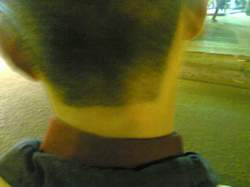

+++
title = "قفاك حصانك"
date = 2007-04-26
authors = ["مروة عبد الفضيل"]

[taxonomies]
authors = ["marwa-abdel-elfadil"]
sections = ["masr"]

[extra]
section_name = "ولاد البلد"
share_image = "/media/admins.20at.com/masr/2fa-2fak2.jpg"
summary = "يهيأ للكثيرين ويخيل لهم أن منطقة القفا أو مؤخرة الرأس بمعزل عن جسم الإنسان، فلا يشعر ولا يتأثر مع إنه كما يقال (حمال أسية) و(ياما دقت علية كفوف).. فباتت منطقة ا"
section_slug = "masr"
section_colour = "#666666"
thumb = "/media/admins.20at.com/masr/2fa-2fak2.jpg"
n_comments = 0
original_url = "http://masr.20at.com:80/newArticle.php?sid=9956"
archived = "20070819051213"
date_source = "byline/meta"
aliases_20at = ["//masr.20at.com/newarticle.php?sid=9956"]

[extra.provenance]
original_url = "http://masr.20at.com:80/newArticle.php?sid=9956"
capture_url = "https://web.archive.org/web/20070819051213/http://masr.20at.com:80/newArticle.php?sid=9956"
capture_label = "١٩ أغسطس ٢٠٠٧، ٠٥:١٢ UTC"
date_note = "من سطر التوقيع في المقال"
other_urls = []
comments = ""
missing_images = "١"
+++

<figure></figure>

يهيأ للكثيرين ويخيل لهم أن منطقة القفا أو مؤخرة الرأس بمعزل عن جسم الإنسان، فلا يشعر ولا يتأثر مع إنه كما يقال (حمال أسية) و(ياما دقت علية كفوف).. فباتت منطقة القفا وسيلة ردع وعقاب أحيانا كما يحدث من قبل بعض رجال الشرطة، ووسيلة للتهريج والمزاح أحيانا أخرى كما حدث معنا كثيرا عندما كنا أطفالا في المدارس عن طريق بعض الألعاب.

وكل هذا يجعلنا ندرك أن القفا ليس مجرد جزء من جسد الإنسان يستهان به.. فنتيجة لهذا الضرب يتعرض الجسم وتحديدا منطقة الجمجمة والعيون والرأس لأضرار، وهي بالتأكيد من أخطر مناطق الجسم..

التقينا العديد من الأطباء في مجالات المخ والأعصاب والعيون والعظام والعلاج الطبيعي ليوضحوا لنا مما تتكون هذه المنطقة وما خطورة الضرب على القفا..

<h3>لا تستهينوا بالقفا</h3>

في البداية يقول الدكتور حاتم عبد الرحمن، أخصائي العظام وعميد المعهد القومي للجهاز الحركي، "لمن لا يعرف فإن منطقة القفا أو علميا مؤخرة الرأس تحديدا تتكون من فقرات عنقية تكون بدايتها من قاع الجمجمة وهى المنوطة بربط الرأس بالقفص الصدري والجذع، وهذه الفقرات بينها غضاريف ويربط الغضروف بالأخر عدد كبير من المفاصل والأربطة، هذه المفاصل تعطى هذه المنطقة ( مؤخرة الرأس والعنق ) مرونة ويسر في الحركة، أضف لهذه المرونة قدرة العنق على تحمل وزن الرأس وأي خبط على الفقرات العنقية خاصة القفا الذي نستهين به قد يؤدى إلى تمزق في الأربطة العنقية".

"وهذا التمزق يكون حسب قوة اليد التي تضرب، بالإضافة إلى الوضع الذي توجد علية الرأس وقت سقوط اليد عليها، فإذا كانت اليد خفيفة فقد يحدث فقط كدمات أو التهابات عنقية طفيفة، وإذا كانت اليد قوية فلا مجال من تأثر كافة الأربطة العنقية، هذا بخلاف التأثير النفسي على الشخص".

<h3>وفاة مفاجئة</h3>

أما الدكتورة ميرفت مصطفى، أخصائي المخ والأعصاب، فتؤكد أن هذا الموضوع بالتأكيد ذات أهمية، فتقول :"بصراحة لم يسألني أحد من قبل عن أثار الضرب على القفا أو مؤخرة الرأس، نظرا لعدم إدراك الكثيرين أن هذه المنطقة قد يكون الضرب عليها سبب كاف للوفاة المفاجئة، فإذا كانت الضربة قوية فلا مجال من إحداث صداع مزمن وقتي، وقد يحدث في كثير من الأحيان ارتجاج في المخ وإصابة النخاع الشوكي وقاع الجمجمة بأضرار جسيمة"

<h3>فقد البصر</h3>

"الضرب على القفا لمن لا يعرف قد يؤدى إلى فقد البصر"..هكذا يخبرنا الدكتور أحمد يحي، استشاري أمراض العيون، مضيفا: "ليس القفا أو مؤخرة الرأس فحسب بل على أي جزء من أجزاء الرأس، حيث أن الضرب يؤثر على العصب البصري والمركز الإبصاري ككل، وأحيانا إذا كانت الضربة طفيفة أو سطحية قد يؤدى إلى زغللة في العين".

<h3>احذر الفقرات</h3>

وأخيرا يؤكد الدكتور إبراهيم بندارى، أخصائي العلاج الطبيعي، أن منطقة مؤخرة الرأس قد يؤدى الضرب عليها إلى الأمراض التي تصيب في كثير من الأحيان الفقرات العنقية كالانزلاق الغضروفي وخشونة الفقرات أو الأمراض الروماتيزمية أو إصابات الأربطة والعضلات العنقية.

وينصح د. بنداري كل إنسان بأن يبتعد تماما عن عادة الضرب على هذه المنطقة (القفا) لأنها من أخطر ما يكون، ومن يعانى بصفة عامة من ألام العنق لا يأخذ بنصيحة شخص أخر يعانى من هذه الآلام لأن الإصابة تختلف من شخص لأخر، فلا يجدي أن يأخذ شخص التمرينات العلاجية التي وضعها أخصائي العلاج الطبيعي لشخص آخر.

وبصفة عامة هناك أشياء كثيرة تؤدى إلى إجهاد الأربطة في منطقة العنق مثل الوقوف أو الجلوس بثني القامة خاصة عند استخدام الكمبيوتر أو التليفون لفترات طويلة، ولا بد من الوقوف مرفوعين القامة وعمل بعض التمرينات التي تقلل من تأثير الجلوس لفترات طويلة.

<a href="/articles/masr-n9957/">خلي بالك من (قذالك)!</a>

<a href="/articles/masr-n9946/">الذين لزقوا الحكومة على قفاها!</a>

<a href="/articles/masr-n9945/">في القفا (سلاية) !</a>

<a href="/articles/masr-n9958/"> قفايا.. حرام!</a>

<a href="/articles/masr-n9954/"> طاطي راسك.. طاطي طاطي</a>

اول مرة اعرف اهمية القفا

أرسل هذا التعليق بواسطة : الهندي

لا اول مرة اعرف بجد اهمية القفا

بعد كدة ههتم بية كويس جدا جدا

إلا مهم .... ده مهم ومهم ومهم

بعد كده كل واحد ييجي ويسيب قفاه في البيت ....

أنا مش مسئول عن قفا حد بعد كده ....

إيه يا عالم ...ربنا يستر علي قفيانا ...

وبعدين بيقول لك في نظرية علمية ... الواحد عنده ودنين وعينين وفتحتي أنف ... لكن فم واحد وقفا واحد ...

إيه العلاقة بقي؟؟

يضرب علي القفا الواحد ... ويصرخ من القفا الواحد برضه ...

لا بقي ...يا هندي ....

مش كل ما أروح حتة ..ألاقيك معلق الأول ...

مش معقول كده ...

سبقتك هنا ..........هههههههههههههههههههه

يالا بقي.... عقبال كل قفا ...

بس برضه مش حاسكت ...

مع افتتاح ولاد البلد الجديد ...تقدروا تشرفوا المدونة بقي

www.mesh7askot.blogspot.com

مش ممكن بجد موضوع اكثر من رائع

أرسل هذا التعليق بواسطة : شريف الدواخلى

لا اجد من الكلام ما يعبر عن اعجابى بالموضوع .. بجد راااااااااااائع .. 4 مصادر متنوعه اضافت لنا كقراء الكثير .. يعنى ماشاء الله الفكره عبرتى عنها بشكل جميل جدا جدا .... و المعلومات اللى فيها فعلا قيمه .. فتحيه لك على هاك الموضوع

حمد لله على السلامة

أرسل هذا التعليق بواسطة : فهد الا سلام

حمدللله على السلامة وكنا مشتقين اوى بس مش هكتب اكثر من كدة

و من القفا ما قتل

و الله يا جماعه لو كان بهجت الاباصيرى عرف ان اهميه القفا بالشكل دا كان بدل ما قال كل واحد يخلى باله من لغلوغه قال كل واحد يخلى بال من قفاه

مش قلتلكو حوار القفا دا افتكاسه تمام

