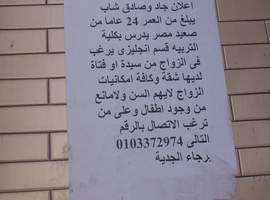

+++
title = "برجاء الجدية.. يريد زوجة"
date = 2007-04-28
authors = ["إيمان كمال"]

[taxonomies]
authors = ["iman-kamal"]
sections = ["masr"]

[extra]
section_name = "ولاد البلد"
share_image = "/media/admins.20at.com/masr/shab2.jpg"
summary = "\"هذه ليست دعابة وإنما إعلان جاد وصادق من شاب يبلغ من العمر 24 عاما من صعيد مصر يدرس بكلية التربية قسم إنجليزي يرغب الزواج من سيدة أو فتاة لديها شقة وكافة إمكاني"
section_slug = "masr"
section_colour = "#666666"
thumb = "/media/admins.20at.com/masr/shab2.jpg"
n_comments = 0
original_url = "http://masr.20at.com:80/newArticle.php?sid=9968"
archived = "20070819051048"
date_source = "byline/meta"
aliases_20at = ["//masr.20at.com/newarticle.php?sid=9968"]

[extra.provenance]
original_url = "http://masr.20at.com:80/newArticle.php?sid=9968"
capture_url = "https://web.archive.org/web/20070819051048/http://masr.20at.com:80/newArticle.php?sid=9968"
capture_label = "١٩ أغسطس ٢٠٠٧، ٠٥:١٠ UTC"
date_note = "من سطر التوقيع في المقال"
other_urls = []
comments = ""
missing_images = "١"
+++

<figure></figure>

"هذه ليست دعابة وإنما إعلان جاد وصادق من شاب يبلغ من العمر 24 عاما من صعيد مصر يدرس بكلية التربية قسم إنجليزي يرغب الزواج من سيدة أو فتاة لديها شقة وكافة إمكانيات الزواج لا يهم السن ولا مانع من وجود أطفال وعلى من ترغب الاتصال على الرقم المبين أدناه برجاء الجدية.

بهذه الرسالة أعتقد محمود الشاب الصعيدي من قنا أنه سيجد مخرجا من أزمته في الحياة ولكن حدث له ما لم يتوقع.. فقد تم القبض عليه بتهمه توزيع منشورات دون أخذ أذن مسبق، ويحكى محمود عن هذا اليوم أن الضباط اعتبروه محتاج لعلاج نفسي أو أنه بيدور علي (.......) ولكنه قال للضابط "مانا لو عاوز بنات زى كده هروح أماكن تانيه وهلاقيها" ولكن كل من في القسم اعتبروا محمود مجنون وأخذوا في التهكم عليه وقضى ليلتها مع المجرمين وتم عمل محضر اشتباه له ثم خرج مره أخرى.

عندما سألت محمود عن غرابة هذه الفكرة رد بأنها مش شيء غريب.. أنا بحاول أدور على حل لمشاكلي لكن الكل بيتريق.. المشكلة أنى لقيت نفسي هضيع لأن الأول والدي كان بيصرف على وعلى كليتى، لكن والدي توفى ووالدتي أصبحت هي من تصرف المعاش عليها هي وأخواتي في المنزل، والمفروض أنى أنا اللي أصرف عليهم وأساعدهم لأني أنا الكبير، وبعدين أنا طالب في القاهرة عاوز أجيب مذكرات بـ600 جنيه وأدفع كارنيه وإيجار سكن، لو اشتغلت بـ10 جنيه في اليوم هيكفي أيه في كل ده.. غير المواصلات والأكل والشرب، يبقى هاتصرف إزاي.

وبعدين الفكرة دي موجودة في الغرب، ممكن إنسانة كبيرة شوية تتجوز إنسان أصغر منها ويعيشوا سعداء جدا وهذا أفضل من أن أكون حرامي، وهناك سكك أخرى.. أنا بدور عن خير، وأرى أنني صح لدرجة كبيرة لكن المجتمع بيفهم الناس غلط بدرجة كبيرة.. ومن يريد في هذا المجتمع أن يحاسبني فليحل لي أزمتي ومشكلتي أنني مش عارف أعمل أيه لإرضاء المجتمع والناس وأهلي الذين قاطعوني ونفسي التي لا أجد لها مصير، إنني أريد الاستقرار حتى أستريح..

<h3>مجرمين وجواسيس يحتاجون حل</h3>

بهذه الكلمات التي تحدث بها محمود لـ"ولاد البلد" فجر مشكلات العديد من الشباب الضائعين الذين لا يجدون حلولا لمشاكلهم، ولا يهتم بهم المجتمع إلا في حال أن يصبحوا مجرمين أو جواسيس أو يسلكوا طرقا مشبوهة أخرى للوصول للمال.

فكيف لشاب في ثالثة كلية الصرف على نفسه وأسرته وهو في مقتبل العمر يحتاج المساندة والدعم حتى يصل للاستقرار ويتزوج بطريقة طبيعية..

رسالة محمود هذه قد تكون قابلتها كثيرا في محطات المترو وأمام جامعه 6 أكتوبر وعين شمس والقاهرة.. فقد وزع أكثر من 100 ورقة في أماكن مختلفة، وبالمناسبة محمود قال لي أنه لم تتصل به أي بنت.. كل من أتصل به إما وسائل إعلام وإما أولاد يقلدون صوت فتيات، وفى نهاية الحديث قال "أين أجد الحل لمشكلتي، خصوصا أن الصحف اعتقدت إنني أريد الشهرة ولم يفعل لي أحد أي شيء ولم أجد المساعدة"..

ليه حق ؟

أرسل هذا التعليق بواسطة : ملكش دعوه

وانا كمان زى محمود فهل ده حرام انا مقتنع ان الستات والفتيات عموما هم ملوك رؤس المال فى مصر

محمود مغلطش مهي البنات بتبيع نفسها وبعشرة جنيه

أرسل هذا التعليق بواسطة : رامز عباس

محمود مغلطش خالص يعني هيعمل ايه شاب زيه وفي عمره عايز يعف نفسه هو لو صايع مكان راح ماخور مصري للاداب المنافيه بس دة ولد محترم وبعدين نصف ستات مصر من نكدهم بيتطلقوا بسرعه يلا بقا ينحب يا نقبانا من 4 سنين كنت بفكر بكدة بس لقيت حل حلو ان الدوله بتنطيشها رغباتنا وحل مشاكلنا بتودى نفسها في مصيبه وفعلا متروح في مصيبه اصل مصر مش جدعه واسالوا احمد زويل

هم يضحك و هم يبكى

ليست دعابى

فعلا

انها الواقع الاليم

اعزائى

استمتعو بالسىء فالاسوأ قادم

مشكلة جامدة

أرسل هذا التعليق بواسطة : حسام المصرى

أنا بجد شايف أنها مصيبة أن البنى أدم يتقدم فى العمر ومايتجوزش تبقى مشكلة وهاجس نفسى تدفع الى الخطيئة وشكراً لحكامنا الأعزاء

