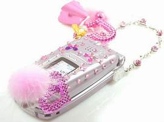

+++
title = "موبايلات البنات.. أخر شياكة"
date = 2007-04-29
authors = ["هالة غازي"]

[taxonomies]
authors = ["hala-ghazi"]
sections = ["masr"]

[extra]
section_name = "ولاد البلد"
share_image = "/media/admins.20at.com/masr/mobile2.jpg"
summary = "بعض الناس هوايتهم زخرفة ما يملكونه وتزويده بكل ما هو جميل، فكل شيء لديهم له إكسسواراته الخاصة، فحجرته وأجهزته الكهربائية والعربة كلا له أدوات تجميله."
section_slug = "masr"
section_colour = "#666666"
thumb = "/media/admins.20at.com/masr/mobile2.jpg"
n_comments = 0
original_url = "http://masr.20at.com:80/newArticle.php?sid=9999"
archived = "20080919122220"
date_source = "byline/meta"
aliases_20at = ["//masr.20at.com/newarticle.php?sid=9999"]

[extra.provenance]
original_url = "http://masr.20at.com:80/newArticle.php?sid=9999"
capture_url = "https://web.archive.org/web/20080919122220/http://masr.20at.com:80/newArticle.php?sid=9999"
capture_label = "١٩ سبتمبر ٢٠٠٨، ١٢:٢٢ UTC"
date_note = "من سطر التوقيع في المقال"
other_urls = []
comments = ""
missing_images = "١"
+++

<figure></figure>

بعض الناس هوايتهم زخرفة ما يملكونه وتزويده بكل ما هو جميل، فكل شيء لديهم له إكسسواراته الخاصة، فحجرته وأجهزته الكهربائية والعربة كلا له أدوات تجميله.

ولعل البنات هن الأكثر اهتمام بالأناقة والشياكة وبكل التفاصيل التي تزيدهن جمالا وتألقا، ولذا فهن الأكثر شغفا بالإكسسوارات، فكل ملبس لديهم له إكسسواراته الخاصة، التي تناسب طبيعته ولونه، فنجد أن الخاتم والعقد والشنطة والحذاء كله يجمل ملابسهن ويزيدها أناقة.

وأحدث ما يحرص عليه الناس الآن وأصبح في يد الجميع، الموبايل، وهو جهاز في غاية الروعة، فمتى نحتاج أي شخص نجده في صحبة جواله في أي مكان وأي زمان، فهو يوفر الكثير من الوقت والمجهود ويقرب البعيد ويحل الكثير من المشكلات، هذه هي وظيفة المحمول، ولكن البعض يأبى أن يظل جهازه هكذا بشكله العادي البسيط، ولذا يسعون للوصول به إلى قمة الجمال والأناقة والشياكة عن طريق تزويده بالإكسسوار.

ونجد أيضا أكثر من يهتم بذلك هن الفتيات، كما في الملابس، فلأجلهن أبتكر البعض إكسسوارات غالية الثمن عبارة عن مجوهرات ثمنيه تناسب الأغنى منهن.

والبعض الآخر ابتكر سلاسل خاصة بالموبايل متعددة الأشكال لترضي جميع الأذواق، كما فعل بيت الأزياء المشهور ديور، وتحتوي علي حرف الـ((]) الشهير، والبعض الآخر ابتكر أشكال أخري علي شكل قلوب وزهور وفراشات وأحذية.

ولكل شخص ذوقه ودخله، الذي من خلالهما يحدد نوع إكسسوار جهازه المحمول، والبعض الآخر لا يفكر من الأساس في شكل وجمال الموبايل، فهل أنت من النوع الأول أم الثاني.

<a href="https://web.archive.org/web/20080919122220/http://www.20at.com/galleries/_Masr/29April07/hala.htm">شاهد جاليري أكسسوار الموبايلات</a>

لالا

أرسل هذا التعليق بواسطة : نهى

موضوع جيد وانا من النوع التانى عشان الموبيل اخر اهتماماتى

من النوع الأول

أرسل هذا التعليق بواسطة : لولو

بصراحة ولو مرة واحدة انا كنت من النوع الأول اهتميت بموبايلي وزوقته وكان عاجبني شكله بالسلسلة الجديدة والنور اللي بيطلعه تويتي اللي كان في السلسلة لغاية ما ضاع تويتي ولم أفكر في احد سواه.

جاليري جميل

أرسل هذا التعليق بواسطة : سوما

بصراحة اللي عجبني الجاليري وخاصة الموبايلات اللي في الأول

باينو ضاااااااااااااع

أرسل هذا التعليق بواسطة : دودو

كده يا لولو فكرتني بمويايلي اللي ضاااااااااااااااااااع

روعة

أرسل هذا التعليق بواسطة : بنت العراق

شكد حلوة

