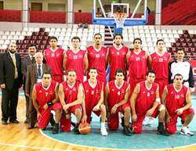

+++
title = "الأهلي والزمالك في قمة.. السلة"
date = 2007-04-29
authors = ["رويترز"]

[taxonomies]
authors = ["reuters"]
sections = ["masr"]

[extra]
section_name = "ولاد البلد"
share_image = "/media/admins.20at.com/masr/ahly-basket2.jpg"
summary = "تشهد الصالة المغطاة باستاد القاهرة الدولي غدا الاثنين مواجهة بين فريقي الأهلي والزمالك في نهائي بطولة كأس مصر لكرة السلة."
section_slug = "masr"
section_colour = "#666666"
thumb = "/media/admins.20at.com/masr/ahly-basket2.jpg"
n_comments = 0
original_url = "http://20at.com/masr/news/5655.html"
archived = "20100130205710"
date_source = "byline/meta"
aliases_20at = ["/masr/news/5655.html"]

[extra.provenance]
original_url = "http://20at.com/masr/news/5655.html"
capture_url = "https://web.archive.org/web/20100130205710/http://20at.com/masr/news/5655.html"
capture_label = "٣٠ يناير ٢٠١٠، ٢٠:٥٧ UTC"
date_note = "من سطر التوقيع في المقال"
other_urls = []
comments = ""
missing_images = ""
+++

<figure></figure>

تشهد الصالة المغطاة باستاد القاهرة الدولي غدا الاثنين مواجهة بين فريقي الأهلي والزمالك في نهائي بطولة كأس مصر لكرة السلة.

قال طارق سليم المدير الفني لسلة الزمالك أن فريقه يسعى الى استغلال الروح المعنوية المرتفعة للاعبيه وتصدرهم للدورة المجمعة الأولى من اجل الفوز بكأس مصر للعام الثاني على التوالي.

وأكد اشرف توفيق المدير الفني للأهلي انه يسعى للفوز بالبطولة معتمدا على خبرة لاعبيه الكبار وعلى رأسهم طارق الغنام وإيهاب الألفي وشريف علي.

