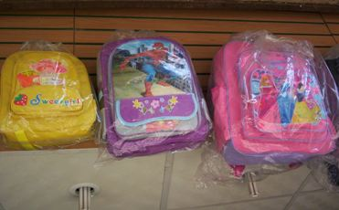

+++
title = "سوق السندقية.. شنطة وكشكول"
date = 2008-09-18
authors = ["مروة مظلوم"]
aliases = ["/articles/masr-n17617/"]

[taxonomies]
authors = ["marwa-mazlom"]
sections = ["masr"]

[extra]
section_name = "ولاد البلد"
share_image = "/media/masr.20at.com/currentarticleassets/shanta.jpg"
summary = "أيام قليلة وتبدأ سنة دراسية جديدة، ومعها يبدأ مارثون شراء الأدوات الدراسية.. حيث يقصد الطلاب وأولياء أمورهم المكتبات لشراء ما يحتاجون، وبالطبع شهرة \"الفجالة\" في"
section_slug = "masr"
section_colour = "#666666"
thumb = "/media/masr.20at.com/currentarticleassets/shanta.jpg"
n_comments = 3
original_url = "http://www.20at.com:80/masr/places-of-egypt/10094-2009-06-10-18-17-56.html"
archived = "20100225100325"
date_source = "byline/meta"
aliases_20at = ["//masr.20at.com/newarticle.php?sid=17617", "/masr/places-of-egypt/10094-2009-06-10-18-17-56.html"]

[extra.provenance]
original_url = "http://www.20at.com:80/masr/places-of-egypt/10094-2009-06-10-18-17-56.html"
capture_url = "https://web.archive.org/web/20100225100325/http://www.20at.com:80/masr/places-of-egypt/10094-2009-06-10-18-17-56.html"
capture_label = "٢٥ فبراير ٢٠١٠، ١٠:٠٣ UTC"
date_note = "من سطر التوقيع في المقال"
other_urls = ["//masr.20at.com/newarticle.php?sid=17617"]
comments = "٣"
missing_images = ""
+++

<figure></figure>

أيام قليلة وتبدأ سنة دراسية جديدة، ومعها يبدأ مارثون شراء الأدوات الدراسية.. حيث يقصد الطلاب وأولياء أمورهم المكتبات لشراء ما يحتاجون، وبالطبع شهرة "الفجالة" في هذا المجال يعرفها الجميع..

الأمر لا يختلف عنه في سوق "السندقية" أحد أقدم الأسواق في مصر لتجارة الأوراق والأدوات المكتبية ومستلزمات الدراسة، وفي السنوات الأخيرة عاد له رونقه وشهرته القديمة بعد أن حولت مكتبات الفجالة نشاطها إلى محلات سيراميك وأدوات صحية!.

"ولاد البلد" تأخذكم في جولة في سوق "السندقية"..

<h3 class="center">من الصين إلى السندقية</h3>

"السوق يحتوي على كل ما هو جديد وتصدره لنا الصين مباشرة"، هذا ما يخبرنا به حمدي عاشور، أحد التجار بالسندقية، مشيرا إلى أن انتشار إعلانات الأدوات المدرسية على قناة الأطفال (سبيس تون) جعلت الأطفال يطالبون الأهل بكراسة (ساندي) وأدوات (فله) المكتبية وكشكول (سندريلا).

ويضيف قائلاً: "هذا فضلاً عن انتشار حقيبة (باربي) و(سبايدر مان) و(تاتشو) في سوق الحقائب المدرسية المعروف بسوق زوزو، حيث يبالغ أصحاب المحلات في ثمن هذا النوع من الحقائب".

وهو الحال نفسه مع الأحذية والطاقم المدرسي، فيقول أحمد ربيع، صاحب أحد محلات الأحذية، أن سعر الحذاء الجلدي يبدأ من 100 جنيه فأكثر، وهو حذاء كلاسيكي غير عملي لأطفال هذا الزمن، لذا فالأهالي تفضل"الكوتشي" فهو عملي أكثر وذو منظر أنيق وألوان يعشقها الأطفال وسعره يبدأ من 70 جنيها وغالباً ما يخضع الأهل لرغبات أبناءهم.

أما طاقم المدرسة فيتواجد أيضا في محلات سوق السندقية، وغالبيته يخص المدارس الحكومية حيث "المريلة" بشكلها القديم الذي لا يفرق بين ولد وفتاة فهي أشبه بفستان"بيج" تعقد له " فيونكة" في الخلف وسعرها لا يتجاوز 15 جنيهاً.

<h3 class="center">طلبات المدرسية</h3>

بخلاف ما سبق تشاهد الأدوات المدرسية من كشاكيل وكراسات وأدوات مكتبية وألوان.. يقول ميشيل كامل، تاجر، أنه يتم التوافد على شراء الأدوات المكتبية من اليوم الأول للدراسة حيث تأتي الأمهات بصحبة أطفالهن ومعهن قائمة بطلبات الأساتذة المدرسين بدأ من الحضانة ووصولاً إلى الثانوية العامة.

ونظرا لأن "كشكول واحد لا يكفي" تقوم الأمهات بشراء أدوات طوال العام مرة واحدة، فتضطر مثلا لشراء "الدستة كاملة" طمعاً في التخفيضات المصاحبة للجملة.

وبالنسبة للألوان فتبدأ الألوان الخشبية من 250 قرشا للعلبة وتصل إلى50 و60 جنيها على اختلاف أنواعها ومواطن استيرادها، فأغلبها صيني وبعضها من الفلبين.

أما نصر محمد توفيق، تاجر لعب أطفال، فيقول: "السندقية ليس فقط سوق لتجارة الأدوات المدرسية من أقلام وكشاكيل وأكلاسيرات.. فهو أيضا سوق لبيع لعب الأطفال وفوانيس رمضان الصيني، وموضة هذه الأيام في الفوانيس الفانوس الخشبي فنجد الأرابيسك العربي والفانوس السداسي والفانوس الطولوني، وهى فوانيس كبيرة الحجم وتتراوح أسعارها مابين 40 إلى 80 جنيها، أما فوانيس الأطفال فمنها المتحرك مثل الحصان والجمل وجحا والموتوسيكل ومنها الثابت مثل عروسة 2008".

* شاهد: <a href="https://web.archive.org/web/20100225100325/http://www.20at.com:80/galleries/17Sep08/sndk.htm"> منتجات السندقية</a>

