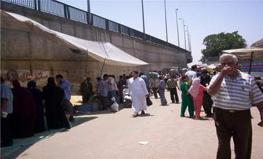

+++
title = "(شارع الضباب) يلتهم تلاميذ التونسي!"
date = 2008-11-23
authors = ["مروة مظلوم"]

[taxonomies]
authors = ["marwa-mazlom"]
sections = ["masr"]

[extra]
section_name = "ولاد البلد"
share_image = "/media/masr.20at.com/currentarticleassets/makbara.jpg"
summary = "إذا أردت الذهاب إلى مجمع التونسي التعليمي عليك اتخاذ أحد طريقين: الأول (أحراش التونسي)وهو عبارة عن سوق به تجمع هائل للحيوانات من شتى الأنواع منها الأليف والمفتر"
section_slug = "masr"
section_colour = "#666666"
thumb = "/media/masr.20at.com/currentarticleassets/makbara.jpg"
n_comments = 2
original_url = "http://20at.com/masr/places-of-egypt/10576-2009-06-09-20-29-42.html"
archived = "20100105142732"
date_source = "byline/meta"
aliases_20at = ["/masr/places-of-egypt/10576-2009-06-09-20-29-42.html"]

[extra.provenance]
original_url = "http://20at.com/masr/places-of-egypt/10576-2009-06-09-20-29-42.html"
capture_url = "https://web.archive.org/web/20100105142732/http://20at.com/masr/places-of-egypt/10576-2009-06-09-20-29-42.html"
capture_label = "٥ يناير ٢٠١٠، ١٤:٢٧ UTC"
date_note = "من سطر التوقيع في المقال"
other_urls = []
comments = "٢"
missing_images = ""
+++

<figure></figure>

إذا أردت الذهاب إلى مجمع التونسي التعليمي عليك اتخاذ أحد طريقين: الأول (أحراش التونسي)وهو عبارة عن سوق به تجمع هائل للحيوانات من شتى الأنواع منها الأليف والمفترس والسام كالثعالب والأفاعي، وربما أسعدك الحظ بمقابلة أحد أشبال الأسود.. أما الطريق الثاني فهو شارع (فريد الأطرش) والذي يعد مقبرته واحدة من أهم عشرة آلاف مقبرة يضمها الشارع ولكثرة حوادثه أطلق عليه سكان حي التونسي اسم .. " شارع الضباب" ..

<h3 class="center">رحلة من( 6 )لـ(16)</h3>

نرمين محمد( 16 سنة) طالبة بالصف الثاني الثانوي تحدثنا عن مأساة أطفال من سن 6 سنوات يمرون يوميا في هذه المنطقة المخيفة حتى يبلغ عمرهم 16 وذلك خلال رحلتهم اليومية إلى المدرسة التي تجبرهم على السير في هذا الطريق بين مجموعة من الحيوانات المحظور بيعها في أسواق عامة نظراً لشراستها، فضلا عن الأمراض التي تنقلها هذه الحيوانات إليهم.

أما هدى ( 14 سنة ) فقد وجدت حل لمشكلتها فتمر من طريق السوق في الصباح الباكر حيث يكون عدد باعة الحيوانات أقل وفي طريق العودة تقوم بتغيير اتجاهها خوفاً من الكلاب والسحالي التي تباع في السوق بالإضافة إلى الرائحة التي يحملها إليهم السوق داخل فصولهم الدراسية.

وتحدثنا ليلى محمود ذكي مديرة (مدرسة التونسي الإعدادية) للبنات عن مجمع مدارس التونسي فتقول" أن هناك طريقين تؤدي إليه الأول شارع فريد الأطرش أو " شارع الضباب" والثاني طريق سوق التونسي أو"الأحراش " والمجمع يضم 7 مدارس 4 مدارس ابتدائية مشتركة ومدرسة إعدادي بنات ومدرستين ثانوي عام للبنات أي ما يقرب من 7آلاف طالب وطالبة يمرون من طريقين لا أمان فيهما، ولأن المنطقة بها مدارس للفتيات فهي بالقطع مستهدفة من شباب المرحلة الثانوية الذين يأتون خصيصاً بدرجات بخارية من منطقة رابعة العدوية إلى التونسي في شكل مظاهرات أمام المدرسة الإعدادي ومدارس الثانوي ويقوموا بإلقاء خطابات للطالبات والقفز داخل المدرسة أو انتظار الفتيات بالدرجات خارج المدرسة".

<h3 class="center">مدرسة أم مقبرة</h3>

وتكمل مديرة مدرسة التونسي:"أدى ذلك الوضع إلى العديد من حوادث الاعتداء والاختطاف، في أحدها قام ثلاثة شباب بتخدير فتاة واختطافها من المدرسة الإعدادي والدخول بها إلى إحدى المقابر لاغتصابها لولا أن عناية الله أدركتها، حيث أنقذها سكان المقبرة من أهالي المنطقة وحملوها إلى المدرسة مغشي عليه، وقد تقدم عدد من الأهالي ومديري المدارس بعدد لا حصر له من الشكاوى للحي فكانت النتيجة إنشاء نقطة شرطة إستغرق بناءها ثلاث سنوات ولم يتم افتتاحها حتى الآن" .

مديحة سليمان مدرسة ابتدائي تحكي عن حادثة أخرى لشارع الضباب فتقول أن : أحد الشباب من راكبي الدراجات البخارية قام باختطاف سلسلة ذهبية من عنقها فسقطت أرضاً وأصيبت بجروح وكان ذلك في طريق عودتها للمنزل في وضح النهار ومثل هذه الحوادث تتكرر يومياً ولا توجد أي استجابة من المسئولين في محاولة تأمين المنطقة وطلابها ومعلميها .. فضلاً عن الحالة الصحية المزرية التي وصل إليها أطفال المرحلة الابتدائية نتيجة لجبال القمامة التي تعترض طريقهم كل يوم والتي لا تخلو من مخلفات القبور وأهل المنطقة.

