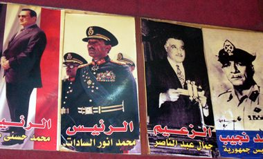

+++
title = "(العروبة).. القهوة مش القضية!"
date = 2009-03-24
authors = ["علياء أبوشهبة"]
aliases = ["/articles/masr-7eta-mn-baladi-11695/"]

[taxonomies]
authors = ["alia-aboshhba"]
sections = ["masr"]

[extra]
section_name = "ولاد البلد"
share_image = "/media/masr.20at.com/currentarticleassets/orooba-cafe.jpg"
summary = "\"العروبة\".. فكرة وقضية يؤمن بها الملايين حول الوطن العربي."
section_slug = "masr"
section_colour = "#666666"
thumb = "/media/masr.20at.com/currentarticleassets/orooba-cafe.jpg"
n_comments = 4
original_url = "http://www.20at.com:80/masr/places-of-egypt/11695-2009-06-09-12-19-11.html"
archived = "20100123090240"
date_source = "byline/meta"
aliases_20at = ["/masr/7eta-mn-baladi/11695-2009-06-09-12-19-11.html", "/masr/places-of-egypt/11695-2009-06-09-12-19-11.html"]

[extra.provenance]
original_url = "http://www.20at.com:80/masr/places-of-egypt/11695-2009-06-09-12-19-11.html"
capture_url = "https://web.archive.org/web/20100123090240/http://www.20at.com:80/masr/places-of-egypt/11695-2009-06-09-12-19-11.html"
capture_label = "٢٣ يناير ٢٠١٠، ٠٩:٠٢ UTC"
date_note = "من سطر التوقيع في المقال"
other_urls = ["/masr/7eta-mn-baladi/11695-2009-06-09-12-19-11.html"]
comments = "٤"
missing_images = ""
+++

<figure></figure>

"العروبة".. فكرة وقضية يؤمن بها الملايين حول الوطن العربي.

و"العروبة".. نفق وشارع يمر فيهما كثيرون أيضاً في منطقة مصر الجديدة.

و"العروبة".. هو قصر الرئاسة الذي يدير منه مبارك مقاليد الحكم في مصر.

و"العروبة" أيضاً هو اسم واحد من أشهر مقاهي القاهرة، والذي يقع في شارع 26 يوليو بالزمالك. وعلى الرغم من أنه لا يحظى بشهرة مقاهي مثل "ريش" أو "بعرة " أو "أم كلثوم"، إلا أن شهرته تنبع من أنه أصبح مقر أهالي النوبة وأعضاء الجالية السودانية بالقاهرة، بالإضافة إلى أن المقهى يجذب أيضاً أهل الفن والرياضة ومعجبيهم.

<h3 class="center">معلم ورئيس رابطة!</h3>

جلسنا على المقهى لاستكشافه ومعرفة حكايته، وهناك التقينا بالحاج فتحي محمود سعد - صاحب القهوة ورئيس رابطة أبناء النوبة بالغورية- والذي أشار إلى أن المقهى افتتح منذ أكثر من نصف قرن حيث حرص وقتها أن يكون مقرا يتجمع بين جدرانه أهالي النوبة، فبعد ترحيلهم من أراضيهم شعر الحاج محمود بضرورة لم الشمل، فحرص على أن يكتسب المقهي الطابع النوبي الأصيل، وأن تتزين جدرانه بمجموعة متميزة من الصور النادرة للنوبه القديمة، وهي الصور التي يحرص على ترميمها كلما تم تجديد المقهى.

وسرعان ما نجح الحاج محمود في مقصده، فقد شعر رواده بالدفء بين جوانبه، فأصبحوا يفضولنه بعد "قهوة عبدالنبي" في عابدين، ويحرص الحاج محمود على وضع صورته بالزي النوبي إلى جانب صور رؤساء مصر الأربعة، والتي تحتل جانبا كبيرا من حائط المقهي، علاوة علي صور الحاج محمود مع عدد من الشخصيات السياسية ومنهم د.آمال عثمان ومحمود أبو الليل محافظ الجيزة الأسبق ود.فتحي سعد محافظ 6 أكتوبر الحالي.

ومن أشهر رواد المقهى من الفنانين النوبيين الفنان محمد الأدنداني والمطرب الأسواني محمد فوزي والممثل النوبي الجوباني، والمطرب النوبي محمد بشير، ومن قواعد المقهى التي لا يتنازل الحاج محمود عن تنفيذها منع شرب الشيشة لمن هم أقل من 23 سنة، وهو ما يحترمه رواده حتى لو كانوا من المشاهير.

<h3 class="center">نزل المشاريب... Cut</h3>

ولعب ديكور المقهى المتميز عامل جذب للعديد من المخرجين لتصوير العديد من الأعمال الفنية فيه والتي ربما تعد نوعاً من التأريخ بالصورة والصوت لما حدث فيه من تغيرات، ويحدثنا عنها أحمد فتحي أحد العاملين بالمقهي قائلا: "شهد المقهي تصوير فيلم (الحب فوق هضبة الهرم) ومسلسل (الفريسة والصياد) وأيضا فيلم (كيمو وأنتيمو)، كما أن قربه من مسرح الزمالك وساقية الصاوي جعله مقصدا لأهل الفن ومنهم الراحلان علاء ولي الدين، ممدوح وافي والفنان وحيد سيف دائم الجلوس على المقهى.

وأضاف بأن الكاتب وحيد حامد زبون دائم للمقهى وأحياناً يفضل الكتابة أثناء تواجده هنا، أما أعضاء الفرق الفنية التي تقدم عروضها على مسرح ساقية الصاوي فهم نوع جديد من الزبائن أصبح يرتاد المقهى، حيث يجلسون بعد البروفات والحفلات.

كما يجتذب المقهى مشاهير الرياضة ولاعبي كرة القدم ومنهم إبراهيم سعيد وعبدالحليم علي وطارق السيد.

<h3 class="center">الحنين للأرض!</h3>

جلسنا بجوار الحاج فايز كرم، أحد رواد المقهى القدامى، وأخذ يحكي لنا عن المقهى بقوله: "اعتدت الجلوس هنا منذ عام 1965 حيث ألتقي بأقاربي ومعارفي وبعض الجيران والأصدقاء، حيث نستمتع بشرب عصير الدوم والكركديه الأسواني الشهير، ورغم تغير الحال هنا من الهدوء الشديد إلى الصخب الشديد خلال السنوات الماضية، إلا أن هذا لم يعكر من صفو جلستنا ولم يحرمنا من سماع أغنيات الست أم كلثوم كما اعتدنا أيام زمان عندما تشدو قائلة: "قول للزمان ارجع يا زمان".

أما محمد بشير - محاسب من أهالي النوبة- فلا ينزعج على الإطلاق من الزحام الذي يعاني منه المقهى، فهو يفضل اصطحاب أسرته إلى هناك؛ لأنه "مكان محترم"، كما أنه يشعره بالحنين إلى النوبة التي لم تتح له الفرصة لزيارتها.

ويرى ممدوح كمال أننا بحاجة إلى كل ما يذكرنا بأصولنا حتى لا ننساها، ولذلك لا يحرص على الجلوس على المقهى ليظل متصلاً بمجتمعه النوبي الذي ينتمي إليه.

