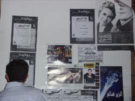

+++
title = "روابط .. مسرح من صفيح!"
date = 2007-04-30
authors = ["أميرة حسن"]
aliases = ["/articles/masr-n10014/"]

[taxonomies]
authors = ["amira-hassan"]
sections = ["masr"]

[extra]
section_name = "ولاد البلد"
share_image = "/media/admins.20at.com/masr/rawabet2.jpg"
summary = "عندما ترى هذا الشارع الضيق الذي لا يبعد كثيراً عن ميدان عبد المنعم رياض.. وعندما ترى هذا الجراج الصفيح الذي يميز مدخل أي مخزن أو محل.. لن تتخيل للحظة أن ما يقبع"
section_slug = "masr"
section_colour = "#666666"
thumb = "/media/admins.20at.com/masr/rawabet2.jpg"
n_comments = 2
original_url = "http://20at.com/masr/places-of-egypt/5674-2009-06-10-09-24-55.html"
archived = "20100105141006"
date_source = "byline/meta"
aliases_20at = ["//masr.20at.com/newarticle.php?sid=10014", "/masr/places-of-egypt/5674-2009-06-10-09-24-55.html"]

[extra.provenance]
original_url = "http://20at.com/masr/places-of-egypt/5674-2009-06-10-09-24-55.html"
capture_url = "https://web.archive.org/web/20100105141006/http://20at.com/masr/places-of-egypt/5674-2009-06-10-09-24-55.html"
capture_label = "٥ يناير ٢٠١٠، ١٤:١٠ UTC"
date_note = "من سطر التوقيع في المقال"
other_urls = ["//masr.20at.com/newarticle.php?sid=10014"]
comments = "٢"
missing_images = "١"
+++

<figure></figure>

عندما ترى هذا الشارع الضيق الذي لا يبعد كثيراً عن ميدان عبد المنعم رياض.. وعندما ترى هذا الجراج الصفيح الذي يميز مدخل أي مخزن أو محل.. لن تتخيل للحظة أن ما يقبع وراءه هو مكان يتجمع فيه مجموعة من المواهب الشابة التي تكوّن بمجهودها الخاص العديد من الفرق الفنية المستقلة، التي أرادات أن تعبر عن فنها تحت أي ظرف، وحتى مع غياب أي نوع من أنواع الدعم المالي الخارجي..

شباب اقتنعوا تماماً أنه ليس هناك شيئا من الممكن أن يعيقهم عن تحقيق حلمهم.. وأن يصلوا بفنهم إلي الناس.. قرروا أن يجدوا مكانا يجمعهم، فقاموا بتأجير مخزن واسع المساحة وبنو عليه مسرحا صغيرا..أسموه "روابط".

على روابط تشاهد عروضا لفرق غنائية أو مسرحية أو عروض لأفلام سينمائية أو مناظرات والقاء شعر.. أما أسعار التذاكر فرمزية إلي حد كبير..

هناك التقينا "محمد عبد الفتاح".. أحد مؤسسي "روابط" ومدير البرنامج الخاص به..

<h3>من هم مؤسسي"روابط"؟</h3>

إحنا أربعة .."ياسر جراب"،"محمد عبد الخالق"،"محمد طلعت"، وأنا .. كلنا درسنا مسرح وكنّا شغالين في المسرح المستقل وبندور على أي مساحة نقدم فيها شغلنا وشغل غيرنا..وبعدين أسسنا شركة روابط وأخذنا المكان اللي إحنا فيه دلوقتي .. أول ما خدناه كان مخزنا وكان "خرابة" لكن إحنا اللي نضفناه وظبطناه كده!

<h3>ليه اسم "روابط" تحديدا؟</h3>

عشان كان هدفنا وإحنا بنعمل الشركة يكون عندنا مكان يربط بين كل الناس المهتمين بالفن المستقل سواء حاجة حكومية أو خاصة.

<h3>بقالكم أد أيه في "روابط"؟</h3>

في شهر يوليو الجاي نكون كملنا سنة بالظبط.

<h3>حد حاول يمولكم بالفلوس بس؟</h3>

لا، خالص..إحنا بنمول روابط من مالنا الخاص وبنتعمد أن كل عرض ميكلفناش كتير.. ده غير إن "تاون هاوس" بتساعدنا ببعض المعدات، والآلات الموسيقية للفرق بنقوم بتأجيرها في أغلب الوقت.ولو عرض عليكم حد يمولكم بس يتحكم في إدارة "روابط"...هتوافقوا؟لأ طبعاً...إحنا هنرفض لو في حد عايز يمولنا ويتحكم فينا...لو حد معاه فلوس وعايز يعمل شيء شبيه لينا إحنا ممكن نساعده.. بس ميجيش يتحكم فينا.

<h3>إيه نظام التذاكر وأجور الفرق هنا في روابط؟</h3>

الفرقة اللي بتعرض عندنا بتاخد دايماً 75% من تمن التذكرة ..والمكان هنا بياخد 25 %.

<h3>وده بيدخل ربح لروابط؟</h3>

لا خالص..بس على الأقل مش بنخسر الحمد لله..وإحنا عارفين أن "روابط" قدمها كذا سنة على ما تبتدي تدّخل ربح لينا.

<h3>أيه اللي بتتمناه لروابط في الفترة اللي جايه؟</h3>

نفسي يبقى لروابط كذا فرع في أكتر من مكان، والفرق اللي بتعرض عندنا تزيد وتدخل ربح عالي.

<h3>أية الجديد في روابط؟</h3>

عملنا قريب حاجة اسمها "صالون روابط"، والمفروض أن الصالون ده هيبقى فيه القاء شعر ومناقشة كتب جديدة واحتفال بكتّاب بيمضوا مع دور نشر..بس لسه مفيش أي حاجة حصلت في الصالون غير القاء الشعر لأن الصالون في بدايتة.

<h3>ليكم أي نوع من أنواع المنافسة أو التعاون مع ساقية الصاوي..؟</h3>

تعاون بينا وبين الساقية لسه الصراحة.. بس هو مفيش أي نوع من أنواع المنافسة، والأستاذ محمد الصاوي كان اقترح قريباً أن تذاكرنا تباع في الساقية وتذاكر الساقية تباع عندنا.

<h3>اضغط علي الصورة لتشاهد لقطات من مسرح روابط</h3>
