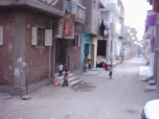

+++
title = "شارعنا.. حدوتة مصرية"
date = 2007-05-03
authors = ["منير أديب"]

[taxonomies]
authors = ["manir-adib"]
sections = ["masr"]

[extra]
section_name = "ولاد البلد"
share_image = "/media/admins.20at.com/masr/7adota2.jpg"
summary = "القطط والكلاب.. أهم اللقطات في ذكرياتي الطفولية التي حفرت في شارع الإسماعيلية بحي المنشية بمدينة \"أبو حماد\"، والتي تبعد حوالي 20 كيلو مترا عن مدينة \"الزقازيق\" ع"
section_slug = "masr"
section_colour = "#666666"
thumb = "/media/admins.20at.com/masr/7adota2.jpg"
n_comments = 3
original_url = "http://www.20at.com:80/masr/places-of-egypt/5719-2009-06-10-09-30-17.html"
archived = "20100115062303"
date_source = "byline/meta"
aliases_20at = ["/masr/places-of-egypt/5719-2009-06-10-09-30-17.html"]

[extra.provenance]
original_url = "http://www.20at.com:80/masr/places-of-egypt/5719-2009-06-10-09-30-17.html"
capture_url = "https://web.archive.org/web/20100115062303/http://www.20at.com:80/masr/places-of-egypt/5719-2009-06-10-09-30-17.html"
capture_label = "١٥ يناير ٢٠١٠، ٠٦:٢٣ UTC"
date_note = "من سطر التوقيع في المقال"
other_urls = []
comments = "٣"
missing_images = ""
+++

<figure></figure>

القطط والكلاب.. أهم اللقطات في ذكرياتي الطفولية التي حفرت في شارع الإسماعيلية بحي المنشية بمدينة "أبو حماد"، والتي تبعد حوالي 20 كيلو مترا عن مدينة "الزقازيق" عاصمة محافظة الشرقية، حيث لعبت الحيوانات الدور الأهم في مراحل حياتي المبكرة.

في شارعنا ترعرعت ونشأت وسط كومة من عشاق الكلاب ومحبيهم بين "ليتا وجاك" وأخري بلدي من اللي قلبك يعشقهم بسرعة، طبعا خوفا منهم لا حبا فيهم، وقطط عشقت تربيتهم ونشأوا معي في البيت الذي كنا نسكنه.

الكلاب كانت الوحيدة من بين الحيوانات التي أشعر بأنها تترصدني، فقد ُفرضت علّي رؤيتها، وحاصرتني بنباحها ليلا، وهاجمتني نهارا في الشارع، كلما حاولت اللعب مع أصدقائي.

كانت للخنازير جولات هي الأخرى، حيث تفنن أحد الجيران في تربيتها، كما تفنن بقية الجيران في تربية أغنامهم وطيورهم.. كل هذا مطلق في الشارع الضيق الذي صار حديقة حيوانات أفريقية مفتوحة، مع العلم أن شارعنا لا يتعدى عرضه الأربعة أمتار.

وكل هذه الحيوانات داعبت طفولتي البريئة وتركت بصمات، لم أنساها وربما لم يستطع الزمان محوها.

<h3>مفارقات لا تنسى</h3>

بعيدا عن الحيوانات ومشاغباتها، فقد كان يسكن شارعنا كثير من المفارقات، كان أبطال تلك المفارقات أطفال في مثل سني، ولكنهم يختلفون عني في عقولهم التي تسبق عمرهم الحقيقي "طبعا في الفساد والإفساد".

ومن أهم نوادر هؤلاء الأصدقاء رحلاتهم اليومية والتي تبدأ بعد ذهاب أبي إلي العمل وتنتهي قبل مجيئه من العمل، ولكنها كانت تمتد إلي ما بعد آذان المغرب في شهر رمضان، فتخرج الأسرة عن بكرة أبيها بحثا عن الطفل المفقود، ومعها أسرة "عبير زكريا" زميلة الدرب، ورفيقة أيام الصبا، وكان "عماد وشريف" أصدقاء التشرد في نفس والتوهان، ولعب "البلي" و"العربيات" المصنوع كوتشاتها من "غطاء" الحاجة الساقعة والتي كنا نسير بها، عابرين شارعنا والشوارع التي تحوطها، فلم تكن هذه السيارات تعرف مكانا تنتهي عنده، كما كانت هذه الصداقة مصدر مشاكلي حيث يتأفف الجيران، وبخاصة "أم خميس" التي تتحول شكوتها إلى أقلام وشلاليت.

بلاشك يمثل لي الشارع الذي أسكنه بكل ما فيه من جيران وأصدقاء، وبكل ما فيه من لعب ومرح، أو ربما بكل ما فيه من لحظات مسروقة، مصدرا خصبا للذكريات وللكتابة والعمل.

<h3>مصدر إزعاج</h3>

كمل تمثل لي شخصيات بعينها مصدرا للإزعاج والآهات التي خرجت مني وأنا طفل لم يتعد سني سنوات، تبدأ من إحدى الجارات والتي يميزها سوء الخلق وعدم الأدب، فكثيرا تأتي مشاكل الأطفال من جانبها، عندما تسلط أبنائها علينا، فتخلق مشكلة، وتقوم بسب وقذف كل من في الشارع، والتعدي بالأيدي والأرجل، وربما السلاح علي الأسر التي يتبعها هؤلاء الأطفال، ومن ثم تقوم أسر الشارع بمنع أطفالهم من اللعب أو التواجد في الشارع، خوفا من المشاكل التي تأتي من جانب هذه الجارة سيئة الخلق.

اللعب ربما لم يكن أصل المشاكل في الشارع، فأكثر ما يميزه الحقد الدفين، لاسيما إذا نجح أحد الأبناء في شهادة جامعية، ولا ينجح أخر من عائله في نفس الشارع، أو تقوم أسره ببناء منزل جديد أو حتي تجديد منزلها.

شارعنا والذكرى والحيوانات حدوتة مصرية متكررة يعيشون فيه طفولتهم وتعيشهم طفولتهم.

