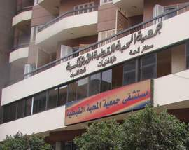

+++
title = "شارع  بدران .. الهلال ع الصليب"
date = 2007-05-03
authors = ["منى سليم"]
aliases = ["/articles/masr-n10063/"]

[taxonomies]
authors = ["mona-selim"]
sections = ["masr"]

[extra]
section_name = "ولاد البلد"
share_image = "/media/admins.20at.com/masr/badran02.jpg"
summary = "\"الشوف مش هو النظر.. الشوف الحقيقي وجهة نظر\""
section_slug = "masr"
section_colour = "#666666"
thumb = "/media/admins.20at.com/masr/badran02.jpg"
n_comments = 5
original_url = "http://20at.com/masr/places-of-egypt/5722-2009-06-10-09-52-38.html"
archived = "20100105141124"
date_source = "byline/meta"
aliases_20at = ["//masr.20at.com/newarticle.php?sid=10063", "/masr/places-of-egypt/5722-2009-06-10-09-52-38.html"]

[extra.provenance]
original_url = "http://20at.com/masr/places-of-egypt/5722-2009-06-10-09-52-38.html"
capture_url = "https://web.archive.org/web/20100105141124/http://20at.com/masr/places-of-egypt/5722-2009-06-10-09-52-38.html"
capture_label = "٥ يناير ٢٠١٠، ١٤:١١ UTC"
date_note = "من سطر التوقيع في المقال"
other_urls = ["//masr.20at.com/newarticle.php?sid=10063"]
comments = "٥"
missing_images = "٣"
+++

<figure></figure>

"الشوف مش هو النظر.. الشوف الحقيقي وجهة نظر"

تذكرت جملة "لينين الرملي" هذه على لسان "محمد صبحي" في مسرحية "وجهة نظر" وأنا انهي شارع (جزيرة بدران) بحي شبرا في نهار قريب.

شبرا .. وأهالي شبرا .. ومن منا لا يعرف شبرا.. ليست تلك التي يتكلم عنها "ريكو" في أغنيته، ولكن شبرا الخلطة السرية من مساجد وكنائس.. صورة للعذراء ومحل المهد ومكتبة المسيح إلى جوار الجمعية الشرعية.

لكن طبعا مش لازم الكلام ده يكون زى ما بتقول القناة الأولى المصرية دليل على الوحدة الوطنية، وليس دائما أيضا هو دليل التناحر والاضطهاد كما يقول "سعد الدين إبراهيم" ومؤتمره، أو كلام "هيكل" عن غياب المشروع القومي افتراض لا أكثر.

فقد يكون تبرير هذه الظاهرة التاريخية التي تشهد عليها شوارع شبرا كل ما سبق أو لا شيء مما سبق.. وممكن تكون حاجة كده من غير تفسير..

المهم، لست من سكان شبرا ولم أدخل شارع جزيرة بدران إلا للبحث عن طبيب عيون متميز يجد حل لهذا الزغللة التي تشوش نظري.

<h3>(1)</h3>

على اليمين، وجدت مستشفى "المحبة" .. نظيفة ومتطورة..

وقبل أن أفرح وأدخل أسأل عن ميعاد وصول الدكتور، ركبتنى الحيرة والغيرة فهناك مستشفى تانية واسمها "الإصلاح الإسلامي".

<h3>(2)</h3>

أروح فين وآجي منين.. مبنى المحبة شكله أحلى لكن الإصلاح باين عليه زحمة.

ثمن الكشف واحد (عشرة جنية).. الناس بيقولوا الاثنين زى بعض والدكاترة ساعات بيبقوا هنا وساعات يروحوا هناك، طيب مادام الحكاية كده والدكاترة كتير والتعب أكتر، ليه واقفين في وش بعض كده ..وكأن المرض رحل عن البشرية كلها وتمركز في هذا المربع.

المهم، لم أشعر بالراحة وخطوت خطوتين للأمام ، فلمحته شاهق عالي مترفع..

"المركز العربي الطبي".

<h3>(3)</h3>

قلت لنفسي مادام الهويات والعقائد أصبحت قضية كبرى وعنوان حتى للمرض، فأنا كمان هالعب .. وسأنحاز لاختياري السياسي وأحافظ على عروبتي..

تفتكتروا دي زغللة عين ولا عقل ؟!!.

