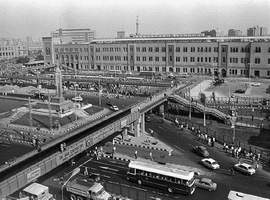

+++
title = "الشارع زمااااان..  ودلوقتي"
date = 2007-05-03
authors = ["دعاء الشامي"]

[taxonomies]
authors = ["doaa-elshamy"]
sections = ["masr"]

[extra]
section_name = "ولاد البلد"
share_image = "/media/admins.20at.com/masr/zaman02.jpg"
summary = "كباري ومترو وميكروباصات وأتوبيسات، كلها طرق للمواصلات فيكي يا مصر لكن رغم كل الإنجازات المعروفة في بناء الكباري وتطوير الطرق تلاقي كل شوارع مصر زحمة وكل إشاراته"
section_slug = "masr"
section_colour = "#666666"
thumb = "/media/admins.20at.com/masr/zaman02.jpg"
n_comments = 3
original_url = "http://20at.com/masr/places-of-egypt/5725-2009-06-10-09-37-30.html"
archived = "20100105141158"
date_source = "byline/meta"
aliases_20at = ["/masr/places-of-egypt/5725-2009-06-10-09-37-30.html"]

[extra.provenance]
original_url = "http://20at.com/masr/places-of-egypt/5725-2009-06-10-09-37-30.html"
capture_url = "https://web.archive.org/web/20100105141158/http://20at.com/masr/places-of-egypt/5725-2009-06-10-09-37-30.html"
capture_label = "٥ يناير ٢٠١٠، ١٤:١١ UTC"
date_note = "من سطر التوقيع في المقال"
other_urls = []
comments = "٣"
missing_images = "٢"
+++

<figure></figure>

كباري ومترو وميكروباصات وأتوبيسات، كلها طرق للمواصلات فيكي يا مصر لكن رغم كل الإنجازات المعروفة في بناء الكباري وتطوير الطرق تلاقي كل شوارع مصر زحمة وكل إشاراتها واقفة...

كل مرة أنزل فيها الشارع مع جدتي ألاقي جملة واحدة بتقول " زمان مكنش فيه الزحمة دي الدنيا اتغيرت والشوارع اتغيرت"...

دورت على صور لشوارع مصر زمان ولقيت فعلا الشوارع اتغيرت

دوس علي الصورة واتفرج علي جاليري صور للشوارع أيام زمان

ودوس علي الصورة دى واتفرج علي جاليري صور للشوارع دلوقتى

