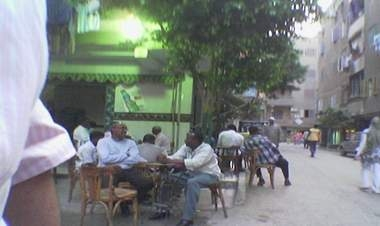

+++
title = "جمهورية (أرض اللواء) الصومالية !"
date = 2007-06-07
authors = ["محمود التركي"]
aliases = ["/articles/masr-n10564/"]

[taxonomies]
authors = ["mahmoud-eltarki"]
sections = ["masr"]

[extra]
section_name = "ولاد البلد"
share_image = "/media/admins.20at.com/aly/image_457_.jpg"
summary = "(إية اللي جاب القلعة جانب البحر.. إنتوا جيتوا إمتى؟).. ذلك الإفيه الشهير الذي أطلقه الفنان محمد سعد في فيلمه عوكل، هو أول ما يتردد في ذهنك عندما تذهب لمنطقة أرض"
section_slug = "masr"
section_colour = "#666666"
thumb = "/media/admins.20at.com/aly/image_457_.jpg"
n_comments = 8
original_url = "http://www.20at.com:80/masr/places-of-egypt/6204-2009-06-10-09-11-10.html"
archived = "20100115062519"
date_source = "byline/meta"
aliases_20at = ["//masr.20at.com/newarticle.php?sid=10564", "/masr/places-of-egypt/6204-2009-06-10-09-11-10.html"]

[extra.provenance]
original_url = "http://www.20at.com:80/masr/places-of-egypt/6204-2009-06-10-09-11-10.html"
capture_url = "https://web.archive.org/web/20100115062519/http://www.20at.com:80/masr/places-of-egypt/6204-2009-06-10-09-11-10.html"
capture_label = "١٥ يناير ٢٠١٠، ٠٦:٢٥ UTC"
date_note = "من سطر التوقيع في المقال"
other_urls = ["//masr.20at.com/newarticle.php?sid=10564"]
comments = "٨"
missing_images = ""
+++

<figure></figure>

(إية اللي جاب القلعة جانب البحر.. إنتوا جيتوا إمتى؟).. ذلك الإفيه الشهير الذي أطلقه الفنان محمد سعد في فيلمه عوكل، هو أول ما يتردد في ذهنك عندما تذهب لمنطقة أرض اللواء بمحافظة الجيزة،

بعدما ترى الصوماليين في شوارع المنطقة، لتظن أنك قد هبطت أرض الصومال وليس أرض اللواء !!

عندما تنزل هذه المنقطة تجد أن أصحاب البشرة السمراء من أهل الصومال قد اكتسحوها بالكامل تقريباً، في الشوارع، المقاهي، المحلات، المساجد..

أثار ذلك المشهد فضولنا، فأردنا معرفة السر وراء هذا الجمع الصومالي.. فسألنا أحد سكان المنطقة وهو (عم ناصر) الذي قال: "المنطقة أصبحت مملوءة باللاجئين والطلاب الصوماليين، الذين تزداد أعدادهم كل يوم عن الأخر، وللأسف تسببوا في زحام المنطقة، وتعودنا على رؤية الشباب الصومالي رجالا وفتيات في شوارعنا ولم يعد وجودهم بيننا غريباً علينا".

وأنهى كلامه معنا مداعبا: "الصوماليون خلاص فاضل لهم سنتين وياخدوا الجنسية" !!.

أخبرنا (الحاج علي)، أحد سماسرة الشقق في أرض اللواء،أن أعداد الصوماليون هنا تقدر بالمئات، يعيشون مع بعضهم حيث تجد الشقة الواحدة بها 3 أو 4 أفراد وأحياناً أكثر، وقد تسبب هؤلاء في ارتفاع جنوني لأسعار الشقق، حيث كانت الشقة قديما تؤجر بنظام "الإيجار الجديد" بـ300 أو 400 جنيهاً فقط، وحاليا أصبحت الأسعار مرتفعة جداً وتبدأ من 700 جنيهاًُ فما فوق، ويضيف الحاج على ساخراً: "معرفش بيجيبوا الفلوس منين"!.

<h3>مقهى الصوماليين</h3>

خلال حدثينا مع أهالي المنطقة علمنا منهم أن هناك قهوة تسمى "قهوة الصوماليين".. (لتعود الذاكرة مرة أخرى لفيلم عوكل عندما كان يتجمع المصريين بتركيا على قهوة المصريين).. على القهوة وجدنا أن أغلب روادها من أصحاب البشرة السمراء والملامج الأفريقية..

الحاج (عبد العظيم السوهاجي) صاحب المقهى أشار إلى أنه لا يعرف سبباً محدداً لكي تصبح قهوته هي المقهى المفضل للصومالين، وقال أنه منذ 4 سنوات تقريبا كان يجلس اثنان أو ثلاثة فقط منهم، ولكن مع مرور الوقت تزاديدت أعدادهم وذلك لما وجدوه من حسن المعاملة، موضحا أنه لا يسمح بحدوث المشاجرات على المقهى ويتدخل لمنعها قبل اشتعالها.

ويرى صاحب المقهى أن الصوماليين يتسمون بالتدين المحافظة على الصلاة في أوقاتها، وعندما يؤذن للصلاة تجدهم يتوجهون للمسجد لأداء الفريضة ثم يعودون مرة ثانية للمقهى، ويميزهم عن المصريين أنهم لا يحدثون ضجة كبيرة ولا تعلو أصواتهم في الحديث كما يفعل المصريين على القهوة.

أما مشروباتهم المفضلة فهي العصائر أو الألبان، وليس الشاي والقهوة مثل المصريين وإذا حدث وطلب أحدهم كوب شاي فلا بد أن يكون "بالحليب"، كذلك فهم لا يدخنون مطلقاً فلا أحد منهم يطلب "حجر معسل"، وتجدهم عادة يقومون بلعب الطاولة أو الدومينو ولكنهم يلعبوها بطريقة مختلفة عن المصريين.

<h3>صومالي زملكاوي</h3>

بالطبع كان علينا أن نقترب من بعض أبناء الشعب الصومالي الذي جاء للسكن في منطقة أرض اللواء..

التقينا بعبد القادر، 19 عاماً، الذي يمكث في مصر منذ 7 سنوات تقريباً وتعلم الكثير من اللهجة المصرية. وكانت أولى مشكلاته التي واجهته عندما جاء لمصر هي اللهجة العامية المصرية فلم يكن يعرفها مطلقاًً وكان فقط يتحدث اللغة العربية الفصحى، وكثيراً ما فشل في شراء بعض مسلتزماته من المحلات لأنه لا يجيد اللهجة العامية، ولكنه حاليا يجيد اللهجة المصرية جيداً، بل وجدناه في أثناء حديثه يقول بعض الكلمات التي يشتهر بها الشباب المصري مثل "قشطه" و "بكبر دماغي".

عبد القادر يشجع نادي الزمالك، بل لمحنا في عيونه نظرات الشماتة – بعدما عرف أنني أهلاوي- لخسارة الأهلي أمام الزمالك مؤخرا، وعن حبه للزمالك أوضح أن السبب يعود لأخيه الذي كان يدرس في الأزهر الشريف خلال التسعينات، وعندما عاد للصومال كانت معه فانلة الزمالك البيضاء والتي أهداها له.

ويقول عبد القادر أن المصريين طيبين جداً ولا توجد روح العنصرية بينهم على العكس من بعض البلاد العربية التي يواجه فيها اللاجئين الصوماليين مشاكل عنصرية كثيرة، أما عن سبب اختياره لمنطقة أرض اللواء فيوضح أنه كان من أوائل الصوماليين الذين أتوا للمنطقة نظراً لرخص الأسعار النسبي، وبعد ذلك جاء الكثير من أبناء وطنه ليسكنوا بجوار بعضهم لأنهم يحتاجون أن يكونوا بجوار بعضهم البعض في أوقات الشدة والفرح.

<h3>صوماليون في النيل</h3>

أما محيي، 24 عاما، والذي يتكلم العربية بصعوبة، فقد حدثنا عن عادات الصوماليين قائلا: "الصوماليون في أرض اللواء يهتمون بالتردد كثيراً على مقاهي الإنترنت للاتصال بعائلاتهم وأصدقائهم وذلك لأن تكلفتها أرخص كثيراً من إجراء المكالمات التليفونية، كما يذهبون للترفيه عن أنفسهم في رحلات نيلية وكذلك المولات الكبرى في مصر، وبعضهم يذهب للأسكندرية والساحل الشمالي، مشيرا إلى أنهم يعتمدون على أقاربهم بأمريكا الذين يبعثوا لهم بالأموال إلى جانب الأموال التي يحصلون عليها كلاجئين من مفوضية شئون اللاجئين".

ويشير محيي إلى أن اللاجئين الصوماليين في مصر تتنوع أعمارهم شبابا وكبارا، ومن يتعدى عمره الـ 50 عاما يطلقون عليه لقب شيخ، أما النساء والفتيات فيقضون أوقاتهم في حفظ القرآن الكريم أو عمل الأشغال اليدوية إلى جانب الأعمال المنزلية.

