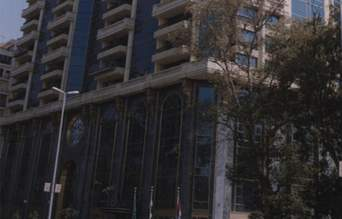

+++
title = "عمارة.. وبواب.. وحكاية"
date = 2007-08-05
authors = ["مروة عبد الفضيل"]

[taxonomies]
authors = ["marwa-abdel-elfadil"]
sections = ["masr"]

[extra]
section_name = "ولاد البلد"
share_image = "/media/admins.20at.com/aly/omaraa.jpg"
summary = "شوارع وسط البلد شوارع لها تاريخ طويل حملته بين جدرانها، ولم تتخل عنه وحفظته من أثر السنين وغدر الزمان.. فنانين وسياسيين.. منهم من رحل ومنهم من ينتظر.. لكن يظل و"
section_slug = "masr"
section_colour = "#666666"
thumb = "/media/admins.20at.com/aly/omaraa.jpg"
n_comments = 0
original_url = "http://www.20at.com:80/masr/places-of-egypt/6931-2009-06-09-12-44-31.html"
archived = "20100216073554"
date_source = "byline/meta"
aliases_20at = ["/masr/places-of-egypt/6931-2009-06-09-12-44-31.html"]

[extra.provenance]
original_url = "http://www.20at.com:80/masr/places-of-egypt/6931-2009-06-09-12-44-31.html"
capture_url = "https://web.archive.org/web/20100216073554/http://www.20at.com:80/masr/places-of-egypt/6931-2009-06-09-12-44-31.html"
capture_label = "١٦ فبراير ٢٠١٠، ٠٧:٣٥ UTC"
date_note = "من سطر التوقيع في المقال"
other_urls = []
comments = ""
missing_images = ""
+++

<figure></figure>

شوارع وسط البلد شوارع لها تاريخ طويل حملته بين جدرانها، ولم تتخل عنه وحفظته من أثر السنين وغدر الزمان.. فنانين وسياسيين.. منهم من رحل ومنهم من ينتظر.. لكن يظل وقع أقدامهم وأنفاسهم يملا أبوب عمارتهم بالعبق والذكريات كثير من الماضي قليل من الحاضر .. تجولت ولاد البلد بين تلك المباني واقتربت من الذكريات .

بدأنا جولتنا بعمارات الإيموبيليا والتي كان يسكن بها أعاظم الفن والسياسة في مصر منهم نجيب الريحاني ومحمد عبد الوهاب والمنتجة آسيا وماجدة الخطيب كذلك ماجدة الصباحي لا تزال

محتفظة بمكتب الإنتاج الخاص بها و المطرب محمد فوزي والذي يسكن ابنه مكانه حتى الآن و الراحل عبد العزيز محمود وليلى مراد ومكتب المخرج كمال الشيخ و من الصحفيين الكاتب فكرى باشا أباظة والمحامي المعروف رجائي عطية وفؤاد باشا سراج الدين رئيس حزب الوفد و إبراهيم باشا عبد الهادي السياسي رئيس وزراء مصر في العهد الملكي .

<h3 class="center">عبود والعمارة</h3>

عم مصطفى عامل الأسانسير وهو أقدم عامل بهذه العمارة تذكر من أسئلتي الماضي وقال" بصراحة أنا مش عارف أقول إيه بس إنتوا كده هتفكروني بناس حلوة عاشرتهم. لكن الأول أكلمكم عن تاريخ العمارات" واستمر في التذكر وبدأت ملامحه تنفرج وأضاف " توجد عندنا خمس عمارات تفصل كل واحدة عن الأخرى ممر وبنيت عام 1939 على يد عبود باشا وقسمها إلى 250 شقة واشترى 27 أسانسير بماركاته ولنفسه احتفظ بخمس أدوار في العمارة رقم (3 ) لتكون مقرا لشركة الأسمدة التي يمتلكها رغم أن مقر الشركة في السويس إلا إنه تفاءل بالإيموبيليا ونقل العمال والمهندسين من مقر الشركة بالسويس إلى هنا"

ويستكمل عم مصطفى كلامه قائلا "عبود باشا كان رجلا غنيا جدا تخيلوا عشان يزين ممر العمارات برخام استعان بشركة إنجليزية للحصول على هذا الرخام وحفر اسمه عليها".عم مصطفى يرى أن عمارة الايموبيليا لا تؤثر فيها الهزات الأرضية ولا حتى القنابل النووية ويرجع ذلك لان العمارات دية ( معمولة ) بضمير ووقتها ما كنش فيه غش وانعدام ذمة. حتى أن الموسيقار محمد عبد الوهاب حسبما يحكي ترك منزله بالعباسية وسكن في الإيموبيليا لأنه كان يعلم بمدى صلابة هذه العمارات ولخوفه الدائم من الزلازل.

ومن كلام عامل الاسانسير القديم تستطيع أن تتفهم حرص مشاهير زمان على عدم ترك شققهم والتضحية بأي شيء على غرار ما فعلت المنتجة آسيا التي احتفظت بشقة لها وتدفع لها إيجارا 6 جنيهات بعد أزمتها المالية بسبب فيلم الناصر صلاح الدين واضطررت أن ترهن عمارتها بمصر الجديدة والكثير من ممتلكاتها عام 1962.

<h3 class="center">عمارة أنور وجدي</h3>

تركت عم مصطفى اتجهت إلى عمارة أنور وجدي في وسط البلد والتي انتهى من بنائها في عام 1955 و توفى في نفس العام لنجد عم شمس الذي يعمل في العمارة منذ إنشائها . كل ما سمعه عن أنور وجدي أنه رجل شرير ، وأنه كان بخيلا ولم يوضح الأسباب التي جعلته يكون هذا الحكم ، ربما لا يعلم أن حرص أنور وجدي سببه نشأته الصعبة ، وخوفه المرضي من الموت.

عمارة أنور وجدي لم تذهب لأحد من الورثة ، وذهبت لهيئة الشرطة بسبب التأميم والحجز على العمارة بسبب مديونياته الباهظة. ومن الآن يسكن العمارة؟ أجاب عن تساؤلي "لا أحد من المشاهير فقط أحفاد المستشار محمود هدهد وأحفاد حامد شمس !!"

أما مصير مكتب أنور وجدي الذي خرجت منه عبقرياته وابدعاته فليس لدى العم شمس ولا أحفاد المستشار محمود هدهد إجابة !!

<h3 class="center">زهراء الجزيرة</h3>

وفي الزمالك حيث برج زهراء الجزيرة الذي كان يسكن فيه عبد الحليم حافظ فبمجرد أن

دخلت العمارة

لم أنته من تساؤلات الأمن من أنت؟ وجاية لمين؟ رايحة فين؟ لانتبه فجأة إنني في مقر السفارة الدنمركية سألت الأمن من الذي يسكن شقة عبد الحليم الآن ؟ فأجاب بقوله "بنت السيدة عليا شقيقة عبد الحليم وزوجها محمد وأولادهم وعلى فكرة شقة عبد الحليم مكونة من خمس حجرات وهى كما هي حتى الخطابات الذي كان يتلقاها لا تزال عالقة على الحائط وصوره حتى ملاءة السرير التي كان ينام عليها لا زالت كما هي لم تتغير ومنعني الأمن من التقاط أي صور للبرج.

وبالزمالك أيضا توجد عمارة ليبون والتي رفض بوابها على الإطلاق حتى ذكر اسمه لكننا نعلم أن هذه العمارة سكن بها كل من النجوم فاتن حمامه, سامية جمال, ومحرم فؤاد, وليلى فوزي, وشيريهان رغم إقامتها في فيلتها بالمنصورية إلا أنها تحتفظ بشقتين واحدة سكنية والثانية كمكتب لها والعمارة مكونه من 14 طابق وبناها رجل أعمال فرنسي في منتصف الخمسينات يدعي ليبون

<h3 class="center">برج الأمراء</h3>

استغرق إنشاء هذا البرج خمس سنوات وتردد أن الشقة يصل ثمنها إلى 20 مليون جنيه حيث تصل مساحتها إلى 500 متر وتمتلك فيفي عبده في هذا البرج شقة.ويمتلك عمرو دياب شقتين باستثناء ذلك نجد أن معظم شقق العمارة تم حجزها للأمراء والشيوخ العرب.

تاريخ سياسي تحمله عمارة وهبه باشا المكونة من جانبين وبسؤال عبد الرحمن بواب العمارة عن أهم المشاهير الذين سكنوا هنا قال الفنانة زوزو ماضي و محمد عبد المتعال باشا احد بشاوات مصر قبل قيام الثورة وظل محتفظا بمكتبه حتى عام 95 حينما توفي, كذلك علي الدين صالح وهو أول رئيس لحزب مصر الفتاه بعد عودته للحياة السياسية هذا وقد تم تصوير عدد كبير من الأفلام هنا منها على ما اذكر فيلم لا أنام.

وبالنسبة لبرج شيراتون فيطلق عليه عمارة الفن والثقافة والجمال ويسكن بها كل من نبيلة عبيد وسمير غانم وزوجته الفنانة دلال عبد العزيز ويبلغ سعر الشقة بها 50 مليون جنيه ويسكن بها كذلك الأمير خالد بن سلطان قائد القوات المشتركة في حرب الخليج في أخر طابق بها وقد رفض أفراد الأمن الإدلاء بأي معلومات عن سكاني البرج.

