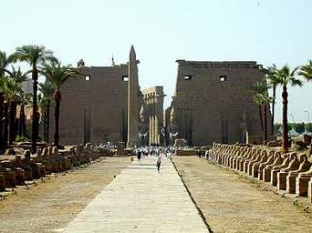

+++
title = "صيف الأقصر وأسوان.. مولع نار"
date = 2008-08-12
authors = ["محمد سيد أحمد"]

[taxonomies]
authors = ["mohamed-sayed-ahmed"]
sections = ["masr"]

[extra]
section_name = "ولاد البلد"
share_image = "/media/masr.20at.com/currentarticleassets/luxor_temple_facade__tb_n110500.jpg"
summary = "من يزور الأقصر وأسوان في فصل الشتاء لا يتردد في الإقدام على الذهاب إليهما مرة ثانية باعتبارهما من أفضل المشاتي عالمياً .. ففي الفترة الممتدة من شهر نوفمبر وحتى "
section_slug = "masr"
section_colour = "#666666"
thumb = "/media/masr.20at.com/currentarticleassets/luxor_temple_facade__tb_n110500.jpg"
n_comments = 0
original_url = "http://www.20at.com:80/masr/places-of-egypt/9862-2009-06-10-08-49-54.html"
archived = "20100211173951"
date_source = "byline/meta"
aliases_20at = ["/masr/places-of-egypt/9862-2009-06-10-08-49-54.html"]

[extra.provenance]
original_url = "http://www.20at.com:80/masr/places-of-egypt/9862-2009-06-10-08-49-54.html"
capture_url = "https://web.archive.org/web/20100211173951/http://www.20at.com:80/masr/places-of-egypt/9862-2009-06-10-08-49-54.html"
capture_label = "١١ فبراير ٢٠١٠، ١٧:٣٩ UTC"
date_note = "من سطر التوقيع في المقال"
other_urls = []
comments = ""
missing_images = ""
+++

<figure></figure>

من يزور الأقصر وأسوان في فصل الشتاء لا يتردد في الإقدام على الذهاب إليهما مرة ثانية باعتبارهما من أفضل المشاتي عالمياً .. ففي الفترة الممتدة من شهر نوفمبر وحتى منتصف مارس من كل عام تشهد المدينتين ازدحاما شديدا من الأجانب والمصريين للتمتع بجمال الطبيعة والطقس هناك..

لكن هل فكرت ولو لمرة كيف يكون حال المدينتين في فصل الصيف؟، أو فكرت أن تستغل فراغ الصيف في زيارة آثارهما؟

(ولاد البلد) تأخذك في رحلة إلى الأقصر وأسوان في شهر أغسطس - عز الصيف- لنعرف كيف هو الحال بالمدينتين..

<h3 class="center">في محطة مصر</h3>

بداية الرحلة كانت من "محطة مصر"، قصدنا شبابيك تذاكر الوجه القبلي ونحن نعتقد أن الزحام سيكون سيد الموقف .. لكنها كانت هادئة تماما، اقتربنا من موظف التذاكر الذي أخبرنا: "تذاكر القطار يقل عددها لأكثر من النصف في الصيف، والعدد الأكبر من الركاب ينزل من القطار في المدن والمحافظات التي تسبق أسوان والأقصر، التي ينزل فيهما العدد الأصغر من ركاب القطار بعد أن كانوا أغلبية في قطارات الشتاء".

عند الوصول كانت حرارة الجو شديدة.. وبمجرد الخروج من محطة القطار استقبلني سائقو التاكسيات المتراصة وراء بعضها والذين يبحثون عن أي زبون..، أخبرني من ركبت معه أن السائقين في الأقصر وأسوان تقل دخولهم خلال شهور الصيف لعدم وجود السياح، حيث تتجاوز درجة الحرارة في كثير من الأحيان 50 درجة مئوية مما يجعل من المدينتين أماكن شبه مهجورة، وهو ما يؤثر مباشرة عليهم.

<h3 class="center">المزارات خاوية</h3>

أثناء تجولنا في المدينتين كانت المعابد شبه خالية إلا من بعض الوفود السياحية المعدودة من الأجانب التي تزور الأقصر وأسوان ضمن برنامج زيارتهم لمصر في الصيف، وكذلك كان حال الشوارع السياحية الشهيرة التي لا يتواجد فيها إلا أصحابها والمصريون من أهل المدينتين، مثل شوارع الكورنيش وخالد ابن الوليد في الأقصر والكورنيش وصفية زغلول في أسوان، أما أكثر ما يجذب الزائر صيفا فهي الرحلات النيلية للمراكب العائمة التي تطوف بين الأقصر وأسوان.

معظم الزائرين يفضلون الإقامة في الفنادق العائمة، وعدد قليل يذهب إلى فنادق إيزيس وشيراتون وهيلتون وموفنبيك وسوفتيل في الأقصر، وفنادق كتراكت القديم والجديد وبسمة وأوبرواى وأمون وإيزيس الجزيرة وإيزيس أسوان في أسوان، وإقامتهم في هذه الفنادق لا تزيد عن بضعة أيام، لذا تستغل الفنادق فترة الصيف في إجراء أعمال الصيانة والتجديد بها.

<h3 class="center">رحلات قليلة</h3>

زيارات المصريين إلى الأقصر وأسوان في الصيف هي بطبيعة الحال قليلة للغاية، وأغلبهم من الشباب طلبة الجامعات الذين لم يستطيعوا الالتحاق برحلات الجامعات في أجازة نصف السنة، وإقامة أصحاب هذه الزيارات تتركز معظمها في فنادق صغيرة وبيوت الشباب.

شركات السياحة بدورها تقل رحلاتها إلى المدينتين، وهي رحلات محددة ولا تقوم هذه الرحلات إلا بعد اكتمال عددها، لذلك لا تستطيع الشركات السياحية تحديد موعد الرحلة للزائر وتأخذ رقم تليفونه للاتصال به لاحقا وإبلاغه بموعد زيارة الأقصر وأسوان حين اكتمال العدد.

وهو ما يؤكده لنا مسئول الرحلات الداخلية بإحدى شركات السياحة، موضحا أن الشركة لا تعقد آمالاً كبيرة على عائدات الأقصر وأسوان خلال الصيف، لعدم الإقبال عليها إلا من أعداد بسيطة، مضيفا: "رغم أن شهر الصيف يشهد عدد كبير من الزيجات، إلا أن العروسان يعزفون تماما عن قضاء ما يسمى بـ (أسبوع العسل) في المدينتين رغم إقبال كل عروسين على هذه الزيارات في الشتاء".

<h3 class="center">الإشغال 30%</h3>

وبحسب تقرير وزارة السياحة الصادر في مطلع شهر يوليو الماضي عن نشاط السياحة في المزارات الأثرية والسياحية في القاهرة والجيزة والغردقة وشرم الشيخ والأقصر وأسوان، فإن ارتفاع درجة الحرارة أدى أيضاً إلى انخفاض نسبة الإشغال في الفنادق بالمدينتين إلى 30% بعد أن كانت نسبة الإشغال 100% بهما خلال شهور الشتاء.

كما أشار التقرير إلى حدوث ركود في حركة البيع والشراء المرتبطة بالسياحة هناك في شهور الصيف وبخاصة في مدينة الأقصر، التي تضم وحدها ثلث أثار العالم، حيث يعمل معظم سكانها في مجال السياحة ويتمنون زوال أشهر الصيف سريعاً عكس ما يتمناه أهالي الإسكندرية وجمصة ورأس البر ومعظم المدن الساحلية المطلة على البحرين المتوسط والأحمر والتي ينشط الرواج بهم في فترة الصيف.

