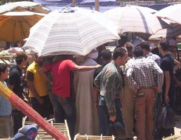

+++
title = "قُمار في عز النهار!"
date = 2008-08-16
authors = ["مروة مظلوم"]
aliases = ["/articles/masr-n17274/"]

[taxonomies]
authors = ["marwa-mazlom"]
sections = ["masr"]

[extra]
section_name = "ولاد البلد"
share_image = "/media/masr.20at.com/currentarticleassets/102_3379.jpg"
summary = "\"فتح عينك تاكل ملبن.. البنت بخمسة.. والخمسة بخمسة وعشرين\".."
section_slug = "masr"
section_colour = "#666666"
thumb = "/media/masr.20at.com/currentarticleassets/102_3379.jpg"
n_comments = 2
original_url = "http://20at.com/masr/places-of-egypt/9891-2009-06-10-17-49-22.html"
archived = "20100105141503"
date_source = "byline/meta"
aliases_20at = ["//masr.20at.com/newarticle.php?sid=17274", "/masr/places-of-egypt/9891-2009-06-10-17-49-22.html"]

[extra.provenance]
original_url = "http://20at.com/masr/places-of-egypt/9891-2009-06-10-17-49-22.html"
capture_url = "https://web.archive.org/web/20100105141503/http://20at.com/masr/places-of-egypt/9891-2009-06-10-17-49-22.html"
capture_label = "٥ يناير ٢٠١٠، ١٤:١٥ UTC"
date_note = "من سطر التوقيع في المقال"
other_urls = ["//masr.20at.com/newarticle.php?sid=17274"]
comments = "٢"
missing_images = ""
+++

<figure></figure>

"فتح عينك تاكل ملبن.. البنت بخمسة.. والخمسة بخمسة وعشرين"..

اعتدنا على سماع هذه المصطلحات في "الموالد" التي تصورها الأفلام القديمة من خلال هواة المقامرة، حيث يقف المقامر إلى جوار آلاف الباعة ويلتف حوله العديد من الناس يمعنون النظر في حركة يده باللعب بأوراق الكوتشينة ويطلقون ذاكرتهم للبحث عن "السنيورة" أو البنت التي أخفاها.

والمشهد هذه المرة ليس لقطة من فيلم وإنما هو حدث واقعي رصدته (ولاد البلد)، فهو يتكرر يومي الأحد والجمعة من كل أسبوع في "سوق الجمعة" الشهير أسفل كوبري التونسي بالسيدة عائشة.

<h3 class="center">بيلعبوا قمار</h3>

فما أن تهبط أسفل الكوبري حتى تصدم بآلاف الباعة الذين تتعثر خطواتك في بضائعهم القديمة، وعند نقطة بعينها أمام سوق الطيور والحيوانات يلتف مجموعة من الناس في عرض الطريق حول طاولة تخفيها أجسادهم، فلا شيء يدل على نوع السلعة التي يبيعها ذلك الشخص، مما يضطرك لسؤال أحد المارة بالسوق عن طبيعة السلعة .. فتكون إجابته ببساطة: "بيلعبوا قمار".

عند التجول بالسوق تبين أن هناك ما يقرب من 4 طاولات لهن الصفة نفسها، وإن اختلفت من إحداها ورق الكوتشينة وتحولت إلى طاولة "روليت" مستديرة لها أسهم وإشارات كما في الطاولات التي في صالات القمار الكبيرة، ويتراص حولها علب سجاير من مختلف الماركات والألوان.

<h3 class="center">رحلة البحث عن السنيورة</h3>

يقول عم محمود، أحد الباعة بالسوق أن لعبة "السنيورة " أحد ألعاب المقامرة القديمة التي كانت موجودة في الموقع القديم لسوق الجمعة، وانتقلت مع انتقال سوق الطيور إلى منطقة التونسي، في البداية لم يعترض أحد على تواجد مثل هؤلاء الباعة في السوق، وبمرور الوقت صار الأمر حقاً مكتسبا ولا يمكن لأحد إجبارهم على الرحيل، بل بالعكس هناك من يحرسهم من أصدقائهم الباعة، منهم من يفعل ذلك مراعاة للصداقة ومنهم من يفعل ذلك حتى لا تدخل الشرطة وقوات الأمن في منطقة معظم العاملين فيها لا يحمل تصريح بالعمل.

أما راضي، تاجر عصافير، يرى أن هناك فئة لا تريد الصدام مع هؤلاء البشر فمعظمهم بلطجية يحمون أنفسهم بأسلحة بيضاء ولا يجرؤ أحد على التعرض لهم خوفاً على مستقبل أطفاله من بعده.

حاولنا أن نسأل بعض المتواجدين بالسوق عن لعبة "السنيورة"، ليكون أغلب الرد: "وأنا مالي ما اللي يسرق يسرق واللي يلعب يلعب .. إن شاء تولع"، قالوها بألسنتهم أو بعيونهم التي تنظر لهذا المشهد على أنه أمر عادي.

