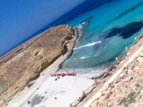

+++
title = ".. أما (عجيبة)!"
date = 2008-08-18
authors = ["مروة عبد الفضيل"]
aliases = ["/articles/masr-n17280/"]

[taxonomies]
authors = ["marwa-abdel-elfadil"]
sections = ["masr"]

[extra]
section_name = "ولاد البلد"
share_image = "/media/masr.20at.com/currentarticleassets/3ageba.jpg"
summary = "إذا أردت أن تترك هذا العالم بصخبه وقلقة وتلوثه وتذهب إلى عالم آخر لا تهمس فيه سوى لنفسك بين الطبيعة الساحرة والهدوء الذي يبعث فيك الراحة، فأنت في حاجة لأن تزور "
section_slug = "masr"
section_colour = "#666666"
thumb = "/media/masr.20at.com/currentarticleassets/3ageba.jpg"
n_comments = 2
original_url = "http://20at.com/masr/places-of-egypt/9895-2009-06-10-17-55-10.html"
archived = "20100105141825"
date_source = "byline/meta"
aliases_20at = ["//masr.20at.com/newarticle.php?sid=17280", "/masr/places-of-egypt/9895-2009-06-10-17-55-10.html"]

[extra.provenance]
original_url = "http://20at.com/masr/places-of-egypt/9895-2009-06-10-17-55-10.html"
capture_url = "https://web.archive.org/web/20100105141825/http://20at.com/masr/places-of-egypt/9895-2009-06-10-17-55-10.html"
capture_label = "٥ يناير ٢٠١٠، ١٤:١٨ UTC"
date_note = "من سطر التوقيع في المقال"
other_urls = ["//masr.20at.com/newarticle.php?sid=17280"]
comments = "٢"
missing_images = ""
+++

<figure></figure>

إذا أردت أن تترك هذا العالم بصخبه وقلقة وتلوثه وتذهب إلى عالم آخر لا تهمس فيه سوى لنفسك بين الطبيعة الساحرة والهدوء الذي يبعث فيك الراحة، فأنت في حاجة لأن تزور شاطئ "عجيبة" عروس مرسى مطروح..

فزيارة واحدة إلى هذا الشاطئ تجد نفسك في حالة "عجيبة" تجمع بين الصفاء والتسامح والسكينة، فمن فوق السماء وأمامك زرقة البحر، وبينهما جبال محفور عليها قلوب وتواريخ تحمل من الذكريات والأسرار ما لا يعرفها سوى أصحابها ممن أرادوا لأنفسهم تخليدا للذكريات.

ورغم ابتعاد هذا الشاطئ عن مدينة مرسى مطروح نفسها بعدة كيلوات، إلا أن الكثير من السائحين أو المصطافين لابد وأن يمروا عليه، معتبرين أنه كنز عليهم استغلاله، وفرصة لأن تتمتع عيونهم وتمتد لآفاق ليس لها نهاية.

(ولاد البلد) ذهبت إلى "عجيبة" لنعرف من زواره أسباب الإقبال عليه ..

<h3 class="center">هكتب اسمي</h3>

محمد مصطفى، طالب بأكاديمية طيبة، قال أنه اعتاد الذهاب وأسرته إلى مدينة مطروح كل عام، وكثيرا ما لا يسعفه الوقت لزيارة كل الشواطئ، لكن شاطئ عجيبة بصفة خاصة لا يستطيع التخلي عن زيارته رغم ابتعاده كثيرا عن الشاليه الذي تملكه أسرته بمنطقة الميناء القديم، ويوضح محمد أنه بمجرد وقوفه على هذا الشاطئ ينبهر بالمنظر والصخور والجبال التي كثيرا ما يتسلقها رغم خطورتها.

أما أم ميدو، وهي إحدى السيدات التي وجدناها تتسلق الجبال رغم كبر سنها، تقول: "الحياة هنا هادئة ويكفي منظر البحر الذي أراه كاملا وأنا أقف على الجبل، فأنا أعتبرها فرصة لأريح نظري وأعطي تمرينات لعيوني، فإطلاق النظر لبعيد جدا دون نهاية يعتبر تمرين جيد للعيون".

حسام، طفل في الثامنة من عمره، يقول: "أنا لازم لما أجي مطروح أجي هنا عجيبة لأني بحب أكتب على الصخور اسمي واسم بابا وماما وأصحابي، ولما أكبر وأتجوز هكتب اسم مراتي كمان زي عمرو أخويا الكبير ما كاتب اسم مراته، ولما رجع بعد كتير لقاها زي ما هي".

<h3 class="center">في حضن البحر</h3>

محمود محمد، طالب بأكاديمية الفراعنة، يحكي أن ما أبهره ليس البحر وزرقته فقط بل الجبال والصخور، يضيف: "أنا عن نفسي أول مرة أزور شاطئ عجيبة، وكنت أسمع أن شاطئ الغرام وصخرة ليلى مراد أفضل ما في مرسى مطروح لكني وجدت أن عجيبة لا يقارن بشيء، ورغم قلة من ينزلون البحر على هذا الشاطئ نظرا للصخور والارتطامات التي ممكن أن تصيبنا بجروح إلا أنني نزلت بحرص لأستمتع بكل صخرة هنا".

أشرف المعز، رب أسرة، يقول: "عوامل التعرية التي سبق ودرسناها في الجغرافيا قبل سنوات بعيدة لأول مرة أشاهدها على الطبيعة، واندهشت من منظر نحت البحر للصخور لتصبح كما لو أن الصخور بالفعل ولدت هكذا في حضن البحر، ووجدتها فرصة جيدة لأشرح لأبنائي على الطبيعة هذه التأثيرات التي يحدثها البحر في الصخور وعن نفسي حينما أنظر إليها أتعجب وأقول سبحان الله".

مروة، طالبة، تقول: "أكثر ما آثار إعجابي حينما وقفت أعلى الجبل هو منظر اللسان الموجود في حضن البحر بطريقة ربانية دون تدخل أي أياد بشرية فيه، وهو ما أكسبه جمالا مضاعفا، وأكثر الأحاديث التي سمعتها تتردد بين زوار الشاطئ ينصب معظمها عن الطحالب الموجودة في الصخور، وإننا هنا لا نستفيد منها بشكل كبير في حين أن الصين تستخدمها في علاج العديد من الأمراض".

* شاهد <a href="https://web.archive.org/web/20100105141825/http://masr.20at.com/CurrentArticleAssets/galleries/18Aug08/ageeba.htm"> جاليري مصور من عجيبة</a>

* شاهد لقطة فيديو من عجيبة.

