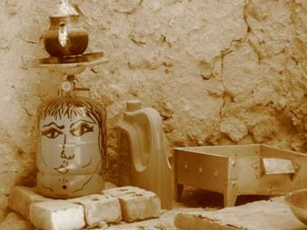

+++
title = "هل سمعت عن (موتوبيا) ؟"
date = 2008-08-19
authors = ["علياء أبوشهبة"]

[taxonomies]
authors = ["alia-aboshhba"]
sections = ["masr"]

[extra]
section_name = "ولاد البلد"
share_image = "/media/masr.20at.com/currentarticleassets/images/fan6.jpg"
summary = "هل تعرف ما هي يوتوبيا؟.. بالتأكيد ورد الاسم على مسامعك من قبل، وهي المدينة الفاضلة كما تخيلها الفيلسوف الشهير أفلاطون، ولكن هل سمعت عن موتوبيا؟!"
section_slug = "masr"
section_colour = "#666666"
thumb = "/media/masr.20at.com/currentarticleassets/images/fan6.jpg"
n_comments = 1
original_url = "http://20at.com/masr/places-of-egypt/9905-2009-06-10-17-58-08.html"
archived = "20100105141654"
date_source = "byline/meta"
aliases_20at = ["/masr/places-of-egypt/9905-2009-06-10-17-58-08.html"]

[extra.provenance]
original_url = "http://20at.com/masr/places-of-egypt/9905-2009-06-10-17-58-08.html"
capture_url = "https://web.archive.org/web/20100105141654/http://20at.com/masr/places-of-egypt/9905-2009-06-10-17-58-08.html"
capture_label = "٥ يناير ٢٠١٠، ١٤:١٦ UTC"
date_note = "من سطر التوقيع في المقال"
other_urls = []
comments = "١"
missing_images = ""
+++

<figure></figure>

هل تعرف ما هي يوتوبيا؟.. بالتأكيد ورد الاسم على مسامعك من قبل، وهي المدينة الفاضلة كما تخيلها الفيلسوف الشهير أفلاطون، ولكن هل سمعت عن موتوبيا؟!

أنها المدينة الفاضلة أيضا ولكن على طريقة الفنان التشكيلي محمد فوزي الجمال، الذي وقع في عشق واحة سيوه، عندما زارها لأول مرة منذ سنوات أثناء رحلته مع الجامعة، فغيرت من مسار حياته بعد أن بهرته طبيعتها وخصائص سكانها، فعاد إليها لينشئ فيها مركزًا فنيا تنمويا أسماه (موتوبيا) للحفاظ على التراث السيوي.

<h3 class="center">مفقود في سيوه</h3>

في زيارة سريعة قام بها عاشق سيوه للقاهرة التقت به (ولاد البلد) للتعرف عليه عن قرب فقال: "عشقت الرسم والتلوين منذ طفولتي، ولكن حاول والدي إبعادي عن الرسم ليدفعني للاهتمام بدروسي، فظلت موهبتي محبوسة بداخلي، وعندما وصلت للمرحلة الثانوية لم أحصل على مجموع كبير فالتحقت للدراسة بكلية الزراعة، وبعد عام من الدراسة بها لفت انتباهي علم الأنثروبولجي (الإنسانيات)، فتركت الزراعة رغم تفوقي فيها ودرست الأنثروبولجي بكلية الآداب جامعة الإسكندرية".

بعد دراسته للأنثروبولجي زادت قناعته بأن الهدف من التعليم هو اكتساب معلومة وليس مجرد الحصول علي شهادة، ورغم ذلك كانت هذه الدراسة محور تغيير في حياته، وجاء سفره إلى سيوه لإجراء أحد البحوث، وقضي فيها ليلتين فقط ولكنهما شكلا نقطة تحول في حياته، حيث بهرته طبيعتها وخصائص سكانها، وأدرك وقتها أنه سيرتبط بهذا المكان لفترة طويلة، خاصة بعد أن خرج في ليلته الأولى ليقضيها في الجبل ونسى الوقت، فظن أصدقاؤه أن مكروها قد أصابه فأبلغوا الشرطة، ولم يصدقوا يومها أن طبيعة المكان أسرته.

عاد محمد من الرحلة وفي ذهنه تصورات كثيرة عن سيوه، فحلم بتأليف كتاب عنها وتجميع مفردات اللغة الأمازيغية وهي لغة أهالي سيوه التي تكاد أن تندثر، كما حلم بتعليم أطفال سيوه من خلال الفن، وذلك لقناعته بأن الفن رسالة في حياة الفنان.. يقول: "الفن بالنسبة لي وسيلة تنمية ومحاولة لتدبر الذات وفهمها واكتشافها، كما أنه وسيلة للتعبير عن أفكارنا وأحلامنا، ويمكن أن يستخدم في التعليم والتعبير عن فكرة أو رأي".

<h3 class="center">التعليم بالفن في موتوبيا</h3>

أعتاد محمد على السفر إلى سيوه سنويا، ومنذ عامين قرر أن ينشئ فيها مركزًا فنيا تنمويا، يعبر عن حلمه بالمدينة الفاضلة، وسماه (موتوبيا) وهو مزيج من حروف اسمه الأولى ومصطلح يوتوبيا، وخلاله عرض مجموعة من أعماله الفنية التي جذبت أهالي الواحة والسياح الوافدين إليها لغرابة الفكرة بالنسبة لهم.

يكمل: "كتبت علي جدران موتوبيا قصة سيوه، وأنشأت مكتبة ضمت ألف كتاب ومجلة من تأليفي، وقررت إدخال الكمبيوتر لأول مرة هناك، حتى يتعلم أطفال المنطقة كيفية التعامل مع الإنترنت، وبسبب ذلك تعرضت لمشاكل من أهالي البلد، دفعتني إلي نقل مقر موتوبيا إلي "جبل الدكرور" في سيوه، وهناك أدخلت المرافق والكهرباء إلي المنزل، واستكملت بنفسي أعمال الصيانة، وجعلت البيت مزارا للأطفال والسياح الأجانب من زوار الواحة، وأسعى حاليا لأضم إلى نشاطه الحفاظ علي الزي الواحاتي".

<h3 class="center">حتى لا تندثر الأمازيغية</h3>

لم يكتف محمد بموتوبيا، بل سعى للحفاظ علي الأمازيغية من الاندثار، وهي اللغة التي ظل أهالي سيوه لقرون طويلة يعتقدون أنهم الشعب الوحيد الذي يتحدث بها، وهي لغة "البربر" ويتحدثها مجموعات كبيرة من أهالي المغرب العربي، ولكنها ظلت سماعية لفترة طويلة لذلك تعمق في دراستها محاولا تعليم أهالي سيوه كيف يكتبون لغة ينطقونها.

ويري محمد أن المدارس الحكومة هي سبب اندثار اللغة، لأنها تجبر الأطفال على الحديث فيما بينهم باللغة العربية، لذلك يمكن أن تجد خريجاً سيوياً يتحدث الأمازيغية ولا يكتبها، ويكتب العربية ولا يتحدث بها.

يستعد محمد حاليا لإصدار أول قاموس عربي - سيوي – إنجليزي، لتعليم أهل سيوه اللغتين من خلال اللغة التي يجدون التحدث بها، ويقول: "قمت بتأليف 12 قصة للأطفال بلغة أهالي سيوه نسختها يدويا، لأني لا أمتلك إمكانية طباعتها".

<h3 class="center">"ذكريات سيويه"</h3>

يعكف عاشق سيوه منذ أكثر من 10 سنوات إعداد كتاب تحت عنوان "ذكريات سيويه" ليسرد فيه تجربته وانطباعه عن الفترة التي قضاها في سيوه، وهو مزيج بين البحث الإنثروبولجي الأكاديمي وأدب الرحلات والسيرة الذاتية، وألوان أدبية أخرى مثل الشعر والقصة، ويحلم بتأسيس متحف في سيوه، كما يسعي لنشر مشروعه "موتوبيا" في الأماكن التي تضم حضارة أصيلة للحفاظ عليها لأنها جزء من الوطن، لذلك يفكر في تأسيس مشروع مماثل في حلايب وشلاتين.

ويحلم محمد الآن بإقامة معرض فني داخل أحد أنفاق مشاة الإسكندرية، لأن الشارع متاح للجميع ولكن التفكير الروتيني يقف أمامه ويقيده، ورغم ذلك فأحلام محمد فوزي الجمال لا تقف عند حد معين وحلمه الأكبر أن يلف حول العالم سيراً على الأقدام لنشر رسالته الفنية.

<a href="https://web.archive.org/web/20100105141654/http://www.facebook.com/group.php?gid=24614396981"> للتعرف علي مزيد عن عالم محمد فوزي الجمال يمكن زيارة </a>

