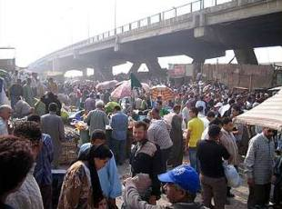

+++
title = "السوق عندكم .. يوم إيه ؟"
date = 2008-08-23
authors = ["محمد سيد أحمد"]
aliases = ["/articles/masr-n17322/"]

[taxonomies]
authors = ["mohamed-sayed-ahmed"]
sections = ["masr"]

[extra]
section_name = "ولاد البلد"
share_image = "/media/masr.20at.com/currentarticleassets/039_1_.jpg"
summary = "- إيه يا ابني قَصة شعرك دي، أنت حالقها في \"سوق الأحد\"؟"
section_slug = "masr"
section_colour = "#666666"
thumb = "/media/masr.20at.com/currentarticleassets/039_1_.jpg"
n_comments = 2
original_url = "http://20at.com/masr/places-of-egypt/9920-2009-06-10-18-04-04.html"
archived = "20100105141727"
date_source = "byline/meta"
aliases_20at = ["//masr.20at.com/newarticle.php?sid=17322", "/masr/places-of-egypt/9920-2009-06-10-18-04-04.html"]

[extra.provenance]
original_url = "http://20at.com/masr/places-of-egypt/9920-2009-06-10-18-04-04.html"
capture_url = "https://web.archive.org/web/20100105141727/http://20at.com/masr/places-of-egypt/9920-2009-06-10-18-04-04.html"
capture_label = "٥ يناير ٢٠١٠، ١٤:١٧ UTC"
date_note = "من سطر التوقيع في المقال"
other_urls = ["//masr.20at.com/newarticle.php?sid=17322"]
comments = "٢"
missing_images = ""
+++

<figure></figure>

- إيه يا ابني قَصة شعرك دي، أنت حالقها في "سوق الأحد"؟

- مبروك الطقم الجديد، "سوق الجمعة" عامل معاكي أحلى واجب..

لعلك تعرضت أو سمعت من قبل الموقفين السابقين، مع اختلاف اسم السوق المشار إليه، فقد يكون سوق الثلاثاء أو الاثنين، أو أي يوم آخر..

فكما أن لكل حي بالقاهرة خصوصيته وكذلك كل مدينة مصرية، نجد أن هذه الخصوصية تمتد لتجعل لكل منطقة "سوقا" يقام في يوم محدد من أيام الأسبوع، بل أن هذا اليوم هو الذي يطلق على اسم السوق، أي أن أيام الأسبوع هي التي تحدد خريطة الأسواق وأسماءها.

فيوم الجمعة مثلا هو الذي يشهد إقامة سوق الجمعة الشهير بمنطقة السيدة عائشة، وسوق الأحد بشبرا الخيمة يقترن بهذا اليوم لإقامته فيه، وهناك سوق الثلاثاء بالمنيب، وسوق الخميس بالمطرية.. والأسواق الأربعة هم الأشهر بين أسواق القاهرة.

أما خارج القاهرة فهناك أسواق أخرى تشهدها محافظات مصر تتوزع على مدار أيام الأسبوع، وعند زيارتك لها تجد شوارع تسمى باسم السوق سواء بشكل رسمي أي أن الحي هو من أطلق عليه هذا الاسم، أو أطلقها الأهالي مجازا، وفي الحالتين إشارة لأهمية هذه الأسواق.

<h3 class="center">من الإبرة للصاروخ</h3>

تكتسب أسواق الأسبوع شعبية طاغية، فهي ترفع شعار "من الإبرة للصاروخ"، فتجد كل بائع يصطف أمامه المئات من الزبائن لشراء احتياجاتهم بأسعار رخيصة عن تلك الموجودة بالمحلات التجارية، والملاحظ أن زبائن هذه الأسواق ينتمون إلى كل الفئات والأعمار السنية، ولعل أكثرهم من النساء، وأغلبهم من الفقراء ومتوسطي الحال.

ولأن معظم هذه الأسواق أقيمت بطرق عشوائية فغالبا ما تكون لها قوانين خاصة تنظم عملها قام بوضعها البلطجية الذين يقومون بحراسة السوق من الدخلاء نظير دفع إتاوة تختلف قيمتها حسب نوع النشاط التجاري والمساحة المعروض بها في أرضية السوق، بالإضافة إلى رسوم نظافة يتم دفعها للوحدات المحلية نظير تنظيف منطقة السوق عقب إزالة محتوياته.

<h3 class="center">من أيام الفراعنة</h3>

"أسواق الأسبوع لها جذور قديمة"، هذا ما أكدته الدكتورة إيمان الشريف، أستاذ الاجتماع بالمركز القومي للبحوث الاجتماعية والجنائية، موضحة أن الفراعنة هم أول من ابتدعوا نظام إقامة السوق في يوم واحد، وأغلب الظن أن هذا اليوم كان الخميس، وفيه يقوم الناس بشراء كل احتياجات البيت ويبقون طوال النهار خارج البيت للتسوق على اعتبار أن اليوم التالي هو الجمعة يوم إجازة.

توارث المصريون هذه العادة من الفراعنة وبمرور الزمن أصبحت هناك أسواق مسماة بأيام الأسبوع مثلما هو الحال الآن، وفي مناطق مختلفة وفيها القديم والمستعمل، ليس هذا فحسب حيث نجد أن الكثير من البلدان العربية أخذت هذا النهج من المصريين، ولعل المملكة العربية السعودية كانت الأبرز في هذا الشأن، فتأسست فيها أسواق على غرار الأسواق المصرية وأسواق متخصصة أيضا، ومن أشهرها سوق الحراك يوم الجمعة، وتعد ظاهرة الأسواق بشكل عام صحية فهي تريح المواطن ويعرف أماكن الأسواق ونوعية البضاعة المباعة فيها من خلال معرفة اليوم.

فهل تجذبك مثل هذه الأسواق، وما هو اليوم المحدد لها في منطقتك؟

