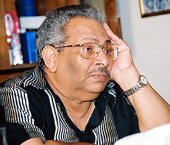

+++
title = "عكاشة.. و ولاد اللذينه"
date = 2007-05-06
authors = ["البراء أشرف"]

[taxonomies]
authors = ["elbaraa-ashraf"]
sections = ["masr"]

[extra]
section_name = "ولاد البلد"
share_image = "/media/admins.20at.com/masr/welad02.jpg"
summary = "رغم الضيق الذي يشعر به كل مشاهد يتجه إلى سينما \"مترو\" بوسط القاهرة لمشاهدة فيلم جديد بها لأنه يكتشف أن إدارة السينما لم تغير الأفلام التي تعرضها منذ أسابيع، إلا"
section_slug = "masr"
section_colour = "#666666"
thumb = "/media/admins.20at.com/masr/welad02.jpg"
n_comments = 4
original_url = "http://www.20at.com:80/masr/review/5732-2009-06-09-11-57-06.html"
archived = "20090903042611"
date_source = "byline/meta"
aliases_20at = ["/masr/review/5732-2009-06-09-11-57-06.html"]

[extra.provenance]
original_url = "http://www.20at.com:80/masr/review/5732-2009-06-09-11-57-06.html"
capture_url = "https://web.archive.org/web/20090903042611/http://www.20at.com:80/masr/review/5732-2009-06-09-11-57-06.html"
capture_label = "٣ سبتمبر ٢٠٠٩، ٠٤:٢٦ UTC"
date_note = "من سطر التوقيع في المقال"
other_urls = []
comments = "٤"
missing_images = ""
+++

<figure></figure>

رغم الضيق الذي يشعر به كل مشاهد يتجه إلى سينما "مترو" بوسط القاهرة لمشاهدة فيلم جديد بها لأنه يكتشف أن إدارة السينما لم تغير الأفلام التي تعرضها منذ أسابيع، إلا أن ذلك المشاهد بنهاية الليلة سيشعر بقدر من الرضا على سينما مترو وإدارتها التي منعته من مشاهدة فيلم جديد بها، وإن كانت وفرت له فرصة دخول مسرح "ميامي" على الناحية المقابلة لها من الشارع نفسه، ومشاهدة مسرحية جديدة تعرض هناك هي "ولاد اللذينة"..

والمسرحية التي تحمل اسم "أسامة أنور عكاشة" في خانة التأليف و"محمد عمر" في الإخراج، ومحمود الجندي وتامر عبد المنعم ومحمود الحديني في البطولة، جعلت المشاهد يغامر بدخول المسرح لمشاهدتها، بعد فترة طويلة من الخصام بين المسرح والجمهور لصالح أفلام السينما.

<h3>رؤية عكاشية</h3>

تدور الأحداث داخل فيلا فخمة في منطقة السادس من أكتوبر بالقاهرة، وفيها يستعرض الكاتب أهم مشكلات المجتمع المصري والصراع بين طبقتين، واحدة غنية وفاسدة، وأخرى فقيرة وكادحة.

داخل قاعة العرض، ستشاهد رؤية سياسية جديدة يطرحها عكاشة، وهو أمر ليس جديداً عليه، وطالما فعله في أعماله الدرامية، خاصة في مسرحياته الثلاثة الأخيرة السابقة لـ"ولاد اللذينة"، حيث قدم على مسرح الدولة "الناس اللي في التالت"، و"عز الضهر" و"ليلة 14" والأخيرة تم عرضها بمسرح الهناجر بالأوبرا.

ولا يخفى على الكثيرين أن اسم أسامة أنور عكاشة على أفيش المسرحية أصبح كافياً لجذب جمهور عريض من مدمني أعمال السيناريست الأشهر في تاريخ الدراما التليفزيونية من خلال أعمال محفورة في ذاكرة المشاهد المصري مثل "ليالي الحلمية"، "الشهد والدموع"، "زيزينيا"، "إمرأة من زمن الحب".. وأعمال أخرى مسرحية.

لكن بعيدا عن المستوى الفني للعمل، حيث يراه بعض النقاد سقطة للمؤلف المتميز، والسبب في رأيهم أن العمل تم إنجازه بسرعة، سواء على مستوى الكتابة أو حتى البروفات، فالمخرج محمد عمر أنجز بروفات المسرحية مع الممثلين في أسبوعين فقط.. وهو استعجال لم يعرفه مسرح القطاع العام من قبل!.

كما أن تامر عبد المنعم هو واحد من الأبطال الرئيسين للعمل، ولا يخفى على الكثيرين أن تامر هو الابن الأصغر للكاتب والصحفي محمد عبد المنعم رئيس التحرير السابق لمؤسسة روزاليوسف القريبة من الدولة، بالإضافة إلى أنه رغم صغر سنه، تمكن من شق طريقه إلى مقعد مدير قصر السينما بوزارة الثقافة، وسط تساؤلات عن المؤهلات التي يملكها لشغل مثل هذا المنصب، غير كونه ابن صحفي مهم.

محمد عبد الحافظ هو البطل التالي لتامر في قائمة أبطال العمل، وبالتركيز على اسم والده ستكتشف أنه ابن المخرج المعروف "إسماعيل عبد الحافظ" وهو شريك أساسي كمخرج لأسامة أنور عكاشة في أعماله التليفزيونية.. فإن أضفت إلى ذلك أن محمد لم يشترك من قبل في أعمال مسرحية، وأنه يواجه عادة نقصاً في العروض المقدمة له عدا تلك التي يخرجها والده، تعرف أن وجوده في "ولاد اللذينة" ربما يقف وراءه العلاقة القوية بين والده ومؤلف العمل والمخرج كذلك.

أضف إلى ذلك أن "بنات اللذينة" جاءت ملابسهن على قدر من القصر والضيق يجعلك تفكر وتعيد التأكد من أنك تشاهد مسرحية من إنتاج مسرح الدولة، حيث اعتاد الجمهور مشاهدة مثل هذه الملابس في المسرح الخاص الذي ينتعش صيفاً مع توافد جمهور الخليجيين على القاهرة.

اتهامات قد تجعل اسم "ولاد اللذينة" منطبقاً على صناع المسرحية، لكن الإقبال الجماهيري ربما يؤكد أنها اتهامات لم تصل بعد إلى آذان الجمهور.

<h3>شرمرينا السبب</h3>

وبعيداً عن المستوى الفني الذي يدور حوله هذا الإختلاف، فإن ما يلفت نظر المشاهد للمسرحية هو وجود "أسامة أنور عكاشة" في الصف الأول بشكل يومي، فهو يحضر كل العروض، بل ويشارك بجزء بسيط من العرض في حديث من طرف واحد يجريه معه محمود الجندي أثناء العمل.

وبسؤاله عن الفقرة التي يشارك فيها، وعن تلقي الجمهور لها باعتبارها مجرد خروج عن النص من محمود الجندي المعروف بخروجه عن النص في أعماله المسرحية السابقة، قال عكاشة أن الفقرة مكتوبة في السيناريو كما يشاهدها الجمهور، وأنه لا يحب أن تحتوي مسرحياته على أي خروج عن النص..

كما أن المشاهدين يخرجون من العرض وهم يرددون كلمة سمعوها للمرة الأولى في حياتهم من خلال العرض، إلا أنها راقتهم كثيرا لدرجة جعلتها تلصق في ذاكرتهم، فأثناء العرض ستجد البطل الرئيسي ُيحمل مسؤولية الأوضاع الفاسدة في مصر إلى طبقة يطلق عليها اسم "شرمرينا"، وبالطبع يظل المشاهد يجهل معنى الكلمة حتى يظن أنها ربما تكون كلمة منتشرة وهو جاهل بها، إلا أنه مع نهاية العرض يفسر محمود الجندي الكلمة، ويقول أنها اختصار لكلمتين هما "شرم الشيخ" و"مارينا" وهي المدن الساحلية المعروفة بأنها الأماكن المفضلة لقضاء الصيف لطبقة الأغنياء في مصر.

لكن السؤال الذي سيظل مطروحا أمام صناع "ولاد اللذينة"، هو هل سيستمر إقبال الجماهير على المسرحية لمجرد أن سينما مترو تعرض أفلاماً ثابتة دون تغيير منذ أسابيع وقد شاهدها الجمهور وأصبح يبحث عن الجديد الذي يجده في العروض المسرحية.

أم أن نص كتبه عكاشة وأخرجه محمد عمر ويؤديه الجندي قادر على المنافسة في موسم الصيف الذي سيشهد رواج لأفلام السينما، والتي ستجبر سينما مترو بالتأكيد على تغيير أفلامها، وتجبر الجمهور على دخولها وإهمال عروض مسرحية مثل "ولاد اللذينة"، ربما هو السؤال الذي يحاول صناع المسرح في مصر الإجابة عنه، بعد أن ظل إقبال الجماهير على العروض مرتبط فقط بركود في عالم السينما..

