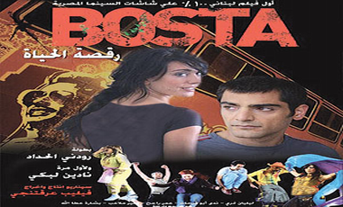

+++
title = "البوسطة....رقص شرقي وغربي"
date = 2007-05-07
authors = ["مروة عبد الفضيل"]
aliases = ["/articles/masr-n10102/"]

[taxonomies]
authors = ["marwa-abdel-elfadil"]
sections = ["masr"]

[extra]
section_name = "ولاد البلد"
share_image = "/media/admins.20at.com/do3a2/bosta1.jpg"
summary = "في عام 1975 فتح بعض المسلحين من حزب الكتائب النار على حافلة صغيرة تقل فلسطينيين عائدين من مهرجان أقيم في \"تل الزعتر\"، ومنه جاءت أولى خطوات الحرب اللبنانية التي "
section_slug = "masr"
section_colour = "#666666"
thumb = "/media/admins.20at.com/do3a2/bosta1.jpg"
n_comments = 4
original_url = "http://www.20at.com:80/masr/review/5761-2009-06-09-11-58-49.html"
archived = "20100310151549"
date_source = "byline/meta"
aliases_20at = ["//masr.20at.com/newarticle.php?sid=10102", "/masr/review/5761-2009-06-09-11-58-49.html"]

[extra.provenance]
original_url = "http://www.20at.com:80/masr/review/5761-2009-06-09-11-58-49.html"
capture_url = "https://web.archive.org/web/20100310151549/http://www.20at.com:80/masr/review/5761-2009-06-09-11-58-49.html"
capture_label = "١٠ مارس ٢٠١٠، ١٥:١٥ UTC"
date_note = "من سطر التوقيع في المقال"
other_urls = ["//masr.20at.com/newarticle.php?sid=10102"]
comments = "٤"
missing_images = ""
+++

<figure></figure>

في عام 1975 فتح بعض المسلحين من حزب الكتائب النار على حافلة صغيرة تقل فلسطينيين عائدين من مهرجان أقيم في "تل الزعتر"، ومنه جاءت أولى خطوات الحرب اللبنانية التي استمرت قرابة 15 عاما من التاريخ.

ما سبق هو ملخص الفيلم اللبناني "البوسطة"، والذي تبنت شركة أفلام مصر العالمية لصاحبها "يوسف شاهين" توزيعه في دور العرض المصرية في محاولة للرهان على كسب الجمهور المصري على غرار الأفلام الأمريكية والهندية.

قصة الفيلم تتحدث عن الحرب اللبنانية، حيث أراد مؤلف الفيلم وكاتبه "فيليب عرقتنجي" أن يبلور هذه الفكرة في فيلم سينمائي، ويحسب له أنه أعطى مضمونا عما حدث في الحرب في قالب استعراضي غنائي راقص، دون الاستعانة بمشهد واحد من الحرب، فغابت لغة الحوار وعلا صوت الغناء وإزادت تحركات الأجساد الراقصة على موسيقى مزجت الشرقي بالغربي.

حينما تشاهد الفيلم تجد نفسك وكأنك تارة في بلاد الغرب حيث الموسيقي الغربية وطعم الحرية والانطلاق، وتارة تجد نفسك هنا في بلاد الشرق حيث الصخب والرقصات المستوحاة من التراث الشرقي.

<h3>الحلم القديم</h3>

اشترك في بطولة العمل اللبنانية "نادين لبكي" في أولى تجاربها مع الأفلام الروائية الطويلة، حيث سبق لها واشتركت في أكثر من فيلم روائي قصير وعرفها الجمهور العربي كأشهر مخرجات الفيديو كليب، شاركها البطولة كل من رودني حداد، ندى أبو فرحات، وكضيوف شرف شاركت كل من الفنانتين صباح ورويدا في بعض مشاهد الفيلم.

أما أحداث الفيلم فتدور حول كمال (رودني حداد) الذي يعود إلى بلدته بيروت بعد أن تم نفيه إلى فرنسا 15 عاما تاركا حلمه في لبنان وهو تكوين فريق الدبكه، وبمجرد مجيئه عاوده هذا الحلم من جديد، لكن برؤية جديدة حيث أعطته فرنسا فكرة دمج الموسيقى الغربية في الدبكه الشرقية، وظل كمال يبحث عن أصدقائه القدامى الذين جمعهم هذا الحلم ليتقابلا في محاولة َطموحه لاستعادة ما كان.

يلفت نظرك في الفيلم وجود بعض المشاهد الساخنة التي تخجل منها البيوت العربية، وكأننا نشاهد فيلما أمريكيا وليس لبنانيا يحمل رائحة الشرق، ناهيك عن الألفاظ التي أقل ما يمكن أن توصف به هي الإباحية، ولا نعرف كيف لم تتدخل الرقابة المصرية في حذفها طالما إنه سيعرض في مصر.

<h3>مشاهد over</h3>

التقينا ببعض الجمهور اللذين حضروا هذا الفيلم..

في البداية يرى "ياسر عبد الهادي": "الفيلم مخجل جدا ولو كنت أعرف ذلك ما كنت دخلته أنا وزوجتي، فبعض المشاهد over جداً، بالإضافة إلى أن لغة الحوار وصلت لأدني مستوياتها، وأنصح أي شخص ألا يدخل هذا العمل لأنه كله رقص، وبصراحة كده لهجتهم غليظة جدا فاضطررنا أن نشاهد الصورة فقط بعيدا عن لغة الحوار"!.

يشاركه في الرأي بعض الشيء "أدهم مدحت" الذي أضاف لكلام ياسر أن الفيلم رغم ما يحتويه من مشاهد ساخنة إلا إنه فيلم عاد بنا إلى أجواء فيلم "غرام في الكرنك" لما به من استعراض ورقصات الدبكه الممتعة وتميز الراقصين بخفة الجسد وكأنهم يرسمون لوحه فنيه، لكن اللهجة اللبنانية فعلا صعبة وعن نفسي لم أفهم الفيلم سوى من ترجمته الأجنبية ولا أعرف ما هو الداعي لاستخدام طريقة الفلاش باك في الأحداث.

أما نيرمين عبد الله، فتخالف الرأيين السابقين، قائله: "الفيلم جيد جدا ومختلف عن الأفلام الأمريكية والهندية وكمان المصرية، ومن زمان لم أشاهد فيلم استعراضي به هذا الكم الضخم من الاستعراض، وقد أثبت هذا الفيلم بجدارة أن اللبنانيين ليس كلهم هيفاء وهبي ونانسي ودوللي فقط، بل هناك ممثلين كثيرون يستحقون أن يُشاهدوا، أقول هذا ولا أنكر المبالغة بعض الشيء في استخدام ألفاظ لا نسمعها في مصر سوى في الشوارع فقط".

<h3>صعوبة اللهجة</h3>

من جانبه يقول الناقد "طارق الشناوي" لـ"عشرينات": "جاءت السينما اللبنانية إلى دور العرض المصرية لتثبت ليس للقائمين على السينما المصرية فحسب بل وللسينما الهندية أن ما لديهم من إمكانيات في الرقص والاستعراض واستخدام لغة الألوان في التعبير عن واقع معاش ضخم جدا، وأحب أن أشيد بالمخرج فيليب عرقتنجي الذي تعامل بذكاء مع القصة، حيث أنه يعرف جيدا مدى صعوبة استيعاب البعض اللهجة اللبنانية، فأقام الفيلم كاملا على لغة الاستعراض والجسد فنجح".

