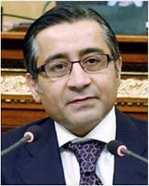

+++
title = "أحمد عز.. وصيف الرئيس"
date = 2007-05-02
authors = ["مجدى مهنا", "المصري اليوم"]

[taxonomies]
authors = ["magdy-mahna", "elmasry-alyoum"]
sections = ["masr"]

[extra]
section_name = "ولاد البلد"
share_image = "/media/admins.20at.com/masr/ahmd-az1.jpg"
summary = "أينما ذهب المهندس أحمد عز، أمين التنظيم بالحزب الوطني، وأكبر منتج لصناعة الحديد في مصر تطارده الاتهامات.. وأينما ذهب هو مشغول بالدفاع عن نفسه من هذه الاتهامات."
section_slug = "masr"
section_colour = "#666666"
thumb = "/media/admins.20at.com/masr/ahmd-az1.jpg"
n_comments = 2
original_url = "http://www.20at.com:80/masr/t7atuf/5687.html"
archived = "20090917012857"
date_source = "byline/meta"
aliases_20at = ["/masr/t7atuf/5687.html"]

[extra.provenance]
original_url = "http://www.20at.com:80/masr/t7atuf/5687.html"
capture_url = "https://web.archive.org/web/20090917012857/http://www.20at.com:80/masr/t7atuf/5687.html"
capture_label = "١٧ سبتمبر ٢٠٠٩، ٠١:٢٨ UTC"
date_note = "من سطر التوقيع في المقال"
other_urls = []
comments = "٢"
missing_images = ""
+++

<figure></figure>

أينما ذهب المهندس أحمد عز، أمين التنظيم بالحزب الوطني، وأكبر منتج لصناعة الحديد في مصر تطارده الاتهامات.. وأينما ذهب هو مشغول بالدفاع عن نفسه من هذه الاتهامات.

وحسب قول المهندس عز نفسه، في ندوة عقدت بالأهرام، بأن الاتهامات جعلت منه المسؤول عن كل مشاكل مصر، ابتداء من ارتفاع أسعار الحديد، حتي نسبة العنوسة.

ومشكلة أحمد عز الحقيقية هي أن الناس لا تصدقه مهما تحدث، ومهما استخدم من حجج ومبررات وأسانيد.

وهناك فرق بين أن يعتقد الناس في صحة كلامه من عدمه، وبين قدرته علي التخاطب والتواصل مع الناس.

المهندس أحمد عز يري في نفسه أنه لا يحظي بالقبول، ولا يجيد مخاطبة الناس، وهي نقطة ضعف عنده، لكنها ليست هي الأساس في عدم تصديق الناس له.. فالصدق له مواصفات أخري غير القبول.. فقد أكون مقبولا لدي الناس، لكنني غير صادق في مخاطبتهم.

وعندما تنشر صحيفة «المساء»، في عدد أمس الأول، تصريحات منسوبة إلي المهندس أحمد عز يقول فيها إن ديونه للبنوك تقدر بثلاثة مليارات جنيه، وأنها لا تمثل سوي ثلث رأسماله في شركة حديد عز وحدها، وليس في جميع شركاته، فهذا يعني أن رأسمال هذه الشركة فقط يقدر بتسعة مليارات جنيه: وهذا يطرح السؤال حول كم يقدر رأسمال جميع شركات أحمد عز إذن؟ هل يصل إلي عشرين أو إلي ثلاثين مليار جنيه؟

هذه هي النقطة المهمة التي تجعل الناس تفقد الثقة في كلام أحمد عز، وتجعل الاتهامات تطارده، وتلاحقه أينما ذهب.. فلم يكن أحمد عز شيئا يذكر في عام ١٩٩٠.

كان مجرد منتجع صغير لصناعة الحديد، ولا يتعدي حجم إنتاجه ١ أو ٢% من سوق إنتاج الحديد، فإذا به يحتكر الآن ٦٧% من هذه الصناعة الاستراتيجية.

كيف استطاع أحمد عز أن يصل إلي هذه المكانة، وبأي وسيلة؟

هذا هو السؤال الذي لا يريد أحمد عز أن يجيب عنه، بينما شغل نفسه، وشغلنا معه، بالإجابة عن تساؤلات أخري.. مثل أنه أصبح رئيسا لمجلس إدارة شركة الدخيلة للصلب في عام ٢٠٠٠، أي قبل أن يصبح أمينا للتنظيم في الحزب الوطني، وقبل حصوله علي عضوية البرلمان.

لا يكفي أن يقول أحمد عز هذا الدفاع، فيصدقه الناس، ولا يكفي أن ينفي استفادته من منصبه البارز في الحزب الوطني، أو اقترابه من الرؤوس الكبيرة بداخله، فيسلم الناس بصحة أقواله، ويقولون له: ولا الضالين.. آمين!

قد يقول أحمد عز عن نفسه، إنه مواطن صالح، ويقوم بتسديد الضرائب المستحقة عليه، وأن مصانعه بها كذا ألف عامل، وأن هؤلاء العمال يتقاضون مئات الملايين من الجنيهات سنويا، لكنه لا يجيب عن سؤال أساسي: من أين لك هذا؟ وكيف تكونت هذه الإمبراطورية؟ والسؤال مشروع، لأن أحمد عز ليس مجرد رجل أعمال عادي.. فقد ارتضي أن يشتغل بالسياسة، وأن يلعب في الدائرة الضيقة لعملية صنع القرار، بل ووضع نفسه في مكان «الوصيف» للرئيس القادم.. ولذلك ستظل الاتهامات تطارده، وتلاحقه أينما ذهب، وستظل الناس لا تصدقه، إلي أن يجيب عن الأسئلة التي لا يريد الاقتراب منها، والإجابة عنها.

