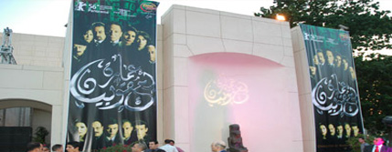

+++
title = "للكبار فقط.."
date = 2006-06-25
authors = ["محمد عبد الرحمن"]
aliases = ["/articles/masr-563/", "/articles/masr-hot-topics-4178/", "/articles/masr-masr-hot-topics-4178/"]

[taxonomies]
authors = ["mohamed-abdel-elrahman"]
sections = ["masr"]

[extra]
section_name = "ولاد البلد"
share_image = "/media/admins.20at.com/masr/3omara.jpg"
summary = "- محمد.. معاك بطاقة..؟؟"
section_slug = "masr"
section_colour = "#666666"
thumb = "/media/admins.20at.com/masr/3omara.jpg"
n_comments = 0
original_url = "http://www.masr.20at.com:80/masr/hot-topics/4178-2009-04-29-08-22-43.html"
archived = "20100105032452"
date_source = "byline/meta"
aliases_20at = ["//masr.20at.com/article.php?sid=563", "/masr/t7kyk/4178-2009-04-29-08-22-43.html", "/masr/hot-topics/4178-2009-04-29-08-22-43.html", "//masr.20at.com/masr/hot-topics/4178-2009-04-29-08-22-43.html"]

[extra.provenance]
original_url = "http://www.masr.20at.com:80/masr/hot-topics/4178-2009-04-29-08-22-43.html"
capture_url = "https://web.archive.org/web/20100105032452/http://www.masr.20at.com:80/masr/hot-topics/4178-2009-04-29-08-22-43.html"
capture_label = "٥ يناير ٢٠١٠، ٠٣:٢٤ UTC"
date_note = "من سطر التوقيع في المقال"
other_urls = ["//masr.20at.com/article.php?sid=563", "/masr/hot-topics/4178-2009-04-29-08-22-43.html", "//masr.20at.com/masr/hot-topics/4178-2009-04-29-08-22-43.html"]
comments = ""
missing_images = ""
+++

<figure></figure>

- محمد.. معاك بطاقة..؟؟

- ليه يا باسم..؟؟

- عشان الفيلم اللي إحنا داخلينه طلع للكبار فقط.. يعني الدخول بالبطاقة!

الحوار السابق تسمعه من باب التهريج أمام أبواب السينمات، وخصوصا مع وجود فيلم معروض يحمل لافتة "للكبار فقط"..

ففي ظل المرونة التي تتميز بها الرقابة على المصنفات الفنية تحت الإدارة الثانية لعلي أبو شادي أصبحت لافتة للكبار فقط الحل السحري لتمرير أفلام تتضمن مشاهد وأفكار ما كانت لتمر لو كانت الرقابة محكومة بعقلية مختلفة.

بمعنى آخر فأن لافتة "للكبار فقط "التي ظهرت للمرة الثانية خلال 6 شهور على لافتات السينما أصبحت طوق نجاة العديد من الأفلام من مقص الرقيب الذي أصبح أكثر خفة في عهد أبو شادي.

في الوقت ذاته مازالت أجيال سابقة تتحسر على أيام زمان، والتي تمكنت من مشاهدة أفلام من عينة أبي فوق الشجرة وحمام الملاطيلي وخمسة باب، وكلها مرت دون "للكبار فقط" ودون أي حذوفات..

<h3>خلينا في موضوعنا..</h3>

في الموسم الحالي يعد فيلم "عمارة يعقوبيان" أحدث الأفلام التي لا يقترب منها المقص بشرط السماح لمن هم فوق الـ 16 عاماً فقط بمشاهدتها، وغالباً ما توضع هذه اللافتة في أفلام تمتلئ بمشاهد جنسية أو فكرية أو عنف لا تناسب الأطفال..

لكن الجنس كان القاسم المشترك بين الأفلام التي تم عرضها بهذا الشرط مؤخراً، على اعتبار أننا لا ننتج أساسا أفلام عنف ورعب، إلا إذا اعتبرنا الرقص مع الشيطان رعب، وتيتو عنف..

كما أن السينما المصرية لا تنتج أفلاماً تتحدث عن الذات الإلهية وتناقش الأديان دون خطوط حمراء، وإن كان من الوارد أن نشاهد قريبا أفلاما مصرية من هذا النوع، بعد الأنباء التي تتردد عن إنتاج فيلم مصري عن حياة المسيح!

إذن هو الجنس.. لكن الجنس في "يعقوبيان" كان يستحق بالفعل هذه اللافتة التي تزيد من جاذبية أي فيلم وتغري الكثيرون سواء المشاهدين أو دور العرض بالمخالفة.

وكما نعلم فالجنس في يعقوبيان يدور بشكل أساسي حول الشذوذ، لأن مشاهد الرجال والنساء الجنسية كانت خفيفة وعابرة لكن يعقوبيان يقدم للمرة الأولى شخصية تمارس الشذوذ الجنسي بشكل متكامل درامياً يسرد كل التفاصيل.

لهذا رحبت أسرة الفيلم بالقرار لو تعتبره مجحفاً، وهو ما حدث أيضاً مع "ليلة سقوط بغداد" الذي كان مضمونه (السياسي – الجنسي) مبرراً قوياً لاستخدام اللافتة الشهيرة، لكنها لم تحقق عنصر جذب بسبب الظروف المعروض فيها الفيلم.

لكن في "بحب السيما" لم يكن الجنس وحده هو السبب، بل أفكار الفيلم نفسها التي تقدم نموذج لم يقبله كثيرون للشخصية المسيحية، الأمر الذي رأته الرقابة غير صالح لأن يكون متاحاً للأطفال، والمفارقة أن بطل الفيلم كان طفلاً حزن لأن أصدقائه في المدرسة لم يستطيعوا مشاهدته على الشاشة الكبيرة.

لكن لافتة "للكبار فقط" هذه المرة لم تخفف من الحرائق التي اشتعلت حول الفيلم من جانب الكنيسة ونشاط أقباط، فالـ"كبار" لم يكونوا كبار في جدالهم حول الفيلم، ولم تتقبل الكنيسة فكرة نقدها، وتم حسم الخلاف في قاعة المحكمة في النهاية لصالح الفيلم!

<h3>الكبار فقط يسهرون!</h3>

وكان فيلم "سهر الليالي" عام 2002 بمثابة أول فيلم يستعيد اللافتة بعد انطلاق موجة السينما الجديدة عام 1998 والسبب كان الجنس أيضا كما ذكرنا منذ قليل.. والطريف أن الذي يشاهد جنس سهر الليالي يضحك على مدى بساطة وخفة المشاهد، لكن وقتها كانت تعتبر مشاهد قوية وخارجة.. خاصة وأن موجة السينما الجديدة تلك تميزت بغياب المشاهد الخارجة وحتى القبلات التي كانت شيئا عاديا من قبل!

أما المفارقة أن الأفلام الأربعة هي إما من انتاج أو توزيع الشركة العربية للانتاج والتوزيع التي تديرها الفنانة إسعاد يونس، فهل هذه الشركة هي الوحيدة التي تتصدى لموضوعات تستحق أن يراها الكبار فقط ؟

<h3>Close for closer</h3>

والجدير بالذكر في هذا المجال أن اللافتة لا تنقذ كل الأفلام والدليل رفض الرقابة عرض فيلم "closer" لجوليا روبرتس بسبب رفض الشركة المنتجة أي حذف من الفيلم الذي امتلاً بمشاهد وحوارات جنسية لم تجدي معها "للكبار فقط"..

ورغم حزن البعض لعدم تمكنهم من دخول تلك الأفلام بسبب عدم وجود بطاقة رقم قومي يثبت أنهم تعدوا الـ 16 عاماً، فأن والد طفلة عمرها عامين سأل موظفة الشباك هل هناك مشكلة في دخولها كون الفيلم للكبار فقط، لكن الموظفة قالت أنه لا مشكلة، لأننا لا نعلم أساسا ما هو السن الذي يبدأ من عنده تطبيق قاعدة "للكبار فقط".

