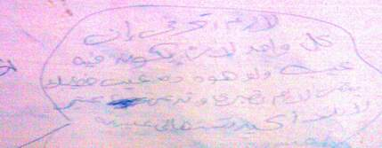

+++
title = "حبيبي.. علي باب الحمام"
date = 2007-04-17
authors = ["هالة غازي"]
aliases = ["/articles/masr-1909/"]

[taxonomies]
authors = ["hala-ghazi"]
sections = ["masr"]

[extra]
section_name = "ولاد البلد"
share_image = "/media/admins.20at.com/masr/7mam.jpg"
summary = "\"أنا مخطوبة لزميل لي في الجامعة، وهو بيحبني جدا وأنا كمان لكن هو بدأ يشك فيا علي الرغم من أنني محترمة جدا، وأحيانا يهينني بالشتيمة أو الضرب، حيث أننا عصبيين جدا"
section_slug = "masr"
section_colour = "#666666"
thumb = "/media/admins.20at.com/masr/7mam.jpg"
n_comments = 0
original_url = "http://www.20at.com:80/masr/t7kyk/5521.html"
archived = "20090822151116"
date_source = "byline/meta"
aliases_20at = ["//masr.20at.com/article.php?sid=1909", "/masr/t7kyk/5521.html"]

[extra.provenance]
original_url = "http://www.20at.com:80/masr/t7kyk/5521.html"
capture_url = "https://web.archive.org/web/20090822151116/http://www.20at.com:80/masr/t7kyk/5521.html"
capture_label = "٢٢ أغسطس ٢٠٠٩، ١٥:١١ UTC"
date_note = "من سطر التوقيع في المقال"
other_urls = ["//masr.20at.com/article.php?sid=1909"]
comments = ""
missing_images = "٣"
+++

<figure></figure>

"أنا مخطوبة لزميل لي في الجامعة، وهو بيحبني جدا وأنا كمان لكن هو بدأ يشك فيا علي الرغم من أنني محترمة جدا، وأحيانا يهينني بالشتيمة أو الضرب، حيث أننا عصبيين جدا".

"فكلمة منه علي كلمة مني تبقى حريقه وبعد كده بيطلب مني أسامحه ويصالحني ويوعدني بأنه سوف يبطل غيره وشك وبالفعل بيتغير لكن مش أوي، كل يوم يقول لي أنتِ بتبصي علي الواد ده والواد ده وأنا مش بابص على حد خالص فماذا أفعل معه؟ هل أظل في محاولة لتغييره أم ماذا أفعل بعد خطوبة عام ونصف أفيدوني؟".

"علي العلم أنني عايشه في بيت أبويه عيشه ما يعلم بيها إلا ربنا، حيث أن لي أم تعاملني معاملة مرات الأب وهذا منذ صغري، غير اخواتي خالص".

شيء لن تتوقعه.. كل ما مضى لم ترسله هذه الحائرة لبريد الجمعة أو تخاطب به أسامة منير أو حتى صديقتها، بل أنها كتبته علي باب حمام الجامعة، فأنت لا تكاد تغلق الباب حتى يواجهك فيض من الأسئلة العاطفية والاجتماعية وأيضا (.....).. فتاة مختلفة مع خطيبها وأخرى تشكي قسوة أم حبيبها التي لم توافق علي زواجهما وأخرى تسأل عن الزواج من شخص من جنسية أخرى وغيرها وغيرها..

وبعدها تظهر الإجابات وتنهال النصائح على رأس من سألت، وبنفس الطريقة.. على باب الحمام.. فمثلا السؤال السابق له العديد من الردود منها:

-لو هو بيحبك وبتحبيه هتقدري تغيريه وتخليه ما يشكش فيكي تاني.

-لازم تعرفي إن كل واحد لازم يكون فيه عيب، ولو هو ده عيب خطيبك يبقى لازم تصبري وتدعي ربنا.

تساءلت ترى ما الدافع وراء كتابة مشكلات الفتيات علي أبواب الحمامات، هل هو الكبت والحيرة أم الفراغ أم مجرد تسلية وتضييع وقت؟ وماذا لو صادفتك إحدى هذه الأسئلة هل ستتطوع وتحاول إيجاد حل لهذه المشكلات وتكتب الرد ؟ هذا ما حاولنا معرفته من خلال فتيات الجامعة أنفسهن.

<h3>عقولهن "لسعت"</h3>

إيمان عبد المقصود قالت: ما يحدث هذا (هبل بنات)، بالطبع هذا خطأ، لأن هذه الأسئلة في الغالب تتحدث عن خصوصيات ولا يمكن التعبير عنها بهذه الطريقة، ومن الأفضل للفتاة أن تحكيها لوالدتها أو صديقتها المقربة.

أما (شيماء أحمد) فأكدت أن هذا الأسلوب في التعبير عن مشكلات البنات "لا يصح" وتعتقد أن عقول البنات "لسعت"، ويفعلن ذلك كنوع من أنواع التهريج ليس إلا، ولا تتوقع أن تجيب في يوم من الأيام علي إحدى هذه الأسئلة.

<h3>موضوع فاشل</h3>

(قلة أدب) هكذا وصفت (سارة محمد) استشارات أبواب الحمامات، عندما سألتها رأيها فيها، وأضافت كنا نجد هذه الأشياء بكثرة في المدارس وأتعجب أني وجدتها أيضا في الجامعة.

وأكملت حديثها قائلة: عندما تحتار إحدى الفتيات فعليها أن تسأل صاحبتها أو أي شخص قريب منها عن حل لمشكلتها، وعبرت عن اعتقادها بأنه قد تكون واحدة من هذه المشكلات صحيحة بالفعل وصديقتها لا تدري ما الحل، أما بقية الأسئلة فهي مجرد تقليد أو تهريج أو سخرية من جانب السائلة والتي تجيب أيضا، وأعتقد أن من لها مشكلة وكتبتها بالفعل علي باب الحمام ووجدت عليها في النهاية إجابات غالبا لن تعمل بالرد المكتوب.

أما علياء محسن فقالت: هذه الأسئلة موضوع (فاشل)، ولا يصح، ويعتبر نوعا من أنواع الانحراف، وغالبا مَن تكتب مشكلتها تعاني الفراغ، ومن الأفضل لها أن تتوجه لمؤسسات اجتماعية مختصة بحل المشكلات، أو جهات معينة مختصة بذلك مثل بريد الجمعة، أو أن تحكي لأي شخص قريب منها، وأكدت أن كتابة الفتيات لهذه المشكلات يمكن أن تؤذي مشاعر غيرها من الفتيات وتضر بهن والمفروض أن يتخذ الأمن يتخذ إجراءاته ويزيل هذه الكتابة.

<h3>ليس غريبا</h3>

أنا عن نفسي لم أقرأ أبدا ما يكتب علي باب الحمام، هكذا ردت (كريستينا مجدي) على سؤالي، وهي في غاية العجب وقالت: أظن أن من تكتب هذه الأسئلة ربما تكون استشارت بالفعل أحد ولم تجد لديه الحل المقنع فاضطرت اللجوء إلى هذه الوسيلة العجيبة.

بينما أكدت (زينب سعد) أن هذا الموضوع ليس غريبا، فمن تحكي عن مشكلاتها بهذه الطريقة، ربما لم تجد أحد تستشيره في مشكلتها أو تتحدث معه، لكن هذا ليس عذرا مقبولا، فيمكنها مثلا أن تتكلم مع أسامة منير، أو مع والدتها وهي سوف تعطيها أفضل الآراء.

<h3>فضفضة</h3>

أما مني عبد الوهاب فأكدت أن ما يحدث هذا نوع من أنواع الكبت، ولا توجد وسيلة لدي من يكتبن هذا غير هذه الوسيلة للتعبير عما بداخلهن.

وقالت: أظن أنها مشكلات حقيقية تعاني منها فتيات وليس تهريجا، فالتهريج يكون بكتابة أسماء أو أعضاء (الشلة)، أما مشكلات أبواب الحمامات فأكيد حقيقية، ولكني لن أفكر أبدا في الرد عليها، وأعتقد أن من تعاني هذه المشكلات تفتقر إلى التعبير عن الرأي حتى مع أصدقائها، ولكن من الأفضل لها أن تلجأ للمختصين أو شخص حكيم تستشيره وتستمع لرأيه.

وضحكت (رشا مصطفي) عندما سألتها عن استشارات أبواب الحمامات، وقالت هذه الفتيات غير حريصات على نظافة الحمام، ولكن هذا يعتبر نوع من أنواع الفضفضة عن كبت يعانين منه، أو لديهن سرا لا يستطيعون أن يبيحوا به لأحد، ولكني لا أتصور أن أرد على مشاكلهن.

من الأفضل لهن أن يستشيروا أحد يخاف عليهن، بالإضافة إلى أنهن يعرضن أنفسهن للرأي الخاطئ.

