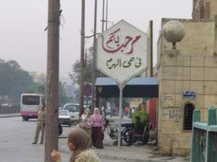

+++
title = "شارع  الهرم .. الليل وأخره"
date = 2007-05-03
authors = ["دعاء الشامي"]
aliases = ["/articles/masr-7eta-mn-baladi-5716/", "/articles/masr-n10057/", "/articles/masr-places-of-egypt-5716/"]

[taxonomies]
authors = ["doaa-elshamy"]
sections = ["masr"]

[extra]
section_name = "ولاد البلد"
share_image = "/media/admins.20at.com/masr/haramst02.jpg"
summary = "علاقتي به قبل شهر من الآن لم تتعد كونه الشارع الذي أفضله للحصول على ساعتين من المتعة الكاملة في إحدى دور السينما المنتشرة على طوله، أو شراء حذاء من إحدى فاترينا"
section_slug = "masr"
section_colour = "#666666"
thumb = "/media/admins.20at.com/masr/haramst02.jpg"
n_comments = 8
original_url = "http://20at.com/masr/places-of-egypt/5716-2009-06-10-09-28-29.html"
archived = "20100105141243"
date_source = "byline/meta"
aliases_20at = ["//masr.20at.com/newarticle.php?sid=10057", "/masr/t7kyk/5716.html", "/masr/7eta-mn-baladi/5716-2009-06-10-09-28-29.html", "/masr/places-of-egypt/5716-2009-06-10-09-28-29.html"]

[extra.provenance]
original_url = "http://20at.com/masr/places-of-egypt/5716-2009-06-10-09-28-29.html"
capture_url = "https://web.archive.org/web/20100105141243/http://20at.com/masr/places-of-egypt/5716-2009-06-10-09-28-29.html"
capture_label = "٥ يناير ٢٠١٠، ١٤:١٢ UTC"
date_note = "من سطر التوقيع في المقال"
other_urls = ["//masr.20at.com/newarticle.php?sid=10057", "/masr/7eta-mn-baladi/5716-2009-06-10-09-28-29.html", "/masr/places-of-egypt/5716-2009-06-10-09-28-29.html"]
comments = "٨"
missing_images = "١٠"
+++

<figure></figure>

علاقتي به قبل شهر من الآن لم تتعد كونه الشارع الذي أفضله للحصول على ساعتين من المتعة الكاملة في إحدى دور السينما المنتشرة على طوله، أو شراء حذاء من إحدى فاترينات محلاته الكثيرة التي تبهرك بألوانها الزاهية وأسعارها المعقولة..هذا فضلا عن كونه الشراع التوأم لشارعنا السابق "فيصل"..إنه شارع "الهرم".

لست كغيري من زواره فلم تربطني به رحلة سياحية ولا جولة في البازارات المنتشرة على جانبيه ولا حتى أهراماته الثلاثة التي أصبحت أراها أربعاً من بلكونة شقتي الضيقة وليس ثلاثة فقط، مما جعل زوجي يقول على سبيل المزاح أنه هرم رابع بناه الأطفال الفراعنة أثناء لعبهم بالأحجار الصغيرة !!

"شارعنا" الآن أمر على فتريناته كل يوم في الذهاب والعودة، لأكتشف كل يوم مساحة منه تستحق الزيارة أو لافته تستحق التصوير..

<h3>منور بناسه</h3>

ليس كغيره من الشوارع يضج بالحياة خلال ساعات النهار ويدخل في سبات عميق ليلا، كما أنه يختلف كليا عن توأمه الرابض على الجانب الأخر..والذي يحمل اسم الحاكم العربي الراحل الذي ساهم في تجديده "الملك فيصل"..

شغال ليل ونهار وكل وقت وله ناسه، فساعات النهار تخص عامة الشعب اللاهثين وراء لقمة عيشهم من ميني باص الجمعية إلى ميكروباص مؤسسة دائري، إلى أتوبيس النقل العام، غارقين في رائحة عرقهم وهمومهم اليومية التي تكبس على أنفاسهم مع أول "شعلقة" على باب "الميني باص"، فيدخل كل منهم في همه ويعاني من سرحان طويل بطول مشواره ولا ينتبه إلا على صوت التباع "الأجرة يا أستاذ" فيدس يده في جيبه ويخرجها بنصف جنيه قديم أو جديد متفرقش معاه..

هؤلاء ناس النهار، يبدأ يومهم في حوالي السابعة صباحا هرباً من الزحام وينتهي في السادسة مساء، وفي تمام التاسعة لن تجد أي من هؤلاء المتعبين في طرقاته فلا يحملون ثمن تذكرة سينما في إحدى دور عرضه إلا تلك السينما الصيفي العارية من السقف والتي تعرض فيلمين في حفلة واحدة، ولا يفضلون السهر كثيرا لأنهم في حاجة إلى الاستيقاظ مبكرا ليجاروا الطاحونة التي يعيشون فيها..

<h3>الليل وناسه</h3>

بعد ساعات قليلة تختلف تماما التركيبة البشرية في الشارع.. لتجد ناس آخرين يرتادوا أماكن تصميمها غريب هندسياً لا تعرف ما هي، فقط هي مجموعة من الأحجار المتراصة ولها باب كبير للدخول وأخر صغير في الناحية الأخرى للخروج، مبنى لا يشبه العمارات ولا الشقق السكنية، ولا تستطيع تمييزه أبدا لو كنت من أصحاب الحياة نهارا ..

أما إذا أردت أن تعرف ماذا يحدث بالداخل فعليك أن تنتظر ساعات الليل، ولن تتعب كثيرا في الاكتشاف من بعيد لبعيد فهناك أضواء شديدة وواجهات مزدحمة بالألوان المبهرة واللافتات الكبيرة التي تحمل في الغالب صورة فنان"مغني يعني" أو راقصة، وربما "بانر" يحمل خليط من صورهم جميعا..

أيامي الأولى في الشارع لم أتبين طبيعة بعض هذه المباني إلا بعد أن ذهبت للسينما حفل منتصف الليل والذي انتهى قرب الفجر، وقتها فقط عرفت إنها حياة الليل وآخره..

سيارات فخمة على الصفين تجعل الشراع ضيق بشكل غريب وكأنه شارع آخر غير الذي عرفته بالنهار، وموسيقى مرتفعة لا تسمعها ولكنك تشعر بها لتنعش في مخيلتك كل ما شاهدته في الأفلام العربي عن طبيعة تلك الأماكن التي تنقلب بعد ساعات إلى دار للملذات وقلب الكراسي والترابيزات، ومعها تقلب لكل أصول الحياء والأدب واستبدالها بصوت شبعان عبد الرحيم الذي يقف كل ليلة على باب كازينو الليل، أو صورة للراقصة "منتهى"، أو بانر كبير لفرقة الأستاذ سعد الصغير بجوار إحدى الراقصات يلمع على باب كازينو الأندلس..

حياة لم أشاهدها عن قرب، ولكنها لا تنتهي في الغالب إلا مع ساعات الصبح الأولى شاهدت نهايتها في أحد الأيام عندما غادرت منزلي مبكرا في السادسة تقريبا لأشاهد هذه السيارات الفخمة وهي تغادر مقارها الحصينة، وعمال النظافة ينظفون المكان من قاذورات الليلة المنتهية استعدادا للنوم أو استعدادا لاستقبال قاذورات جديدة!

<h3>شارعنا كلنا</h3>

لسنا وحدنا وزوار الليل من نسكن هذا الشارع الطويل ولكن هناك من سبقونا في إعماره منذ آلاف السنين هناك رابضون في نهايته وكأنهم يشاهدوننا كشريط سينمائي يؤديها أبطال من أحفادهم الصغار..الفراعنة ومقابرهم وكنوزهم المنهوبة التي يزورهم كل البشر من كل أنحاء الدنيا يسكنون أيضا هنا في نهاية شارع الهرم..

"هو إيه اللي في الأهرامات بيعجبهم يعني شوية أحجار جنب بعض؟".. السؤال ظل يؤرقني أكثر من أربع سنوات كاملة قضيتها في القاهرة دون أن أفكر في زيارة الأجداد العظام، واكتشفت إنني لست وحدي من يطرحه بل أغلب المصريين لم يفكرون في زيارتهم ولا حتى مجرد إلقاء السلام عليها.. ولم يهتموا كثيرا بنية رفعهم من عجائب الدنيا السبع لأنهم يرون في شارعهم عجائب أخرى غير تلك التي تعلنها الدول الكبرى!

شارع الهرم سيبقى" شارعنا" لعدة سنوات قادمة لن تتعدى أصابع اليد الواحدة هي فترة عقد الإيجار، وإذا استطعت أن يصبح شارعنا إلى الأبد فلن أفرط فيه أبدا لأنها فرصة للاستمتاع بالسينما والملابس الرخيصة والأحذية المميزة ومجاورة الأجداد في آن واحد، والفرصة الأكبر هي التخلص من ازدحام شارع فيصل والتمتع بجمال الأهرامات "الأربعة" من بلكونة منزلنا.

كازينو باريزيانا

إلى الهرم

بداية حي الهرم

إلى المناطق الأثرية

بازار سياحي

شارع الهرم في المغربية

الأهرامات من بلكونتنا

الأهرامات.. الأربعة

كازينو الليل .. بالنهار

كازينو الأندلس

