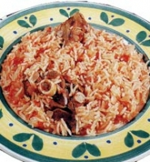

+++
title = "الكبسة السعودية"
date = 2005-12-20

[taxonomies]
authors = []
sections = ["ramadan"]

[extra]
section_name = "رمضان"
share_image = "/media/admins.20at.com/heba/kapsa.jpg"
summary = "تشتهر كل بلد بوجبتها التقليدية وطبقها الخاص مثل طبق الكشري في مصر والكسكسى في المغرب والسمك والبطاطا في بريطانيا.."
section_slug = "ramadan"
section_colour = "#6A3D9A"
thumb = "/media/admins.20at.com/heba/kapsa.jpg"
n_comments = 0
original_url = "http://ramadan.20at.com:80/article.php?sid=77"
archived = "20060221172949"
date_source = "first-capture"
aliases_20at = ["//ramadan.20at.com/article.php?sid=77"]

[extra.provenance]
original_url = "http://ramadan.20at.com:80/article.php?sid=77"
capture_url = "https://web.archive.org/web/20060221172949/http://ramadan.20at.com:80/article.php?sid=77"
capture_label = "٢١ فبراير ٢٠٠٦، ١٧:٢٩ UTC"
date_note = "تاريخ أول لقطة في الأرشيف (لا يوجد تاريخ في المقال)"
other_urls = []
comments = ""
missing_images = ""
+++

<figure></figure>

تشتهر كل بلد بوجبتها التقليدية وطبقها الخاص مثل طبق الكشري في مصر والكسكسى في المغرب والسمك والبطاطا في بريطانيا..

كذلك تشتهر السعودية بأكلة الكبسة والتي لاغني عنها عند السعوديين بل تعتبر من أهم الوجبات اليومية لديهم.

-كيلو لحم ضأن بالعظم.

-أربع حبات طماطم وأربع بصلات.

-ثلاث أكواب أرز.

-ثلاث ملاعق كبيرة زيت نباتي خالي من الكلسترول.

-أربع أعواد قرفة وأربع حبات ليمون وستة حبات حبهان وخليط من البهارات حسب الرغبة.

الطريقة : 

يقطع اللحم إلى قطع متوسطة أو صغيرة حسب الرغبة وينظف تنظيفا كاملا. يوضع الزيت في إناء الطهي على نار هادئة لمدة ثلاث دقائق ثم يضاف إليه مقشور البصل .

ثم تقطع الطماطم إلى قطع صغيرة فيضاف اللحم ويقلب المقدار حتى يحمر اللحم من جميع الجهات ثم تضاف قطع الطماطم ويغطى إناء الطهي ويترك على نار هادئة.

ويتبل اللحم ويضاف إليه الليمون الجاف والحبهان والقرفة ومقدار نصف لتر ماء.

بعد أن يغلي الماء يضاف إليه الأرز ثم تترك على نار هادئة حتى ينضج الأرز.

وبالهنا والشفا

<h3>20/10/2005 </h3>
