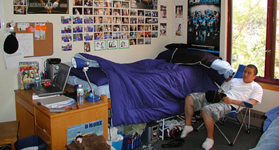

+++
title = "رمضانيات شاب كسلان"
date = 2005-12-20

[taxonomies]
authors = []
sections = ["ramadan"]

[extra]
section_name = "رمضان"
share_image = "/media/admins.20at.com/mariam/kaslan.jpg"
summary = "بصراحة أحسن حاجة في رمضان بالنسبة إلي هي... النوم!"
section_slug = "ramadan"
section_colour = "#6A3D9A"
thumb = "/media/admins.20at.com/mariam/kaslan.jpg"
n_comments = 0
original_url = "http://ramadan.20at.com:80/article.php?sid=83"
archived = "20060129134914"
date_source = "first-capture"
aliases_20at = ["//ramadan.20at.com/article.php?sid=83"]

[extra.provenance]
original_url = "http://ramadan.20at.com:80/article.php?sid=83"
capture_url = "https://web.archive.org/web/20060129134914/http://ramadan.20at.com:80/article.php?sid=83"
capture_label = "٢٩ يناير ٢٠٠٦، ١٣:٤٩ UTC"
date_note = "تاريخ أول لقطة في الأرشيف (لا يوجد تاريخ في المقال)"
other_urls = []
comments = ""
missing_images = "٣"
+++

<figure></figure>

بصراحة أحسن حاجة في رمضان بالنسبة إلي هي... النوم!

النوم الثقيل المتواصل، وليس أي نوم، والميزة أن دوام الجامعة يقل وبالتالي يصبح عندي وقت أطول لممارسة نشاطي أو بالأحرى.. كسلي المفضل.

ورغم ذلك, لا أبالي بالذهاب إلى الكلية معظم الأيام وأفضل التراخي "الأنتخة" فوق جزيرة القطن(السرير).

<h3>نوم.. نوم.. نوم..!</h3>

ومع أنني لست مدخناً, إلا أنني أعاني بشدة خلال ساعات الصيام بسبب اشتياقي للشاي والقهوة الذين أدمنهما. وبالتالي لا أستطيع أن أمارس أي عمل يتطلب قدراً من التركيز في نهار رمضان. والمشكلة الكبرى أنه بعد الإفطار وانتفاء حجة الحرمان من المنبهات، أجد نفسي وقد غلبني الخمول والنعاس أيضاً بسبب إفراطي في تناول الطعام، فأعود مرة أخرى للنوم.

طبعاً وكما قلت من قبل لا أذهب إلى الكلية إلا قليلاًً في رمضان، أما المذاكرة فأكاد أنساها خلال الشهر الكريم. وهذا ليس حالي فقط بل حال معظم معارفي وأصدقائي، وأحمد الله أن رمضان بعيد عن موسم الامتحانات.

ولا أدري كيف كان حالي عندما كنت في المرحلة الإعدادية حيث كانت امتحانات نصف العام تتم خلال شهر الصيام، لعلني كنت أكثر نشاطاً مما أنا عليه الآن. والطريف أيضاً أنني لا أتوقف عن المذاكرة فحسب بل عن قراءة الجرائد أيضاً إلا فيما ندر، وأكتفي بمتابعة الأخبار عن طريق الإطلاع على المواقع الإخبارية على النت في عجلة.

<h3>السلطان حسن.. أجمل تراويح</h3>

أما أجمل شئ يميز شهر رمضان عن بقية شهور السنة هي صلاة التراويح، ولكن ليس في أي مسجد... فأنا لا أستطيع الاستمتاع بصلاة التراويح إلا في مسجد السلطان حسن بمنطقة القلعة وسط القاهرة، فالصلاة هناك لها طعم مختلف تماماً والشيخ الذي يؤمنا في الصلاة يتمتع بصوت عذب يصعب أن تجد مثيلاً له في أي مسجد آخر.

كما أن التصميم المعماري نفسه غاية في الروعة. فالمسجد يتكون أساساً من أربعة محاريب ذات ارتفاع شاهق وباحة كبيرة تصل بين أجزاء المسجد، ويؤدي العلو الشاهق للمسجد إلى تردد صوت الإمام بطريقة تضفي على صوته رونقاً جميلاً، إلا أن صدى الصوت يؤدي أحياناً إلى بعض المشاكل, فصوت الأطفال وهم يلهون في المسجد أو وهم يبكون يتردد بشكل كبير ويشتت تركيز المصلين.أما أكثر ما يعجبني هناك فهو صوت ماء الوضوء في أنحاء المسجد الذي يعطي المرء إحساساً أنه بجوار نهر أو شلال.

وكانت عادتي العام الماضي أن أتوجه بعد أداء الصلاة في مسجد السلطان حسن إلى محل العصير المجاور الذي يقدم سوبيا مميزة جداً، ولكنني حزنت هذا العام حين وجدت أن المحل قد أغلق وحل محله محل إطارات..!!

أما صلاة التهجد, فأفضل أن أؤديها في مسجد حراء بالمقطم، حيث أجد الجو هناك ملائماً جداً للخشوع في الصلاة، فالإضاءة خافتة، وصوت الإمام عذب وهادئ، أما المسجد نفسه فلا هو مزدحم فيشتت تركيزي ولا خاو فأنام وأنا أصلى. وغالباً، لا يطيل الإمام في الصلاة فلا أمل أو أتعب أثناء ركعات التهجد الأربع.

<h3>خشاف وقطايف وزبادي</h3>

وبالنسبة للطعام، فشهر رمضان هو أكثر الشهور التي آكل فيها. فأنا أقيم في منزلي مع أخوتي الجامعيين مثلي دون أبي وأمي لظروف سفرهم للخارج فأعاني كثيرا في مسألة الطعام. أما في رمضان, فتهل علينا العزائم والولائم من كل صوب خصوصاً من ناحية أقاربي، فنادراً ما أتناول إفطاري في المنزل.

وأحب دائما أن أكسر صيامي على كوب من مشروب "الخشاف" المكون من تمر ومشمش وتين وزبيب وعصير حلو.. ما أحلاه من مشروب. ويا سلام على " الحلو" بعد الإفطار.. بدايةً بالكنافة والقطايف مروراً بقمر الدين ولقمة القاضي وغير ذلك الكثير. ودائماً أحب أن أتسحر بالزبادي، وألاحظ أن كثيراً من الناس يحبون ذلك أيضاً بدليل أنني أجد في ثلاجة السوبر ماركت أضعاف كمية الزبادي عن الأشهر العادية.

<h3>يا زحمة رمضان.. هِلِّي!</h3>

ولكن الدنيا ليست وردية على طول الخط ولا يخلو رمضان من مشاكل. وكبرى مشاكله هي الإزدحام الرهيب في الشوارع سواء قبل الإفطار أو بعد العشاء. وتتفاقم المشكلة كلما اقترب العيد حيث تتردد العائلات على المحلات لشراء ملابس العيد لأطفالهم. وأنا عن نفسي أحاول تجنب النزول من بيتي ليلاً في رمضان. إلا أنني آخذ نصيبي من الزحام ظهراً في الأيام القليلة التي أذهب فيها للجامعة.

فحين أتأخر في الكلية إلى ما بعد الواحدة والنصف ظهراً , أواجه صعوبة بالغة في العودة إلى المنزل حيث يتحول ميدان العباسية إلى لوحة سريالية تتداخل فيها السيارات والحافلات مع مئات المشاة ليتحول الأمر إلى عذاب مقيم للكل. فيستغرق مثلاً وصول الميكروباص الذي أركبه، إن وجدته أصلاً، إلى طريق صلاح سالم أكثر من ربع ساعة في حين أنه يقطع تلك المسافة في أقل من 30 ثانية في الظروف المعتادة.

<h3>أحسن الشهور </h3>

وختاماً أستطيع أن أقول أن رمضان في جميع الأحوال هو أحسن شهور السنة بالنسبة إلي، إلا أنني لا أتمنى أن يكون العام كله رمضان، وإلا سأقع في مشكلة كبيرة لأنني لن أذاكر ولن أفلح. وخاصةً أن امتحانات منتصف منتصف العام (Mid-Term) ستبدأ بعد العيد رأسا...!

<h3>معاذ الزغيمي</h3>

<h3>22/10/2005 </h3>

نور ,

sudanees ,

عامل بجد ,

