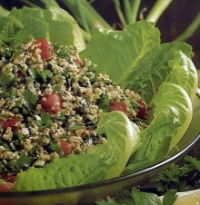

+++
title = "تبولة لبناني"
date = 2005-12-20

[taxonomies]
authors = []
sections = ["ramadan"]

[extra]
section_name = "رمضان"
share_image = "/media/admins.20at.com/mariam/taboula1.jpg"
summary = "عدنا إليكم من جديد و لكن هذه المرة مع المطبخ اللبناني..."
section_slug = "ramadan"
section_colour = "#6A3D9A"
thumb = "/media/admins.20at.com/mariam/taboula1.jpg"
n_comments = 0
original_url = "http://ramadan.20at.com:80/article.php?sid=84"
archived = "20060221173023"
date_source = "first-capture"
aliases_20at = ["//ramadan.20at.com/article.php?sid=84"]

[extra.provenance]
original_url = "http://ramadan.20at.com:80/article.php?sid=84"
capture_url = "https://web.archive.org/web/20060221173023/http://ramadan.20at.com:80/article.php?sid=84"
capture_label = "٢١ فبراير ٢٠٠٦، ١٧:٣٠ UTC"
date_note = "تاريخ أول لقطة في الأرشيف (لا يوجد تاريخ في المقال)"
other_urls = []
comments = ""
missing_images = "١"
+++

<figure></figure>

عدنا إليكم من جديد و لكن هذه المرة مع المطبخ اللبناني... 

سنقدم اليوم وصفة لسلاطة شهية وسهلة للغاية ومكوناتها في متناول الجميع، كما سنقدم بعض الأفكار و النصائح المتعلقة بالطهي والمطبخ و التي نرجو أن تكون خير عون لكم. 

<h3>تبولة لبناني </h3>

* ثمرة طماطم كبيرة.

* 3 حبات بصل أخضر.

* حزمتين بقدونس.

* حزمة نعناع أخضر (ممكن نعناع مجفف).

* نصف كوب برغل.

* نصف فنجان صغير ثوم مطحون.

* 3 ملاعق طعام زيت زيتون.

* ملح.

* فلفل أسود.

* خس.

* ربع كوب عصير ليمون (زي اللي بتشربه و أنت مريض "بدون سكر" ).

<h3>( الطريقة) :- </h3>

· يتم نقع البرغل في ماء ساخن لمدة ساعتين (ياريت يكون أول النهار علشان نلحق نفطر!) ثم يصفى من الماء و يترك جانباً.

· يتم فرم كلاً من البقدونس و النعناع و البصل سوياً.

· تقطع الطماطم قطعاً صغيرة للغاية بعد نزع البذر و يضاف إليها البقدونس و النعناع و البصل و الثوم المفروم.

· يضاف البرغل، زيت الزيتون، الفلفل الأسود، الملح، و عصير الليمون ثم يقلب الخليط جيداً.

· يوضع في طبق التقديم مع تزيينه بالخس و شرائح الليمون أو أي خضروات تفضلونها.

وبألف هنا وشفا...

<h3>نصائح من داخل المطبخ</h3>

ما هي الطريقة المثلى لغسل الصحون ؟

ألا تغسل بماء راكد كانت منقوعة فيه، و تغسل بماء دافئ نقي وسائل صحون رائحته عطرة، ثم تترك لتجف في الهواء حتى لا تصبح رائحتها كريهة، و تنشف بفوطة نظيفة قبل وضعها في أماكنها إن أمكن.

<h3>كيف نتخلص من بواقي الطعام الملتصق بالأواني؟</h3>

عن طريق نقعها في ماء ساخن مع إضافة ملعقة كبيرة من بيكربونات الصوديوم.

<h3>كيف نزيل رائحة الطعام أو الطبخ عن أيدينا (خاصة اللحوم و الأسماك)؟</h3>

· بالنسبة لرائحة الطبخ تفرك اليدين بالخل.

· بالنسبة لرائحة البصل تفرك اليدين بالبقدونس.

· بالنسبة لرائحة الثوم تفرك اليدين بتفل القهوة.

· بالنسبة لرائحة السمك تفرك اليدين بالليمون.

ثم تغسل اليدين والأظافر بعد ذلك جيداً بصابون رائحته حلوة وقوية.

يا رب التبولة تعجبكم والنصائح تفيدكم... وقولوا لنا إيه الأخبار؟!

<h3>22/10/2005 </h3>
