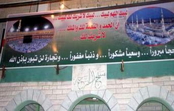

+++
title = "على ضربات الدفوف .. عاد الحجيج"
date = 2008-12-17
authors = ["رنا خموس"]
aliases = ["/articles/20at-religious-10746/"]

[taxonomies]
authors = ["rana-khmos"]
sections = ["salamo-3lakom"]

[extra]
section_name = "السلام عليكم"
share_image = "/media/masr.20at.com/currentarticleassets/marwah/7ageg.jpg"
summary = "على وقع ضربات الدف وأصوات المنشدين، يتم استقبال حجاج بيت الله الحرام في فلسطين، حيث يردد البعض الأناشيد، أو تردد نساء عائلات الحجاج بعض الأغنيات الشعبية.."
section_slug = "salamo-3lakom"
section_colour = "#1A661A"
thumb = "/media/masr.20at.com/currentarticleassets/marwah/7ageg.jpg"
n_comments = 0
original_url = "http://20at.com/20at/religious/10746.html"
archived = "20100105183814"
date_source = "byline/meta"
aliases_20at = ["/salamo-3lakom/10746.html", "/20at/religious/10746.html"]

[extra.provenance]
original_url = "http://20at.com/20at/religious/10746.html"
capture_url = "https://web.archive.org/web/20100105183814/http://20at.com/20at/religious/10746.html"
capture_label = "٥ يناير ٢٠١٠، ١٨:٣٨ UTC"
date_note = "من سطر التوقيع في المقال"
other_urls = ["/20at/religious/10746.html"]
comments = ""
missing_images = ""
+++

<figure></figure>

على وقع ضربات الدف وأصوات المنشدين، يتم استقبال حجاج بيت الله الحرام في فلسطين، حيث يردد البعض الأناشيد، أو تردد نساء عائلات الحجاج بعض الأغنيات الشعبية..

أم كمال، من نابلس، كانت تنشد بصوتها الصداح "الحجي نزل البحر بايدو كيلة.. والحمد لله رجع سالم لها العيلة" وهي تقبل والدتها العائدة من بيت الله الحرام بعيون تملئها دموع الفرح، قائلة: "لطالما تمنت والدتي التي تبلغ من العمر 75 عاما أن تقوم بأداء مناسك الحج قبل موافاتها المنية، وها هو اليوم يتحقق حلمها، ونحمد الله على ذلك حمدا كثيرا وعودتها سالمة".

"بشرى لنا نلنا المنى .. زال العناء وأوفى الهنا.. والدهر أنجز وعده والبشر أضحى معلنا.. في روضة الهادي الشفيع وصاحبيه والبقيع.. ويا شمس طيبي باللقاء ويا نفس قري أعينا.. هذا زمان المصطفى..بشرى لنا"..

كانت تلك أنشودة سارة التي علت في حفل استقبال النسوة لعائلة الحاجة أم وليد، والأخيرة تصف لنا رحلتها بالفرحة كبيرة، حيث يتجرد فيها الإنسان من معاني الحياة جميعها ليكون في بين يدي ربه، خاضعا له بكل جوارحه وحواسه، "فهي رحلة لا تنسى ولها طعم خاص، كما أن استقبالنا بعد العودة له طعم آخر فنكن حاملين بشائر ملاقاة نبينا الكريم".

<h3>تمور وإضاءة</h3>

صورة أخرى ما زالت ترسم في فلسطين في حفل استقبال حجاج بيت الله الحرام، يوزع فيها الأطفال مرتدين الدشاديش البيضاء التمور والمسابح، وتشعل الأضواء ليزين بها ليال بيوت الحجاج أعلانا منهم باستقبال المهنئين لتتلألأ سماء ليل مدننا وإعلان انتهاء موسم آخر من التوبة والمغفرة.

فيقول الحاج أبو يحيى: "للحج نكهته الخاصة في فلسطين فهناك عادات اجتماعية يتم القيام بها للحجاج بجلب الفرق الدينية للنشيد في حفل استقبال الحجاج، ويوزع التمر وبعض الضيافة على المهنئين ويكون فرصة للتواصل، ويتم إضاءة المنازل طوال فترة استقبال المهنئين، فيما يعلق على المنازل لافتات التهنئة بالعودة وصور الحجاج".

أما الحاجة أم سامي، فقد ابتاعت قبل ذهابها إلى الحج السجاجيد والمسابح من مدينتها وبعض الهدايا للأقارب والجيران، تقول: "الحجاج لا يستطيعون حمل جميع الأغراض سوى ماء زمزم الذي نقوم بجلبه معنا من الحج، وقبل الحج نقوم بشراء ما يلزم من ضيافة معهودة من هنا، حتى لا نبذل جهد كبير ولصعوبة حمل الأغراض من مكة إلى هنا".

سامي قادري، أحد تجار المدينة، يقول: "موسم الحج رزق آخر لنا، فيه يقوم الحجاج بشراء مستلزمات استقبال المهنئين بعد عودتهم إلى أرض الوطن من تمر ومسابح وسجاجيد وعباءات وملابس وغيرها، فيكون هناك انتعاش تجاري نحظى به في هذا الموسم المبارك".

<h3>سعف وشجر</h3>

في مدينة الخليل، نجد أيضا بعض الطقوس، فقد استقبلت المدينة حجاجها بسعف النخيل والسرو، فكانت مداخل بيوت الحجاج قد زينت بسعف وشجر السرو احتفالا بعودتهم..

خالد، أحد أبناء الحاج أبو مصطفى، التقيناه وهو يخط على لافتة عبارة "حجا مبرورا وسعيا مشكورا" لإعلان استقبال والديه، موضحا أنه يفعل ذلك إلى جانب تزيين مداخل المنازل تيمنا بالرسول عليه الصلاة والسلام عندما استقبله أهل المدينة بسعف النخيل.

