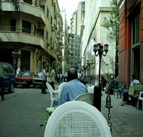

+++
title = "عيال أخلاقية..!"
date = 2009-03-16
authors = ["البراء أشرف", "وانا مالي"]
aliases = ["/articles/20at-religious-11589/"]

[taxonomies]
authors = ["elbaraa-ashraf", "wana-mali"]
sections = ["salamo-3lakom"]

[extra]
section_name = "السلام عليكم"
share_image = "/media/masr.20at.com/currentarticleassets/borsac.jpg"
summary = "ماذا يعني أن تكون \"عيلاً أخلاقياً\"؟."
section_slug = "salamo-3lakom"
section_colour = "#1A661A"
thumb = "/media/masr.20at.com/currentarticleassets/borsac.jpg"
n_comments = 2
original_url = "http://20at.com/20at/religious/11589-2009-05-09-10-28-18.html"
archived = "20100105183235"
date_source = "byline/meta"
aliases_20at = ["/salamo-3lakom/11589.html", "/salamo-3lakom/11589-2009-05-09-10-28-18.html", "/20at/religious/11589-2009-05-09-10-28-18.html"]

[extra.provenance]
original_url = "http://20at.com/20at/religious/11589-2009-05-09-10-28-18.html"
capture_url = "https://web.archive.org/web/20100105183235/http://20at.com/20at/religious/11589-2009-05-09-10-28-18.html"
capture_label = "٥ يناير ٢٠١٠، ١٨:٣٢ UTC"
date_note = "من سطر التوقيع في المقال"
other_urls = ["/salamo-3lakom/11589-2009-05-09-10-28-18.html", "/20at/religious/11589-2009-05-09-10-28-18.html"]
comments = "٢"
missing_images = ""
+++

<figure></figure>

ماذا يعني أن تكون "عيلاً أخلاقياً"؟.

في وقت مثل هذا، يمكن معرفة العيل الأخلاقي بسهولة، وعبر عدد من الملاحظات الأساسية السهلة، التي تحتاج إلى كثير من الحرص، بحيث لا تخلط بين "العيل" و"المستعيل"، أو بين "الأخلاقي" وشخص تربطه بالأخلاق "خلقه الضيق".

العيل الأخلاقي يجلس في وسط البلد، على البورصة غالباً، يحتاج وقتاً طويلاً لمعرفة أن وسط البلد ليست مجرد ممراً قصيراً بجوار البنك المركزي، يربط بين شوارع واسعة لا يعرف اسمها.

جدير بالذكر أنه ظن لفترة طويلة أن ممر "البورصة" ضيقاً، وغير مطروق، ويكاد يضفي على الجالسين فيه صفات "غير أخلاقية" مشبوهة، لكن بمروره مصادفة بـ"أفتر إيت" – دون أن تكون لديه نية مبيتة لذلك المرور -، أدرك الفتى رحابة "البورصة" وسعتها، وكونها لا تزال تسمح لتسعة من زملاء العمل بالجلوس في حلقة كانوا يظنون أنها ضيقة، حتى عرف ما معنى أن تكون في وسط البلد مقاهي تحمل اسم "الخن" أو "التكعيبة".

"الأخلاقي" يشتري الجرائد في طبعاتها المسائية كل ليلة، ويجلس في ركن مضيء ويقرأ باهتمام، دون تعليقات ربما، تحسباً لأن يكون بين الجالسين زميلة جديدة، يمكن خدش حياءها بألفاظ نابية تنتمي للغة الثلاثة أحرف.

وحين نتحدث عن شراء الجرائد، فإنا نقصدها كلها، اليومية بالتحديد، المصري والدستور والبديل بترتيب التصفح، ثم "الشروق" لكونها الأحدث، واصل الأخلاقي شراء البديل في وقت لم يكن صحفيي البديل يعرفون فيه إن كانت جريدتهم طبعت هذا المساء، بقناعة تامة أن الطباعة لا يشترط أن ينبني عليها توزيع.. الأخلاقي يؤمن بالقضية بعنف، يقسم باسم خالد البلشي أن الجريدة تستحق أن تشترى، وقد صدقه بعض الزملاء غير الأخلاقيون بعدما لاحظوا ارتفاع ملحوظ في مستوى الجريدة في الشهور الأخيرة.. جدير بالذكر أن بعض الأخلاقيين يعملون أصلاً في جريدة البديل.

والأخلاقي يواظب على الصلاة، هو لا يعرف على وجه التحديد كيف يمكن المحافظة على الصلاة وسب الدين في الوقت ذاته. لكن المسجد متوسط الحجم في نهاية ممر البورصة يسمح بآداء الصلوات في الأوقات المستقطعة بين فقرات سب الدين المسائية اليومية مع زملاءه غير الأخلاقيين جلساء البورصة.

والأخلاقي يأكل من "القزاز"، يطلب "كبدة بانية" و"شوربة عدس بالزبدة" و"بوم فريت"، ويجلس للأكل برأس منخفضة تجاه الأرض، فهو لا يزال متذكراً لنص ديني قديم – على الغالب حديث شريف – يذكر فيه المجاهر بالأكل بكونه غير آهل للثقة أو الشهادة في المحاكم.

والأخلاقي لا يقبل الزميلات، لكنه يعرف جيداً ما يستطيع أن يفعله مع كل واحدة منهن، يعلم حدود اتساع "أفق" كل زميلة – هو يسميه أفق، لكن زملاؤه غير الأخلاقيين يطلقون عليه أسماء أخرى.

الأخلاقي يعرف أن "سعاد" قد تصحبه للمنزل (منزلها بالطبع)، وأن "سناء" ترغب فيه "عاطفياً فقط"، وأن "سارة" لا تهتم له قدر اهتمامها بالمنصب الذي يشغله في الموقع الإليكتروني الذي يعمل به محرراً أو ما شابه.. هو يعرف كل هذا وأكثر، لكنه يفضل أن يتزوج من فتاة لا يبدأ اسمها بحرف السين، وأن تكون محجبة أو من أسرة متدينة "غير إخوانية".

والأخلاقي يحظى بصداقات مع الجميع، عفواً، لا يمكن أن نسمي تلك العلاقات صداقات، يمكن فقط أن نقول أن الغرباء قد يجدون فيه بعض اللطف، باعتبار أنه لا يدخن السجائر، ولا يقبل الفتيات، ولا يصدر شخيراً متواصلاً بسبب وبدون.

والأخلاقي لا يشرب، لا يرقص، لا يرتدي سلسلة ذهبية في عنقه لا يلبس البوكسر ولا يرتدي حذائاً أحمر ولا شراباً قصيراً ولا جينزاً ساقطاً. كما أنه يرتدتي نضارة، ويضع جيلاً على شعره، ويسرحه كل يوم، ويقصه كل شهر ويحلق ذقنه كل أسبوع.. أغلب الأخلاقيين يذهبون للحلاق بانتظام.. ويهتمون لأمر أنفسهم.

والأخلاقي يستخدم المعطرات، ويضع مزيلاً للعرق، ويتردد في مواجهة صديقه – غير الأخلاقي – بفظاعة الرائحة القادمة مما بين رجليه، وتحت إبطيه.

والأخلاقي يحمل كاميرا الديجيتال، ولديه مدونة، ويذهب إلى ساقية الصاوي ويستمع لفرقة اسكندريلا ويحفظ بعض أغنيات فيروز كراوية ويشتري شريط وجيه عزيز ويحمل أغنيات سعاد ماسي من مواقع الإنترنت.

والأخلاقي يشاهد أفلام الأوسكار، ويدخل للسينما بانتظام، ويحب محمد سعد، ولا يجد في دخول "مبروك أبو العلمين حمودة" أمر مشين.

والأخلاقي بدين، لا يرتدي سلسلة ذهبية، ولا حظاظة بلاستيكية، ولا تلاحقه الشائعات، ولا تدور شبهات حول كونه شاذ جنسياً أو مدمن للحشيش.

والأخلاقي مندهش، يستمع للجميع، ويحتفظ لنفسه بتعليقات ختامية يفرغها بينه وبين نفسه في حمام بيتهم السيراميكي، ويسأل نفسه عما إذا كانت الحياة بالشكل الأخلاقي هي الأنسب فعلاً في مكان مثل وسط البلد؟.

والأخلاقي يجيب على الأسئلة بأجوبتها، لم يحدث أن سئل أخلاقي عن حاله فقال "بحاول أكون كويس"، أو "بعافر مع الدنيا"، أو "اقرأ لميلان كونديرا وأشعر بخفة كائني الذي أوشك أن يطير".. تلك الإجابات لا تناسب شاب أخلاقي أصيل.. يجيب بواحدة من إجابتين.. "كويس" أو "زعلان شوية".. وتنتهي الإجابة طالما لم توجه إليه المزيد من الأسئلة.

وهو يستخدم الفيس بوك معظم الوقت، ويغير في حالته كل يوم، مستخدماً أجزاء من أبيات شعرية معروفة، أو كوبلية في أغنية شعبية، أو إفيه بفيلم كوميدي.. لم يغير الأخلاقي اسمه على فيس بوك للعربي، يفضله إنجليزياً، ويضع صوراً لنفسه مع أصدقاؤه وعائلته، لكنه يحذف صورة له إلتقطتها أخته له، وهو يحتضن دبوب.. فالأخلاقي ليس بيضاوياً، ولن يكون.

والأخلاقي يحترم الجميع، ويقرأ لكل من يكتب، ويكتب لكل من يقرأ، ولديه وسواس من أن يظهر اسمه في قائمة مواقع "بيسو"، أو يسب أحدهم أمه في تعليقات مدونته.

والأخلاقيون – بشكل عام – يتناقصون.. وعن نفسي فقد كنت لفترة طويلة أخلاقي، أو أوشك أن أكون.

وهذه السطور التي أهديها لصديقة اسمها ليلى أرمن، وصديق آخر اسمه فهمي، ولصناع فيلم اسمه "أنا ومارلي".. رسالة، لكل الأخلاقيين.. بأني .. لم أعد منهم.

