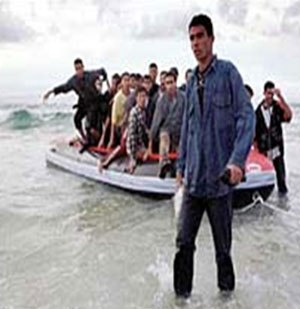

+++
title = "الطافشون من مصر :مهاجرون بلا أنصارا"
date = 2008-01-09
authors = ["مروة صلاح"]

[taxonomies]
authors = ["marwa-salah"]
sections = ["masr"]

[extra]
section_name = "ولاد البلد"
share_image = "/media/masr.20at.com/currentarticleassets/5733384067_1.jpg"
summary = "هاجر الرسول (ص) وأصحابه من مكة للمدينة المنورة هرباً مما واجهوه في مكة من محاربة أهلها لهم ، لكنهم وجدوا في المدينة من فتح لهم البيوت ..وجدوا أنصارا لهم تقاسموا"
section_slug = "masr"
section_colour = "#666666"
thumb = "/media/masr.20at.com/currentarticleassets/5733384067_1.jpg"
n_comments = 3
original_url = "http://www.20at.com:80/t7kyk/7994.html"
archived = "20090525141857"
date_source = "byline/meta"
aliases_20at = ["/t7kyk/7994.html"]

[extra.provenance]
original_url = "http://www.20at.com:80/t7kyk/7994.html"
capture_url = "https://web.archive.org/web/20090525141857/http://www.20at.com:80/t7kyk/7994.html"
capture_label = "٢٥ مايو ٢٠٠٩، ١٤:١٨ UTC"
date_note = "من سطر التوقيع في المقال"
other_urls = []
comments = "٣"
missing_images = ""
+++

<figure></figure>

هاجر الرسول (ص) وأصحابه من مكة للمدينة المنورة هرباً مما واجهوه في مكة من محاربة أهلها لهم ، لكنهم وجدوا في المدينة من فتح لهم البيوت ..وجدوا أنصارا لهم تقاسموا معهم كل شيئا، وقبل ذلك هاجر إبراهيم إلى مصر هربا من النمروز وتزوج هاجر، وموسى رحل إلى مدين وأكرمه شعيب فكل من هؤلاء هاجر ووجد مناصرا يستقبله.

أما الآن فالمهاجرون أصبحوا بلا أنصارا، وخير مثل على ذلك هؤلاء الشباب المصريين الذين يهجرون واقعهم الأليم من فقر و بطالة وجهل متجهين إلى أوربا عبر زوارق الموت، فهؤلاء لا يستقبلهم إلا الاعتقال أوالموت، يهجرون أسرهم ليعودوا إليهم في توابيت.

<h3>واقع نعيشه</h3>

"أنا شاب مصري حاصل علي بكالوريوس اقتصاد وعلوم سياسية، من أحد الكفور بمحافظة الغربية.. سيدي المحترم .. المجتمع المصري يلوم الشباب ويتهمهم بالكسل والدلع، ومفتي الديار يتهمنا بالطمع والجشع ويحكم علي الموتي منا بالنار.. وأنا شخصياً منذ تخرجي دفعة ٢٠٠١ وأعمل أجيراً باليومية في البوية ودهان الحوائط وتركيب السيراميك وأحياناً في السباكة، وبعد ست سنوات ادخرت تسعة آلاف جنيه وعمري الآن "٢٩ سنة"، وأنت تعرف أن نار الأسعار تشوي قلوبنا، وسوف تزداد اشتعالاً في السنوات القليلة المقبلة، وتعلم أن حكومتنا ليست جادة، فالحال من سيئ لأسوأ، وأمثالنا لم يعد لهم مكان في هذا البلد، وأمام أعيننا من يحتكر السلع ويحقق المليارات، ويهرب بفلوس البنوك.

ولهذا لم أتردد لحظة في التوقيع علي إيصالات أمانة علي بياض لأشخاص لا أعرفهم، ودفعت خمسة آلاف جنيه مقدمًا لمساعدتي على السفر، ركبت بعد الغروب من سواحل كفرالشيخ مركب صيد متهالك مربوط بذيله قارب مطاطي يحمل ٢٢ شابا ليصل عددنا إلي ١٨٥ كالسردين حتى نصل لسواحل ليبيا القريبة من إيطاليا..

وقبل وصولنا أتت الرياح بما لا تشتهي السفن، وعاصفة رهيبة تطيح بأحلامنا وغرقنا وسط الأمواج والصراخ والعويل، مات من مات، وتبقي ١٢ غيري أمسكنا في الأحبال المربوطة علي جانب القارب المطاطي إلي أن وصلت في الصباح طائرة إنقاذ يونانية حملتنا إلي معسكر بأحدي الجزر مكدس بالمصريين وغيرهم لنعرف منهم أن ٢٥% يموتون غرقا، ٥٠% يتم القبض عليهم و٢٥% ينجون وينجحون في دخول أوروبا سنويا.

سيدي: أقسم لك ونحن بين الحياة والموت كنا نبلل شفاهنا بالمياه المالحة وندعو من قلوبنا علي حكوماتنا وكل الرؤساء والملوك العرب بأن ينتقم الله منهم جزاء ما فعلوه بنا.

وأقسم لك أنني سوف أحاول مرة وعشرًا حتي أصل إلي أحد هذه البلدان التي تحترم آدمية الإنسان وتصون كرامته، وتمنحه الفرصة لتحقيق ذاته وطموحاته، وإما الموت غرقا لأفوز بشرف المحاولة".

هذه إحدى الرسائل التي نشرتها جريدة "المصري اليوم" لأحد هؤلاء الشباب المهاجرين بلا أنصار.

<h3>رحلة الموت</h3>

ويقوم الشباب باللجوء إلى سماسرة السوق ومكاتب السفريات غير القانونية ووسطاء الهجرة الذين يتقاضون من كل شاب ما يقرب من 30 ألف جنيه للسفر، وتنتشر على الحدود مع ليبيا أو في بعض محافظات الصعيد عصابات للنصب على هؤلاء الشباب، وتتقاضى منهم مبالغ طائلة بدعوى توفير فرص عمل لهم في أوروبا ثم يهربون بهذه الأموال دون أن يحاسبهم أحد...وتنتهى رحلة الشباب إما بالموت أو السجن والترحيل.

وهناك طرق عديدة لتهريب المهاجرين غير الشرعيين، منها الطرق البرية عن طريق التسلل إلى ليبيا، حيث يتم تهريب المهاجرين إلى إيطاليا ومالطا وعن طريق الأردن يتم تهريب المهاجرين إلى قبرص واليونان أو تركيا.

<h3>مجرد أرقام</h3>

وقد أوضح التقرير الذي أصدرته المنظمة المصرية لحقوق الإنسان أن إحصائيات الأمن الإيطالية سجلت إجمالي المهاجرين غير الشرعيين الذين دخلوا ايطاليا عام 2007 عن طريق البحر 1419 مهاجراً، لقي 500 مهاجر مصرعهم في البحر المتوسط حتى الآن مقابل 302 مهاجر فقط خلال عام 2006 بأكمله.

كما أصدرت وزارة الداخلية المصرية تقريراً أكد أن أجهزة الأمن قامت بضبط 630 قضية هجرة غير شرعية خلال 2007، وصل عدد المتهمين فيها إلى ألف متهم، وأضاف التقرير أنه تم الكشف عما يزيد على خمسين تشكيلا عصابياً يقوم بتهريب الشباب المصري إلى الخارج.

<h3>قرى أكثر تطفيشا</h3>

ومن القرى التي اشتهرت بسفر شبابها إلى أوربا قرية (تطون) التي تقع في محافظة الفيوم وهى أكثر محافظات مصر ارتفاعاً في نسبة الهجرة وكذلك الغربية والمنوفية والشرقية والدقهلية.

كما يذكر أن إيطاليا وليبيا وسوريا ودول أخرى، ترحل المئات من المصريين كل شهر تقريبا، بعد فشلهم في الهجرة غير الشرعية ، وقد أنقذت العناية الإلهية 135 شابا حاولوا السفر إلى اليونان عن طريق الهجرة غير الشرعية من الموت المحقق عندما أجبرتهم إحدى عصابات التهريب على إلقاء أنفسهم في عرض البحر أمام بحيرة البرلس.

<h3>احتياطات أوربية</h3>

ولأن قضية الهجرة غير الشرعية باتت مشكلة تؤرق الدول المستقبلة لهؤلاء المهاجرين وعلى رأسها دول أوروبا، فقد ركزوا على ضرورة وقف فلول الهجرة غير الشرعية عن طريق إنشاء معسكرات احتجاز أو دعم الاتفاقات الأمنية المشتركة التي تتيح تسليم المهاجرين إلى حكومات بلدانهم أو عن طريق الدعم المادي واللوجيستى لحكومات شمال إفريقيا لتشديد الحراسة على الحدود وتعقب المهربين والمهاجرين أنفسهم.

كما قرر مجلس الوزراء زيادة الرقابة علي المنافذ البحرية، بالتنسيق مع قوات الشرطة والجيش، وتشديد العقوبات على أفراد الشبكات العاملة في هذا المجال، إلى جانب تفعيل القنوات الشرعية للسفر، وإنشاء شركات للتدريب والتنسيق مع أسواق العمل الخارجية، لإيفاد الشباب والفنيين بصورة منظمة في حالة الحاجة إليهم في الخارج.

<h3>فى النار</h3>

وكان موقف وسائل الإعلام الحكومية المصرية موقف تغييبي كالعادة من خلال الابتعاد عن جذور المشكلة فأصبحت شاشات التلفزيون تصور الشباب المهاجر على أنهم مجرمين، وأن البلاد تنتشر بها فرص العمل لكن هؤلاء الشباب يجرون وراء سراب الحياة السهلة بدلاً من بذل مجهود في وطنهم، ووصل الأمر في إحدى البرامج التليفزيونية المتخصصة باستدعاء المفتى ليقول إن الهجرة غير الشرعية حرام و ان الموتي في سبيل هذه الهجرة ليسوا شهداء.

وقد أثارت هذه المسألة أزمة حادة بين دار الإفتاء المصرية ومجمع البحوث الإسلامية بالأزهر الشريف، فقد تمسك مفتى مصر الشيخ علي جمعة بأن هؤلاء الذين يلقون بأنفسهم في التهلكة دون سبب قاهر ليسوا شهداء، بينما خرج بيان من الأزهر يفيد بعكس ذلك استنادا إلى أحاديث نبوية تقول أن الغريق شهيدا.

