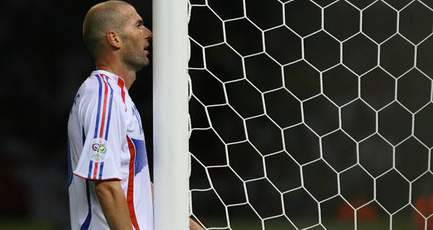

+++
title = "في الجزائر ... زيدان مظلوم!"
date = 2006-07-12

[taxonomies]
authors = []
sections = ["worldcup2006"]

[extra]
section_name = "كأس العالم ٢٠٠٦"
share_image = "/media/admins.20at.com/worldkoop/zizo-insidom.jpg"
summary = "12/07/2006"
section_slug = "worldcup2006"
section_colour = "#1B6E3A"
thumb = "/media/admins.20at.com/worldkoop/zizo-insidom.jpg"
n_comments = 54
original_url = "http://worldcup2006.20at.com:80/article.php?sid=123"
archived = "20081226213842"
date_source = "byline/meta"
aliases_20at = ["//worldcup2006.20at.com/article.php?sid=123"]

[extra.provenance]
original_url = "http://worldcup2006.20at.com:80/article.php?sid=123"
capture_url = "https://web.archive.org/web/20081226213842/http://worldcup2006.20at.com:80/article.php?sid=123"
capture_label = "٢٦ ديسمبر ٢٠٠٨، ٢١:٣٨ UTC"
date_note = "من سطر التوقيع في المقال"
other_urls = []
comments = "٥٤"
missing_images = ""
+++

12/07/2006

<figure></figure>

كامل الشيرازي – في الملعب – الجزائر

لأن زين الدين الزيدان من أصول جزائرية ... فكان لابد وأن يتعاطف معه الشباب الجزائري ويعتبروا هفوته أمام الإيطالي ماتيرازي دفاعاً عن النفس..!

فالشارع الجزائري هائم بزيدان ومازال حتى الآن يدعو الفيفا لإنصافه..!!

<h3>نتاج جزائري خالص</h3>

تجاوب الشارع الرياضي الجزائري بشكل كبير ومتفاعل مع النهاية الدراماتيكية للنهائي الفرنسي الإيطالي الأحد الماضي.

وأبدى عدد كبير من الشباب، تضامنهم وتعاطفهم بشكل كبير ومؤثر مع واقعة طرد النجم الدولي الفرنسي، الجزائري الأصل، زين الدين زيدان، عندما نطح برأسه المدافع الإيطالي ماركو ماتيرازي في بطنه وأسقطه أرضاً..!!

كما امتزج الشعور العام للجزائريين بين حيرة ما قام به زيدان في الدقائق الأخيرة من الوقت الإضافي، شاعرين بالأسف للطريقة التي ودع بها صانع أمجاد فرنسا زين الدين زيدان، الذي استقطب اهتمام العالم أجمع بعد أدائه الرائع خلال المباريات الأخيرة مع منتخبه.

وتشكلت جماعات كثيرة في الأحياء الشعبية الكبيرة بالعاصمة الجزائرية مثل كباب الوادي، حسين داي، وساحة أول ماي، وكان لا حديث فيها إلا عن أفول نجم الكابتن (زيزو) الذي يستهوي قلوب الجزائريين لأنهم يعتبرونه نتاجاً جزائرياً خالصاً..!

<h3>سرقوا من زيدان ... الوداع التاريخي!</h3>

دافع الشباب الجزائري المتيم بـ(زيزو) أو صاحب الصلعة الذهبية كما يحلو للكثير تسميته، عما بدر منه، وعاشت العاصمة الجزائرية وغيرها من المدن حالة استثنائية خلال الـ72 ساعة المنقضية، حيث جابت مئات السيارات الشوارع الكبرى وعليها صور ضخمة لزيدان الذي يرى فيه الجزائريون مثلهم الأعلى ورمزاً لنجاح جزائري الجيل الثالث المغترب بفرنسا.

ووسط تلك الهالة، عانى الجزائريون من ألم عميق وهم يحاولون إيجاد الأعذار والتبريرات للتصرف الذي اقترفه زيدان الذي يوقرونه.

فقال فريد كريمي، أحد الشباب المحبين لزيدان : "الخطأ ليس خطأ زيدان، أنا متأكد من أن ماتيراتزي قال شيئاً شديد السوء لزيدان ليجبره على التصرف بهذه الطريقة. ولابد أن حجم الإهانة كان كبيراً.

ولا تنسوا أن زيدان كائن جد حساس".

كما قال الصحفي الرياضي نبيل جابر : "زيدان لم يخطئ، حتى وإن كان مدعواً لضبط النفس. لقد سرقوا منه وداعاً تاريخياً، وخروجاً على طريقة الكبار".

في حين لاحظ أحمد حاجي (بائع حلويات) أن "الضغط الشديد" الذي عانى منه زيدان في البطولة ككل وخصوصاً في النهائي ... لعب دوره، كما يرى أن زيدان يبقى مجرد رجل عادي من لحم ودم له نقاط ضعفه وأعصابه التي كلفته 13 بطاقة حمراء من قبل..!!

<h3>الكل يدافع عن زيزو</h3>

بينما كشف أحد أقرباء زيدان أن الأخير اعتدى على المدافع الإيطالي لأن هذا الأخير وصفه بـ" الإرهابي".

وقال رابح زيدان المقيم ببلدة آفمون التابعة لولاية بجاية (التي تقع على بعد 250 كلم شرق الجزائر)، أن قائد المنتخب الفرنسي "معروف بهدوئه وسعة صدره ولم يتعود على ضرب الناس"، كاشفاً عن استعدادات حثيثة لاستقبال زيدان بمسقط رأسه إستقبالاً يليق بمقامه أواخر شهر سبتمبر المقبل.

وعلّق العديد من الشباب الذين تحدثنا إليهم على عجالة : "لم نشجع المنتخب الفرنسي بل قمنا بمؤازرة زين الدين زيدان، وشعرنا بالأسف لحادثة طرده، لكن لابد أنه سمع شتائم قاسية من قبل اللاعب ماتيرتازي دفعته للاعتداء عليه بتلك الطريقة العنيفة".

ويعتقد الجزائريون أن تحقيق الفيفا سيظهر صحة موقف زيدان وخطأ ماتيرتازي، خصوصا وأنّ المدافع الإيطالي عاد ليعترف بإهانته لزيدان بعد أن نفى الأمر في البداية، وبعد التصريح الذي أدلى به زيدان اليوم للتلفزيون الفرنسي.

كما تدخل الرئيس الجزائري عبد العزيز بوتفليقة أمس، ليدلي بدلوه ويدافع عن زيدان.

حيث اعتبر أن قائد منتخب فرنسا تصرف دفاعاً عن شرفه، وقال بوتفليقة في رسالة رسمية وجهها إلى زيدان : "في وجه الإعتداء الخطير الذي تعرضت له، قمت برد فعل دفاعاً عن شرفك أولاً، قبل أن تخضع للقانون من دون أن تخاف، وبالتالي فلا أسباب لديك لتكون مطأطئ الرأس على الإطلاق".

<h3>الجزائر فخورة بك</h3>

ووصف الرئيس الجزائري زيدان بأنه "حمل دائماً مشعل الموهبة والعظمة والتواضع والتهذيب".

وتابع قائلاً : "بما أنك لم تنس بلدك الأم، فإن الجزائر والجزائريين جميعاً فخورون بك، ولن ينسوك أبدا".

وأضاف : "سوف أكون سعيداً جداً باستقبالك في وطنك، أنت وعائلتك في التاريخ الذي تراه مناسباً ونستطيع أن نتفق عليه"، وأردف : "أريد أن أنقل إليك في هذه الظروف الصعبة التي تمر بها، مشاعر الشعب الجزائري بأكمله تجاهك والإحترام الكبير الذي يكنه لك".

وحيا الرئيس الجزائري مسيرة زيدان قائلاً : "أنهيتها في القمة ودخلت بفضلها أسطورة كرة القدم العالمية".

كما يرى الرئيس أن زيدان هو الأفضل في العالم، وبقدر ما هو أسطورة من أساطير كرة القدم العالمية، فإنه يظل إنساناً معرضاً لما يتعرض له سائر البشر. كما امتدح خصاله وأخلاقه العالية، وذهب إلى حد إبداء إعجابه بطريقة تنفيذه لضربة الجزاء التي سجلّها في مباراة النهائي.

وتشهد مختلف مناطق الجزائر منذ سنوات، طقوساً خاصة بين الشباب ومحبي كرة القدم كلما تعلّق الأمر بإنجازات (زيزو) أو إحرازه للأهداف مع منخب بلده أو ناديه، وهو السيناريو الذي يتكرر منذ أن سجل هدفين في مرمى البرازيل وحصول فرنسا على كأس العالم في صيف 1998.

ويتضاعف الفخر والإهتمام بزيدان بعد حصوله على لقب أفضل لاعب في العالم لعامي 1998 و2003، بجانب فوزه ببطولات محلية وعالمية مع ناديي يوفنتوس وريال مدريد، ومنتخب فرنسا.

<h3>أي طعم للكرة بدون زيزو؟!!</h3>

ما زاد من تعلّق وشغف الجزائريين بزيدان، قيامه بلفتات إنسانية رائعة كلما زار وطنه الأم، ككفالة عدد من أيتام الجزائر وزيارتهم، ومساهمته في إغاثة ضحايا الزلزال العنيف الذي هز العاصمة الجزائرية في ربيع 2003.

وقد تلقى الشارع الرياضي في الجزائر خبر إعلان معشوقهم ترك وإعتزال كرة القدم مباشرة بعد المونديال الألماني، بمزيد من الحسرة والحزن، حتى أن هيثم حمادي (أحد الشباب الذي يحبون زيدان بشدة) صارحنا بتأثر وكآبة : "أي طعم سيكون للكرة من دون زيدان!".

الآن، بات الجزائريون يقسمون أن مدلّلهم زيدان لم يقل كلمته الأخيرة، وسينتصر لنفسه من خلال كشفه حقيقة كلام ماتيرازي ضده، وها ما أدلى به اليوم في حديثه التلفزيوني.

ويقول متيمون آخرون بزيزو أنه سيأخذ بنصيحة ليبي ولن يعتزل الكرة ... ولكن رد زيدان على هؤلاء جاءهم اليوم، حيث قرر أن يعتزل لعب كرة القدم تماماً بعد قدم لجمهور وعشاق كرة القدم فناً جميلاً وأمتعهم بلعبه ومهاراته طوال السنوات الماضية.

<h3>* اقرأ أيضاً : <a href="https://web.archive.org/web/20081226213842/http://www.worldcup2006.20at.com/article.php?sid=109">زيدان .. لا عب من كوكب آخر!</a></h3>

<a href="https://web.archive.org/web/20081226213842/http://www.worldcup2006.20at.com/article.php?sid=120">هل زيدان .. إرهااااابي؟!</a>

