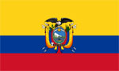
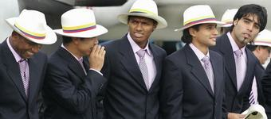

+++
title = "الإكوادور"
path = "sites/worldcup2006/team-10"
template = "extra.html"

[extra]
site = "worldcup2006"
kind = "team"
original_url = "http://worldcup2006.20at.com:80/teams.php?tid=10"
archived = "20060614015847"
+++

<a href="/articles/worldcup2006-49/">الساعات السويسرية تعطل مفعول ديوك فرنسا</a>

<figure></figure>

<figure></figure>

- تأسس اتحاد الإكوادور عام 1925.

- انضم إلى الإتحاد الدولي لكرة القدم (فيفا) عام 1926.

- منتخب ضعيف وقع في مجموعة البلد المضيف، ورغم سعيه إلى إثبات نفسه إلا أن حظه في الصعود إلى الدور الثاني ليست كبيرة.

- قبل يوم السابع من نوفمبر عام 2001، موعد الجولة الأخيرة في تصفيات أمريكا الجنوبية

المؤهلة لكأس العالم بكوريا واليابان ‏2002,‏ كانت الإكوادور لا تمتلك أي تاريخ يذكر في كرة القدم وبمعنى أدق في تاريخ كأس العالم.

لكن كل ذلك تغير في اليوم الذي وصلت فيه الإكوادور إلي النهائيات للمرة الأولي في تاريخها عقب تعادلها مع الأورجواي‏1-1‏ في التصفيات‏,‏ فتحولت الإكوادور بين عشية وضحاها إلي أمة تعشق كرة القدم وصار كأس العالم حديث الجميع، وكان شعارها في بطولة كأس العالم 2002 "تعلم واكتسب الخبرة".

* (مونديال 2002 كوريا واليابان) : خرجت من الدور الأول.

- صعد الفريق إلى المونديال بعدما نجح في حصد 28 نقطة من 18 مباراة في تصفيات أمريكا الجنوبية حيث احتل الفريق المركز الثالث في التصفيات خلف البرازيل والأرجنتين، والأكثر أهمية هو المفاجآت التي حققها أمام المنتخبات الكبيرة كلها في المنطقة.

- ويكاد التاريخ الكروي لا يحجز أي مساحة للإكوادور حتى تسجل فيها إنجازات تذكر، ويكفي أن نقول أن أول مباراة دولية لها كانت في ‏8‏ أغسطس ‏1938‏ أمام بوليفيا وانتهت بالتعادل، وأكبر فوز حققته في تاريخها كان على منتخب بيرو بنتيجة ‏6/‏صفر، وأسوأ هزيمة تلقاها منتخب الإكوادور كانت بنتيجة صفر‏/12‏ من المنتخب الأرجنتيني.

- شارك المنتخب الإكوادوري في بطولة كوبا أمريكا ‏23‏ مرة‏،‏ وكانت أول مرة في عام‏1939، وأفضل نتائجه في هذه البطولة هو حصوله علي المركز الرابع في عامي‏1959‏ و‏1993‏.

* (إيفان هورتادو) :

- قائد الفريق فهو قائد محنك في وسط الملعب يستطيع توجيه زملائه وإمدادهم بالفرص لإحراز الأهداف‏،‏ وقاد ناديه المكسيكي نيكاكسا إلى العديد من الألقاب على مدار السنوات الماضية، وهو يعد صاحب الرقم القياسي في عدد المباريات التي خاضها مع منتخب بلاده.

* (‏ديلجادو) :

- اللاعب الهداف الذي يكفي القول أنه احتل صدارة هدافي أمريكا الجنوبية في كأس العالم برصيد ‏31‏ هدفاً لنعرف مدي أهميته للفريق.

* (لويس سوريس) :

- يستمد المنتخب الإكوادوري قوته من خلال‏ لويس سوريس المدير الفني للفريق والذي تولي المهمة عام ‏2004‏،‏ واستطاع أن يقود الفريق باقتدار ونجاح في التصفيات الأخيرة‏.

بولندا – كوستا ريكا - ألمانيا

* (حراس المرمى) إدوين فيافويرتي – كريستيان مورا – داميان لانزا.

* (الدفاع) إيفان هيرتادو – جيوفاني إسبينوزا – أوليسيس ديلاكروز – نيسير رياسكو –

خورخي جواجو – خوسيه لويس برلازا.

* (خط الوسط) مارلو أيوفي – إدوين تينوريو – إديسون منديس – باتريسيو يوروتيا –

كريستيان لارا – سيجوندو كاستيو – لويس أنتونيو فالنسيا – لويس فيرناندو

ساريتاما.

* (الهجوم) إيفان كافيديس – أجوستين دلجادو – كارلوس تينوريو – فليكس بورخا –

كريستيان بنيتز.

