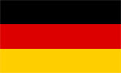
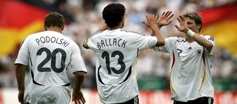

+++
title = "ألمانيا"
path = "sites/worldcup2006/team-19"
template = "extra.html"

[extra]
site = "worldcup2006"
kind = "team"
original_url = "http://worldcup2006.20at.com:80/teams.php?tid=19"
archived = "20060614020035"
+++

<a href="/articles/worldcup2006-49/">الساعات السويسرية تعطل مفعول ديوك فرنسا</a>

<figure></figure>

<figure></figure>

- تم تأسيس الإتحاد في عام 1900.

- انضمت المانيا إلى الفيفا في عام 1904.

- المنتخب الألماني أو منتخب الماكينات، أحد أهم الفرق الطامحة في بلوغ منصة التتويج، وذلك رغم أن ألمانيا لم تقدم في تاريخها منتخبا ذو ناحية فنية راقية، ولكنها تقدم منتخب يلعب كرة ميكانيكية، لذا ارتبط اسمهم بالماكينات.

- ينتظر عشاق المنتخب الألماني كأس العالم بفارغ الصبر، حيث تتوق القلوب لرؤية الماكينات تعود للعمل من الجديد، بعد سنوات توارت فيها واحدة من القوى الكروية في العالم عن الأنظار.

- أصبح الشعار السائد قبل انطلاق البطولة بأيام هو "ألمانيا في مأزق"، فالضغوط من جميع الجهات، داخلياً وخارجياً، والأسباب مختلفة ومتعددة، والجماهير تعيش في حالة قلق لأنهم لا يعلمون مستوى محدد لفريقهم، خاصة بعد أن تأهل إلى النهائيات تلقائياً بصفته البلد المضيف، ودون أن تخوض أية تصفيات، حيث تحولت هذه الميزة مع الألمان إلى عامل سلبي وهو نقص الخبرات العملية المكتسبة من خوض غمار التصفيات.

- يحفل سجل الألمان بثلاث بطولات لكأس العالم، ويشارك المنتخب الألماني في نهائيات كأس العالم للمرة الخامسة عشرة، وصعد إلى المباراة النهائية 7 مرات مسجلاً رقماً جديداً مع البرازيل ألا وهو وجود أحدهما في آخر تسع مباريات نهائية في أخر عشر بطولات وكانت البطولة الوحيدة التي لم يظهر فيها أي من المنتخبين في النهائي هي عام 1978.

- تعد الفترة من 1982 وحتى 1990 هي الأفضل في تاريخ البلد المضيف، فقد صعدت ألمانيا إلى نهائي 82 و86 ولم تحقق اللقب حتى نجح فرانز بيكينباور بخبرته في قيادة منتخب 90 للقب الألماني الثالث ليكون الوحيد بجانب البرازيلي ماريو زاجالو الذي استطاع الفوز بكأس العالم كمدرب وكلاعب.

* (مونديال 1934) المركز الثالث.

* (مونديال 1938) خرجت من الجولة الأولى.

* (مونديال 1954) فازت بلقب بطل كأس العالم.

* (مونديال 1958) المركز الرابع.

* (مونديال 1962) خرجت من ربع النهائي.

* (مونديال 1966) المركز الثاني.

* (مونديال 1970) المركز الثالث.

* (مونديال 1974) فازت بلقب بطل كأس العالم.

* (مونديال 1978) خرجت من الجولة الثانية. * (مونديال 1982) المركز الثاني.

* (مونديال 1986) المركز الثاني.

* (مونديال 1990) فازت بلقب بطل كأس العالم.

* (مونديال 1994) خرجت من ربع النهائي.

* (مونديال 1998) خرجت من ربع النهائي.

* (مونديال 2002) المركز الثاني.

- فضلاً عن فوز الفريق بكأس الأمم الأوروبية ثلاث مرات أيضاً، يعد منتخب ألمانيا هو الأول في تاريخ أوروبا الذي يستطيع أن يجمع بين كأس الأمم وكأس العالم.

* (مايكل بالاك) :

- يعد النجم بالاك، أحدث المنضمين لصفوف تشيلسي بطل الدوري الإنجليزي، وهو النجم السابق لفريق بايرن ميونخ، وهو اللاعب الذي يعتبر أحد بوابات الأمل التي يقف خلفها الجمهور الألماني.

- يتمتع بالاك بقوة بدنية هائلة يستغلها جيداً من خلال مركزه في وسط الملعب الذي يجوبه يميناً ويساراً ليغلق كل الطرق لمرمى فريقه.

- يجيد التهديف بقدمه القوية وضرباته الرأسية وله الكثير من الأهداف المؤثرة طوال مسيرته الكروية، مما دفع النجم البرازيلي رونالدو للإشادة به قائلاً: "إنه لاعب عظيم، ولا يوجد ما يمكن انتقاده بسببه حول مهاراته الفنية والفردية".

* (يورجن كلينسمان) :

- يقود منتخب الماكينات المدير الفني كلينسمان، الذي يتحمل الكثير من النقد والإتهامات، على الرغم من أنه تولى مسئولية الفريق بعد خروج الألمان المبكر من نهائيات بطولة الأمم الأوروبية عام 2004، ومن وقتها وهو يبذل قصارى جهده من أجل تحقيق الأفضل.

- لجأ إلى وسائل غير تقليدية في طريقة تدريبه، مثل تعيين مدرب متخصص للياقة البدنية، والسعي إلى طرق جديدة في التواصل مع اللاعبين، وبالرغم من هذا إلا أن الكثيرين مازالوا ينتقدونه، ويعلنون بكل وضوح عن أرائهم المحبطة بشأن ما يمكن أن يحققه المنتخب في المونديال.

كوستاريكا – بولندا - الإكوادور

* (حراسة المرمي) : لينس ليمان - أوليفر كان - تيمو هيلدبراند.

* (خط الدفاع) : آرني فريدريك - روبرت هوت - مارسيل يانسن - فيليب لام - بير

ميرتساكر - كريستوف ميتزيلدر - وينز نوفوتني.

* (خط الوسط) : مايكل بالاك - باستيان شفانيشتايجر - تيم بوروفسكي - تورستن فرينجز

- توماس هيتزلشبرجر - سيباستيان كيهل - ديفيد أودونكور.

* (خط الهجوم) : جيرالد أسامواه - مايك هانكة - ميروسلاف كلوزه - أوليفر نويفيل - لوكاس بودولسكي.

