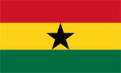
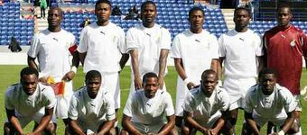

+++
title = "غانا"
path = "sites/worldcup2006/team-2"
template = "extra.html"

[extra]
site = "worldcup2006"
kind = "team"
original_url = "http://worldcup2006.20at.com:80/teams.php?tid=2"
archived = "20060614015628"
+++

<a href="/articles/worldcup2006-45/">الأزوري يُسقط نضال النجوم السوداء!</a>

<figure></figure>

<figure></figure>

- تأسس اتحاد غانا لكرة القدم عام 1957.

- انضمت غانا إلى الفيفا عام 1958.

- هذه هي المرة الأولى في تاريخ المنتخب الغاني التي يتأهل فيها لكأس العالم، وهو المنتخب الذي ناضل كثيراً من أجل نيل هذه الشرف الدولي، بعد أن أثبت نفسه بقوة داخل القارة السمراء، وأخرج للعالم لاعباً عالمياً هو عبيدي بيليه الذي تمنى طويلاً أن يقود منتخبه نحو هذا العرس العالمي.

- لم تتأهل غانا إلى المونديال من قبل، ولكنها أحرزت كأس الأمم الإفريقية أربع مرات في أعوام 1963، 1965، 1978 و1982.

- استطاعت غانا الوصول إلى مونديال ألمانيا بعد أن قدمت عروضا قوية ونتائج مستحقة في تصفيات أفريقيا، ونجحت في إقصاء منتخب جنوب إفريقيا الذي سيستضيف مونديال عام 2010 القادم.

* (مايكل إسيان) :

- من مواليد عام 1982 من النجوم الغانية الواعدة.

- وهو لاعب نادي تشيلسي بطل الدوري الإنجليزي الذي اشتراه في صفقة جعلته أغنى لاعب إفريقي، عندما انتقل من ليون الفرنسي إلى تشيلسي مقابل 24.4 مليون إسترليني.

* (ستيفن أبياه) :

- قائد الفريق هو ستيفن أبياه المحترف في صفوف فناربخشة التركي بعد أن قضى ثمانية مواسم في إيطاليا بين أندية أودينيزي وبارما وبريشيا ويوفينتوس.

إيطاليا – التشيك – الولايات المتحدة الأمريكية

* (حراسة المرمى) : سامي أدجي- ريتشارد كينجستون - جورج أوو.

* (خط الدفاع) : إيريك أددو - عيسى أحمد – إلياسو شيلا - صامويل كوفور - جون

مينساه - حبيب محمد - جون بانتسيل- إيمانويل بابوي - دانييل كوايي –

هانز ساربي.

* (خط الوسط) : أوتو أددو - ستيفن أبياه - ديريك بواتينج – هامينو دراماني - مايكل

إسيان – سولي مونتاري.

* (خط الهجوم) : ماثيو أمواه - أزوماه جيان – رزاق بيمبونج - أليكس تاشي مينساه.

