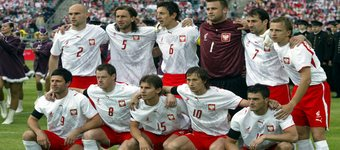

+++
title = "بولندا"
path = "sites/worldcup2006/team-20"
template = "extra.html"

[extra]
site = "worldcup2006"
kind = "team"
original_url = "http://worldcup2006.20at.com:80/teams.php?tid=20"
archived = "20060614020049"
+++

<a href="/articles/worldcup2006-49/">الساعات السويسرية تعطل مفعول ديوك فرنسا</a>

<figure></figure>

<figure></figure>

- تم تأسيس الاتحاد في عام 1919.

- انضمت كوستاريكا إلى الفيفا في عام 1923.

- بولندا قد لا تبدو معروفة للجميع، ولكن المتابع لبطولات كأس العالم يعلم جيداً تاريخ هذا الفريق الذي شارك مرات عديدة في ذلك الحدث العالمي، ولولا ظروفها السياسة لكان لها تاريخ أكبر مع هذا المهرجان المونديالي.

- هذه هي المرة السابعة التي تصل فيها بولندا إلى نهائيات كأس العالم لكرة القدم بعد مشاركاتها السابقة في 6 بطولات، منها بطولتان أحرزت فيهما المركز الثالث.

* (مونديال 1938) خرجت من الجولة الأولى.

* (مونديال 1974) المركز الثالث.

* (مونديال 1978) خرجت من الجولة الثانية.

* (مونديال 1982) المركز الثالث.

* (مونديال 1986) خرجت من الجولة الثانية.

* (مونديال 2002) خرجت من الجولة الأولى.

- من خلال تلك الأرقام، نجد أن بولندا بدأت تسطر تاريخها مع كأس العالم عام 38، ولكن نظام البطولة في ذلك الوقت بخروج المغلوب وعدم وجود مجموعات ووقوعها أمام البرازيل كان السبب في خروجها مبكراً من البطولة بهزيمة 6 – 5.

- بسبب الحرب العالمية، ووقوعها تحت الحكم الشيوعي، غابت بولندا عن الظهور في عالم كرة القدم، حتى تأهلت إلى كأس العالم 74 بألمانيا لتحقق مفاجأة تلو الأخرى حتى حصلت على المركز الثالث بفوزها على البرازيل.

- في الأرجنتين 78 صعدت بولندا للدور الثاني غير أن هزيمتها أمام البرازيل والأرجنتين عجلت بخروجها من البطولة.

لكن بولندا أثبتت نفسها مرة أخرى في مونديال إسبانيا 82 بصعودها إلى الدور قبل النهائي غير أن الإيطالي باولو روسي كتب نهاية المشوار البولندي لتواجه فرنسا على المركز الثالث، وتحقق فوزا ثمينا عليه، بثلاثة أهداف مقابل هدفين لتحقق المركز الثالث لثاني مرة في التاريخ.

- وكأن التاريخ يعيد نفسه، فقد تكفلت السامبا البرازيلية بإرسال بولندا خارج البطولة بأربعة أهداف، ثم غابت بولندا عن كأس العالم 16 عاماً وكانت العودة في كوريا واليابان ولكنها ودعت البطولة من الدور الأول بهزيمتين أمام كوريا والبرتغال وفوز وحيد على أمريكا.

- في التصفيات المؤهلة لمونديال ألمانيا 2006، كانت مسيرة المنتخب البولندي في المباريات التأهيلية جيدة، حيث استطاع البولنديين الفوز بجميع مبارياتهم دون مباريتين خاضوها ضد الفريق الإنجليزي، إحداها انتهت بالتعادل.

- ومن ثم يسعى المنتخب البولندي إلى تقديم عروض وإحراز نتائج جيدة في النهائيات حتى يؤكدون أن مسيرتهم الرائعة في التصفيات لم تكن من قبيل الصدف، خاصة وأنه نجح في تحقيق مفاجأة حقيقية عندما تعادل مع المنتخب الإنجليزي في عقر داره.

* (ماسيي زورافسكي) :

- من مواليد عام 1976، وهو من ألمع نجوم المنتخب البولندي.

- يلعب في صفوف سلتيك الأسكتلندي منذ العام 2005.

- بدأ مسيرته في نادي كراكوفيا البولندي، وقاده إلى إحراز عدة ألقاب محلية.

* (حراسة المرمى) : يرشي دوديك - لوكاس فابيانسكي - توماس كوستشاك.

* (خط الدفاع) : ياتشيك باك - مارسين باستشينسكي- ميخائييل زيفلاكوف - ماريوس يوب

- سيفيرين جانكارتشيك – ماريو سليفاندوفسكي - داريوش دودكا.

* (خط الوسط) : أوزيبيوش سمولاريك- كاميل كوسوفسكي - ياتشيك كرزينوفيك - أركاديو

شرادومسكي - سيباستيان ميلا - ميروسلافا سيمكوفياك - بيوتر جيزا -

رادوسلاف سوبوليفسكي – داميان جورافسكي.

* (خط الهجوم) : ماسيي زورافسكي - جريجوري راسياك - أرينيوز ييلين -

بافل بروزيك.

