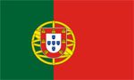
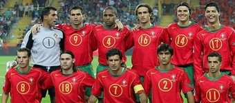

+++
title = "البرتغال"
path = "sites/worldcup2006/team-22"
template = "extra.html"

[extra]
site = "worldcup2006"
kind = "team"
original_url = "http://worldcup2006.20at.com:80/teams.php?tid=22"
archived = "20060614020118"
+++

<a href="/articles/worldcup2006-49/">الساعات السويسرية تعطل مفعول ديوك فرنسا</a>

<figure></figure>

<figure></figure>

- تأسس الإتحاد البرتغالي في عام 1914.

- انضم إلى الاتحاد الدولي لكرة القدم (فيفا) عام 1923.

- "رحم الله امرئٍ عرف قدر نفسه" ... شعار يرفعه المنتخب البرتغالي في خوضه مباريات مونديال 2006، فبرغم ترشيح الكثير من الخبراء للبرتغال لصدارة المجموعة الرابعة والتي تضم معها كلاً من إيران وأنجولا والمكسيك، إلا أن المدير الفني لويس سكولاري صرح بأنه يسعى لبلوغ دور الثمانية على الأقل في البطولة.

ورغم تصريحات سكولاري إلا أنه من داخله يتمنى تكرار ما حققه مع نجوم السامبا في بطولة 2002 والفوز باللقب، لتحقيق إنجاز عالمي غير مسبوق في مجال التدريب.

ويعتبر البرتغاليون أن الفوز بكأس العالم وحده هو القادر على تخفيف ألامهم بعد خسارة لقب بطولة الأمم الأوروبية التي أقيمت على أرضهم عام 2004، ولكن تحقيق هذا الحلم على الأرجح سيكون صعباً.

- تنحصر مشاركات البرتغال في المونديال على ثلاث دورات فقط :

* (انجلترا 1966) المركز الثالث. وفي هذه البطولة فازت البرتغال على كلٍ من الإتحاد السوفيتي 2/ 1 وعلى كوريا الشمالية 5/ 3 وعلى بلغاريا 3/ صفر وعلى كلٍ من المجر والبرازيل 3/ 1، وخرجت من الدور قبل النهائي بعد الهزيمة من انجلترا 2/1.

* (المكسيك 1986) الجولة الأولى. لم يظهر المنتخب البرتغالي ثانية في البطولة إلا بعد عشرين عاماً من المشاركة الأولى. وفي هذا العام حققت البرتغال المفاجاة وفازت على انجلترا 1/ صفر، إلا أن ذلك لم يشفع لها في الوصول للدور الثاني بعد الهزيمة من المغرب 1/ 3 ومن بولندا صفر / 1.

* (كوريا واليابان 2002) الجولة الأولى. خرجت البرتغال هذه المرة أيضا من الدور الأول بعد الهزيمة من الولايات المتحدة 2/ 3 ومن كوريا الجنوبية صفر / 1 والفوز على بولندا 4/ صفر.

- خاضت البرتغال 12 مباراة خلال مشوار التصفيات، فازت في 9 منها وتعادلت في الثلاثة الأخرى، ولم تلقى أية هزيمة طوال التصفيات.

* لويس فيجو : لاعب البرتغال الأشهر...

- ولد في 4 نوفمبر عام 1972.

- بالرغم من أن النجم البرتغالي لويس فيجو لا يتمتع بنفس السرعة التي كان عليها من قبل بعد بلوغه الثالثة والثلاثين، إلا أنه ما زال لاعباً بارزاً.

- فيجو هو أكثر لاعبي البرتغال مشاركة في المباريات، إذ شارك في 117 مباراة، وسجل 31 هدفاً.

- وما زال فيجو قادراً على تهيئة الفرص وتسجيل الأهداف.

* بيدرو باوليتا : هداف المنتخب البرتغالي.

- ولد في 28 أبريل عام 1973.

- يلعب الآن لفريق باريس سان جيرمان الفرنسي.

- يسعى باوليتا في هذه البطولة لزيادة سجله القياسي من الأهداف على المستوى الدولي مع المنتخب البرتغالي، والبالغ 43 هدفاً.

أنجولا – إيران - المكسيك

* (حراس المرمى) ريكاردو (1) - كيم (12) - باولو سانتوس(22).

* (الدفاع) باولو فيريرا (2) - ماركو كانييرا (3) - ريكاردو كوستا (4 ) - فرناندو

مييرا (5) - ميجل (13) - نونو فالنتي (14) - ريكاردو كارفاليو (16).

* (خط الوسط) كوستينيا (6) - بوتيت (8) - هوجو فيانا (10) - مانيش (18) - تياجو

(19) - ديكو (20).

* (الهجوم) لويس فيجو (7) - بدرو باوليتا (9) - سيماو سابروزا (11) - لويس بوا مورتي

(15) - كريستيانو رونالدو (17) - نونو جوميز (21) - هيلدر بوستيجا (23).

