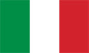
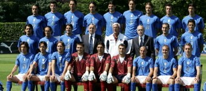

+++
title = "إيطاليا"
path = "sites/worldcup2006/team-29"
template = "extra.html"

[extra]
site = "worldcup2006"
kind = "team"
original_url = "http://worldcup2006.20at.com:80/teams.php?tid=29"
archived = "20060614020252"
+++

<a href="/articles/worldcup2006-49/">ساعات سويسرا تعطل مفعول الديوك </a>

<figure></figure>

<figure></figure>

- تأسس إتحاد كرة القدم الإيطالي عام 1898.

- انضمت إيطاليا إلى إتحاد الفيفا عام 1905.

- يتطلع المنتخب الإيطالي الذي يعد من القوى العظمي في عالم كرة القدم إلى تتويج رابع في مونديال ألمانيا، مستفيداً من تاريخه العريق أولاً، ومن قوته ومتانة خطوطه ثانياً، إلى جانب ترسانة النجوم التي يحويها هذا المنتخب الذي يلقى تعاطفا وتأييدأً جماهيرياً طاغياً في مختلف دول العالم.

- يملك المنتخب الايطالي تاريخا حافلا في كؤوس العالم، حيث شارك في بطولاته 16 مرة، فاز بها في 3 مرات أعوام 1934، 1938 و1982، وحل وصيفاً (احتل المركز الثاني) عامي 1970 و 1994، وفي المركز الثالث عام 1990.

* (مونديال 1934) فازت بلقب بطل كأس العالم.

* (مونديال 1938) فازت بلقب بطل كأس العالم.

* (مونديال 1950) خرجت من الجولة الأولى.

* (مونديال 1954) خرجت من الجولة الأولى.

* (مونديال 1962) خرجت من الجولة الأولى.

* (مونديال 1966) خرجت من الجولة الأولى.

* (مونديال 1970) المركز الثاني.

* (مونديال 1974) خرجت من الجولة الأولى.

* (مونديال 1978) المركز الرابع.

* (مونديال 1982) فازت بلقب بطل كأس العالم.

* (مونديال 1986) خرجت من الجولة الثانية.

* (مونديال 1990) المركز الثالث.

* (مونديال 1994) المركز الثاني.

* (مونديال 1998) خرجت من الدور ربع النهائي.

* (مونديال 2002) خرجت من الجولة الثانية.

- كما تمكن المنتخب الإيطالي من الفوز ببطولة أمم أوروبا عام 1968.

- لم يجد المنتخب الإيطالي أية صعوبة تذكر في التأهل لمونديال ألمانيا، حيث تصدر المجموعة الخامسة دون عناء، وظفر ببطاقة التأهل الأولى.

- يملك المنتخب الايطالي تاريخا حافلا في كؤوس العالم، حيث شارك في بطولاته 16 مرة، فاز بها في 3 مرات أعوام 1934، 1938 و1982، وحل وصيفاً (احتل المركز الثاني) عامي 1970 و 1994، وفي المركز الثالث عام 1990.

* (مونديال 1934) فازت بلقب بطل كأس العالم.

* (مونديال 1938) فازت بلقب بطل كأس العالم.

* (مونديال 1950) خرجت من الجولة الأولى.

* (مونديال 1954) خرجت من الجولة الأولى.

* (مونديال 1962) خرجت من الجولة الأولى.

* (مونديال 1966) خرجت من الجولة الأولى.

* (مونديال 1970) المركز الثاني.

* (مونديال 1974) خرجت من الجولة الأولى.

* (مونديال 1978) المركز الرابع.

* (مونديال 1982) فازت بلقب بطل كأس العالم.

* (مونديال 1986) خرجت من الجولة الثانية.

* (مونديال 1990) المركز الثالث.

* (مونديال 1994) المركز الثاني.

* (مونديال 1998) خرجت من الدور ربع النهائي.

* (مونديال 2002) خرجت من الجولة الثانية.

- كما تمكن المنتخب الإيطالي من الفوز ببطولة أمم أوروبا عام 1968.

- لم يجد المنتخب الإيطالي أية صعوبة تذكر في التأهل لمونديال ألمانيا، حيث تصدر المجموعة الخامسة دون عناء، وظفر ببطاقة التأهل الأولى.

غانا – الولايات المتحدة الأمريكية - التشيك

* (حراسة المرمى) : جانلويجي بوفون – أنجيلو بيروتسي – ماركو أميليا.

* (خط الدفاع) : جانلوكا زامبروتا - أليساندرو نيستا – فابيو كانافارو – فابيو جروسو –

كريستيانو زاكارادو – أندريا بارزاجلي – ماركو ماتيرازي- ماسيمو أودو.

* (خط الوسط) : ماورو كامورانيزي – أندريا بيرلو – جينارو جاتوزو – دانيال دي

روسي – سيموني بيروتا – سيموني باروني.

* (خط الهجوم) : فرانشيسكو توتي – أليساندرو ديل بييرو - لوكا توني – ألبرتو

جيلاردينو- فيليبو إنزاجي – فينشينزو إكوينتا.

