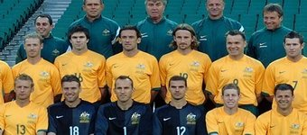

+++
title = "أستراليا"
path = "sites/worldcup2006/team-30"
template = "extra.html"

[extra]
site = "worldcup2006"
kind = "team"
original_url = "http://worldcup2006.20at.com:80/teams.php?tid=30"
archived = "20060614020304"
+++

<a href="/articles/worldcup2006-49/">ساعات سويسرا تعطل مفعول الديوك </a>

<figure></figure>

<figure></figure>

- تأسس إتحاد كرة القدم الأسترالي عام 1961.

- انضمت أستراليا إلى إتحاد الفيفا عام 1963.

- بعد 32 سنة وجد المنتخب الأسترالي نفسه مرة أخرى وسط أفضل منتخبات العالم بعد مشاركته الأولى عام 1974 بمونديال ألمانيا أيضاً، وكأن كلمة السر لدى الأستراليين هي ألمانيا..!

- ورغم الخبرة الدولية المحدودة للاعبي المنتخب الأسترالي، إلا أنهم سيدخلون منافسة شرسة على المركز الثاني في المجموعة مع كرواتيا واليابان؛ لأن المركز الأول بطبيعة الحال محجوز للبرازيل.

- هذه هي ثاني مشاركة للفريق الذي يمثل منطقة (الأوقيانوسيا) في المونديال.

* (مونديال 1974) خرجت من الجولة الأولى.

- بطل الأوقيانوسيا أعوام 1980 ، 1996 ، و2000.

- جاء تأهل أستراليا إلى المونديال عبر ملحق التصفيات، بعد فوزها على أوروجواي 4-2 بركلات الترجيح.

* (مارك شوارزر) :

- كان لحارس المرمى المحترف في صفوف نادي ميدلزبره الإنجليزي دور كبير في وصول بلاده إلى مونديال ألمانيا حيث تمكن مارك من صد ركلتين من الضربات الترجيحية التي حسمت الموقعة مع أوروجواي.

* (هاري كيول) :

- رغم إصابته، إلا أن كيول يظل نجم الفريق الحالي، فهو اللاعب المحترف في صفوف نادي ليفربول الإنجليزي والذي يلعب في مركز الجناح، والذي أظهر هذا اللاعب بمستوى متميز جداً في الدوري الإنجليزي هذا الموسم مع فريقه.

* (جوس هيدنك) :

- هو المدرب الهولندي الشهير، الذي يشرف علي تدريب منتخب أستراليا، بالإضافة لكونه مديراً فنياً لفريق أيندهوفن الهولندي، لكن يظل التساؤل هل ستنجح خبرة هيدنك مع الأستراليين كما نجحت في مونديال 2002 مع كوريا الجنوبية؟!

اليابان – البرازيل - كرواتيا

* (حراسة المرمى) : مارك شوارزر - زيليكو كالاش - آنتي كوفيتش.

* (خط الدفاع) : لوكاس نيل - كريج مور - توني بوبوفيتش – مايكل بيوتشامب - مارك

ميليجان.

* (خط الوسط) : ماركو بريشيانو - تيم كاهيل - جيسون كولينا - سكوت شيبيرفيلد -

ستان لازاريديس - جوسيب سكوكو - فينس جريلا - لوك ويلكشاير -

مايل ستيريوفسكي.

* (خط الهجوم) : بريت إميرتون - جون ألويزي - جوشوا كينيدي - هاري كيول - آرشي

تومبسون - مارك فيدوكا.

