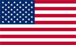
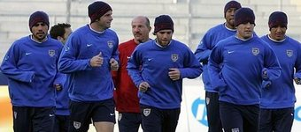

+++
title = "الولايات المتحدة الأمريكية"
path = "sites/worldcup2006/team-31"
template = "extra.html"

[extra]
site = "worldcup2006"
kind = "team"
original_url = "http://worldcup2006.20at.com:80/teams.php?tid=31"
archived = "20060614020315"
+++

<a href="/articles/worldcup2006-49/">ساعات سويسرا تعطل مفعول الديوك </a>

<figure></figure>

<figure></figure>

- تأسس الإتحاد الأمريكي لكرة القدم عام 1913.

- انضم الإتحاد الأمريكي إلى الفيفا عام 1913.

- يسعى منتخب الولايات المتحدة الذي تأهل للمونديال للمرة الثامنة في تاريخه إلى ظهور أفضل من المرات السابقة.

* (مونديال 1930)خرج من الدور قبل النهائي.

* (مونديال 1934) خرج من الدور الثاني.

* (مونديال 1950) خرج من الدور الأول.

* (مونديال 1990) خرج من الدور الأول.

* (مونديال 1994) خرج من الدور الثاني.

* (مونديال 1990) خرج من الدور الأول.

* (مونديال 1990) خرج من دور الثمانية.

- تأهلت أمريكا إلى مونديال ألمانيا عن مجموعة أميركا الوسطى والبحر الكاريبي "كونكاكاف"، بعد أن تصدرتها محتلة المركز الأول.

* (لاندون دونوفان) :

- من مواليد عام 1982 في كاليفورنيا.

- من النجوم الواعدين في الفريق، بعد تجربة قصيرة فاشلة مع بايرن ميونيخ، عاد دونوفان إلى بلاده وقاد نادي سان هوزيه إلى لقب الدوري مرتين.

- تم اختياره أفضل لاعب في الولايات المتحدة الأمريكية عام 2003.

- خاض 59 مباراة مع منتخب بلاده وسجل فيها 19 هدفاً.

التشيك – إيطاليا - غانا

* (حراسة المرمى) : كيسي كيلر - تيم هاورد - ماركوس هانيمان.

* (خط الدفاع) : كارلوس بوكانيجرا - ستيف شيروندولو - جيمي كونراد - إيدي

بوب - إيدي لويس – أونيو أوجوتشي – كريس أولبرايت – جريج

برهالتر – بابلو ماسترويني.

* (خط الوسط) : لاندون دونوفان - كلينت ديمبسي - كلاوديو رينا – جون أوبراين - بن

أولسن - داماركوس بياسلي – بوبي كونفي.

* (خط الهجوم) : إيدي جونسون – براين تشانج – جوش وولف – براين ماكبرايد.

