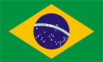

+++
title = "البرازيل"
path = "sites/worldcup2006/team-32"
template = "extra.html"

[extra]
site = "worldcup2006"
kind = "team"
original_url = "http://worldcup2006.20at.com:80/teams.php?tid=32"
archived = "20060614020327"
+++

<a href="/articles/worldcup2006-49/">ساعات سويسرا تعطل مفعول الديوك </a>

<figure></figure>

<figure></figure>

- تأسس إتحاد كرة القدم البرازيلي عام 1914.

- انضمت البرازيل إلى إتحاد الفيفا عام 1923.

- لا يختلف اثنان على قوة ومتانة المنتخب البرازيلي، فهو المتصدر للتصنيف الشهري للفيفا منذ ذلك التاريخ وحتى الآن، وهو المرشح الأول لنيل لقب أية بطولة يدخلها.

* (مونديال 1930) خرجت من الجولة الأولى.

* (مونديال 1934) خرجت من الجولة الأولى.

* (مونديال 1938) المركز الثالث.

* (مونديال 1950) المركز الثاني.

* (مونديال 1954) خرجت من ربع النهائي.

* (مونديال 1958) فازت بلقب بطل كأس العالم.

* (مونديال 1962) فازت بلقب بطل كأس العالم.

* (مونديال 1966) خرجت من الجولة الأولى.

* (مونديال 1970) فازت بلقب بطل كأس العالم.

* (مونديال 1974) المركز الرابع.

* (مونديال 1978) المركز الثالث.

* (مونديال 1982) خرجت من الجولة الثانية.

* (مونديال 1986) خرجت من ربع النهائي.

* (مونديال 1990) خرجت من الجولة الثانية.

* (مونديال 1994) فازت بلقب بطل كأس العالم.

* (مونديال 1998) المركز الثاني.

* (مونديال 2002) فازت بلقب بطل كأس العالم.

- وصلت البرازيل إلى جميع بطولات كأس العالم من 1930 حتى 2006، ولم تتخلف عن أية بطولة، محرزةً اللقب 5 مرات، لتصبح صاحبة المركز الأول في عدد مرات الفوز بالمونديال.

- فازت البرازيل ببطولة كوبا أمريكا سبع مرات، وبكأس بان أمريكا أربع مرات.

- خاضت البرازيل التصفيات المؤهلة لكأس العالم رغم أنها حامل اللقب، وذلك للمرة الأولى في تاريخ البطولة، وجاء تأهلهم على يد المدير الفني كارلوس ألبرتو باريرا والذي سبق له قيادة نجوم السامبا لحصد اللقب عام 1994.

- يدخل الفريق الأول على مستوى العالم هذه البطولة بمجموعة كبيرة من نجومه أمثال كافو، ورونالدينيو، وروبرتو كارلوس، ورونالدو، وإيمرسون، وزي روبرتو، وأدريانو، وكاكا، إلا أن الأكثر تميزاً فيهم :

* (رونالدينيو) :

- نجم برشلونة الأسباني، وأفضل لاعب في العالم لعامين متتالين 2004 و2005.

- اعتبره الكثيرون نجم البرازيل الأول بإجماع الآراء في مونديال 2002، حيث ساهم بشكل كبير في حصول البرازيل على البطولة، وليسجل هدفاً رائعاً من ضربة ثابتة في مرمى الحارس الإنجليزي العملاق ديفيد سيمان في ربع النهائي، وهو الهدف الذي لم ينساه محبو رونالدينيو ولم تنساه أيضاً الجماهير الإنجليزية.

* (رونالدو) :

- رونالدو الذي تبقى له هدفان حتى يصبح هداف البطولة الأول عبر تاريخها، وهو اللاعب الذي تمسك به باريرا رغم انتقادات بيليه المتتالية له.

كرواتيا – أستراليا - اليابان

* (حراسة المرمى) : ديدا – جوليو سيزار – روجيرو تشيني.

* (خط الدفاع) : كريس – لوسيو – خوان – لويزاو – روبرتو كارلوس – كافو – سيسينيو

– جلبرتو.

* (خط الوسط) : جلبرتو سيلفا – إيمرسون – كاكا – رونالدينيو – زي روبرتو – جنينيو

بيرنامبوكانو – ريكاردينيو.

* (خط الهجوم) : رونالدو – أدريانو – روبينيو – فريد.

