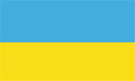
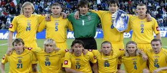
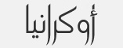

+++
title = "أوكرانيا"
path = "sites/worldcup2006/team-5"
template = "extra.html"

[extra]
site = "worldcup2006"
kind = "team"
original_url = "http://worldcup2006.20at.com:80/teams.php?tid=5"
archived = "20060614015735"
+++

<a href="/articles/worldcup2006-45/">الأزوري يُسقط نضال النجوم السوداء!</a>

<figure></figure>

<figure></figure>

<figure></figure>

- تأسس الإتحاد الأوكراني في عام 1991.

- انضم إلى الإتحاد الدولي لكرة القدم (فيفا) عام 1992.

- تعد مشاركة أوكرانيا فى كأس العالم بألمانيا هى المشاركة الأولى لها، منذ أن حصلت على استقلالها عام 1991 بعدما انشقت عن الإتحاد السوفيتى الذى تفتت فى ذات العام.

- خاض المنتخب الأوكرانى التصفيات المؤهلة لبطولة كأس العالم مرتين ولم يحالفه التوفيق، لكنه أبهر الجميع بعد تأهله لبطولة العالم بألمانيا بعد اكتساحة الكبار فى مجموعته بالتصفيات التى ضمت اليونان بطلة أوروبا 2004، وتركيا ثالث العالم 2002، والدانمارك وجورجيا وكازاخستان ليتوقع لها الخبراء بأن تكون الحصان الاسود للبطولة.

- لم تشارك أوكرانيا في أي بطولة لكأس العالم، ولكنها شاركت في التصفيات المؤهلة لكأس العالم 1998، و2002، ولم يحالفها التوفيق.

- لم تتأهل أوكرانيا كذلك لنهائيات كأس أوروبا ولا مرة.

* أندريه شيفيتشينكو :

- مهاجم المنتخب الأوكرانى ونادى إيه سى ميلان الأول، ومعشوق الجماهير، وهداف من طراز فريد.

- ولد في 29 سبتمبر 1979.

- يجيد التحكم فى الكرة، وتمريراته متقنة، ورأسياته قوية.

- استحق بهذه المواصفات أن يحصل على لقب أحسن لاعب فى أوروبا عام 2004.

- بدأ حياته فى دينامو كييف الأوكرانى، واستقر فى ميلان الذى عشقه وأصبح أحد أعمدته الأساسية.

* أندريه فورنين :

- ولد في 21 يوليو 1979.

- لاعب في باير ليفر كوزن الألمانى.

- تألق فى صفوف كوزن فى مركز الهجوم ليعتمد عليه أوليج المدير الفنى للمنتخب الأوكرانى كعنصر أساسى فى هجوم المنتخب ببطولة كأس العالم.

* أندريه جوسين:

- ولد في 11 ديسمبر 1972.

- لاعب ارتكاز فريق أسمار الروسى ومنتخب أوكرانيا.

- يحمل على عاتقه مهام خط وسط المنتخب الأوكرانى.

أسبانيا – السعودية - تونس

* (حراس المرمى) ألكسندر شوفكوفسكى (1) - أندريه بايتوف (12) -

بوجدان شوست (23).

* (الدفاع) أندريه نسماشينى (2) - سيرهى فيدروف (3) - فلاديمير يزيرسكى (5) –

أندرى روسول (6) - دميترو شيجرينسكى(13) - فياتشيسلاف سفيدركى(22) –

فلاديسلاف فاشوتشيك(17).

* (خط الوسط) أناتولى تيموشوك(4) - أولج شلاييف(8) - أولج جوسيف(9) – سبرهى

ريبروف(11) - أندرى جوسين (14) - روسلان روتان(21) - ماكسيم

كليشينكو(19) - سيرهى نازارينكو(18).

* (الهجوم) أندرى فورنين(10) - أندريه شيفشينكو(7) - أندرى فوروبى(16) - أرتيم

ميافسكى(15).

