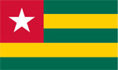
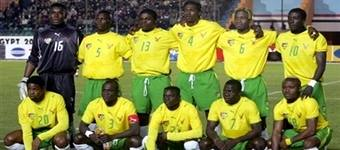
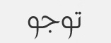

+++
title = "توجو"
path = "sites/worldcup2006/team-6"
template = "extra.html"

[extra]
site = "worldcup2006"
kind = "team"
original_url = "http://worldcup2006.20at.com:80/teams.php?tid=6"
archived = "20060614015748"
+++

<a href="/articles/worldcup2006-45/">الأزوري يُسقط نضال النجوم السوداء!</a>

<figure></figure>

<figure></figure>

<figure></figure>

- تأسس اتحاد توجو عام 1960.

- انضم إلى الاتحاد الدولي لكرة القدم (فيفا) عام 1962.

- تحدت توجو جميع العوائق وتأهلت إلى المونديال، فلم يكن منتخب توجو يوماً ما من الفرق المرشحة للتأهل إلى كأس العالم، وكان دائماً من ضيوف قائمة المستبعدين.

ولكن هذه المرة كان لمنتخب توجو ومدربه أوتو فستر رأي آخر، حيث تخطت توجو كل العوائق التي حلت بمجموعتها في التصفيات، ودهست كل من حاول أن يوقف مسيرتها وانطلقت فقط نحو الهدف والحلم الكبير... كأس العالم، والتأهل إليه لأول مرة في تاريخها.

- تعد توجو حديثة العهد بالنسبة للكرة الأفريقية. حيث لم تسجل أى إنجاز حتى الآن، دولياً كان أم قاريا.

- وعلي الرغم من الخروج المبكر من كأس الأمم الإفريقية 2006 والتي كانت مقامة في مصر، إلا أن لديهم آمال الكبيرة في تحقيق إنجاز يذكر لهم في كأس العالم .. علي غرار ما فعلته الكاميرون و نيجيريا و السنغال.

- تأهل منتخب توجو عن طريق المجموعة الأولي الأفريقية والتي كانت تضم كلاً من(توجو - السنغال – ليبريا – زامبيا - الكونغو – مالي).

و تصدرت توجو هذه المجموعة عن طريق النتائج التالية :

- فوزها علي الكونغو (3/2) ذهاباً و( 2/0) إياباً.

- فوزها علي ليبريا ( 3/0) ذهاباً والتعادل السلبي إياباً.

- الفوز علي زامبيا (4/1) ذهاباً والهزيمة بهدف واحد إياباً.

- الفوز علي مالي (2/1) ذهاباً و(1/0) إياباً.

- تعادلت مع السنغال (2/2) ذهاباً و فازت عليها إياباً (3/1).

* إيمانويل أديبايور : وهو أهم لاعبي منتخب توجو، لما يملكه من مهارة عالية.

- مهارته العالية ساهمت في التحاقه بنادي أرسنال الإنجليزي بالرغم من صغر سنه، حيث يبلغ 21 عاماً فقط، وكان قادماً من نادي موناكو الفرنسي في يناير الماضي.

- لقب ب(كانو الجديد) في الأرسنال، لبشرته السمراء وطوله الفارع.

وقد ساهم ايدبايور بشدة في تأهل منتخب توجو إلى النهائيات بإحرازه 11 هدفاً في التصفيات و أحرز بهم أيضاً لقب الهداف و من المنتظر ظهور طيب له خلال المونديال.

* أوتو فيستر : المدرب الألماني البالغ من العمر 69 عاماً.

- يعتبر من أوائل المدربين الألمان الذين بدأوا التدريب في أفريقيا، ومن أنجحهم أيضاً.

بدأ مشوار أوتو فستر التدريبي في أفريقيا عام 1976 بتدريب المنتخب الرواندى، ولكنه لم يستمر معهم طويلاً، حيث قام بتدريب منتخب بوركينا فاسو في نفس العام وحتى 1978.

- انتقل بعد ذلك لتدريب فريق السنغال لمدة 3 سنوات، ثم منتخب كوت ديفوار للناشئين، ثم منتخب الكونغو، تلاها بمنتخب غانا للناشئين... بعدها قرر التغيير فذهب إلى آسيا ليدرب المنتخب السعودي من عام 1997 حتى 1999.

- عاد مرة أخرى إلى أفريقيا ليدرب نادي الزمالك المصري، ثم الصفاقصي التونسي، وعاد مرة أخرى إلى مصر مدرباً فريق (المصري)، ثم اتجه إلى توجو ليصبح مدربهم الرسمي.

كوريا الجنوبية – سويسرا - فرنسا

* (حراس المرمى) كوسي أجاسا – نيمني تشانيرو – كودجوفي أوبيلالي.

* (الدفاع) داري نيبومبي – جون بول أبالو – تشاجني ماساماسو – لودوفيش أسيمواسا –

إريك أكوتو – كريم جودي – توريه أسيمو.

* (خط الوسط) أليكسيس روماو – أزياونو ياو – توماس دوسيفي – توريه شريف مامام –

أجوبا كوامي – أراسا أفو.

* (الهجوم) إيمانويل أديبايور – جونيور ياو سينايا – مصطفى ساليفو – أديكامبي الوفيدي –

روبرت مالم – قادر محمد – ريتشموند فورسون.

