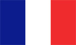
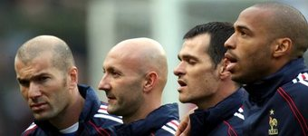
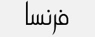

+++
title = "فرنسا"
path = "sites/worldcup2006/team-8"
template = "extra.html"

[extra]
site = "worldcup2006"
kind = "team"
original_url = "http://worldcup2006.20at.com:80/teams.php?tid=8"
archived = "20060614015821"
+++

<a href="/articles/worldcup2006-45/">الأزوري يُسقط نضال النجوم السوداء!</a>

<figure></figure>

<figure></figure>

<figure></figure>

- تأسس الإتحاد الفرنسي في عام 1919.

- انضم إلى الاتحاد الدولي لكرة القدم (فيفا) منذ إنشائه عام 1904.

- تستعد حالياً الديوك الفرنسية للصياح من جديد، فبعد أن ابهرت العالم في كأس العالم عام 1998 بفوزها به... لم يتوقع أحد أبداً النتائج المخيبة للآمال التي حققها المنتخب الفرنسي في نهائيات كأس العالم 2002 بعد خروجه من الدور الأول بدون تسجيل ولو هدف واحد يبيض ماء وجههم..!

كان هذا المونديال (كوريا واليابان) بمثابة كابوس للمنتخب الفرنسي، يريد أن يزيله من الذاكرة. حيث يدخل هذا العام بثوب جديد و بفكر مدرب جديد، هو ريموند دومينيك.

- شاركت فرنسا في العديد من البطولات العالمية منها : 11 مشاركة في كأس العالم.

* (أورجواي 1930) الجولة الأولى.

* (إيطاليا 1934) الجولة الأولى.

* (فرنسا 1938) ربع النهائي.

* (سويسرا 1954) الجولة الأولى.

* (السويد 1958) المركز الثالث.

* (إنجلترا 1966) الجولة الأولى.

* (الأرجنتين 1978) الجولة الأولى.

* (أسبانيا 1982) المركز الرابع.

* (المكسيك 1986) المركز الثالث.

* (فرنسا 1998) المركز الأول (بطل كأس العالم).

* (كوريا واليابان 2002) الجولة الأولى.

- كما فاز المنتخب الفرنسي ببطولة الأمم الأوروبية (Euro) مرتين عامي (1984 – 2000)، وتأهلت في البطولة الأخيرة Euro 2004 للدور ربع النهائي.

- لم يكن طريق منتخب فرنسا سهلاً علي الإطلاق في التأهل هذا العام , فقد واجه صعوبة بالغة في الصعود إلى النهائيات، ووقع المنتخب الفرنسي في المجموعة الرابعة الأوروبية والتي كانت تضم كلاً من، (فرنسا- سويسرا- أيرلندا- إسرائيل – قبرص – جزر الفارو ).

وكانت نتائج منتخب فرنسا فيها كالتالي :

- التعادل السلبي مع إسرائيل ذهاباً والتعادل الإيجابى (1/1) إياباً.

- فوزها علي منتخب جزر الفارو (2/1) ذهاباً و(3/0) إياباً.

- التعادل السلبي مع منتخب أيرلندا ذهاباً والفوز (1/0) إياباً.

- الفوز علي منتخب قبرص (2/0) ذهاباً و(4/0) إياباً.

- التعادل السلبي مع منتخب سويسرا ذهاباً والتعادل الإيجابى (1/1) إياباً.

- معظم لاعبي المنتخب الفرنسي ذات مميزات خاصة جداً، ولكن يمكننا القول بأن

من أهم لاعبي المنتخب الفرنسي :

* زين الدين زيدان : زيزو... لاعب خط الوسط و كابتن منتخب فرنسا.

- يمكن القول بأنه افضل من لمس الكرة في العالم و ليس فقط في منتخب فرنسا.

- زيدان لاعب ريال مدريد الأسباني يعتبر صانع تاريخ فرنسا الحديث, وهذا عندما ساهم بشكل كبير في حصولهم علي كأس العالم 98 في فرنسا, وأيضاً كأس أمم أوروبا عام 2000 و التي كانت مقامة في هولندا و بلجيكا.

- وقد حرمت الإصابة زيدان من الظهور بشكل جيد خلال المونديال الماضي و لكنه يسعي لتحقيق إنجاز في هذا المونديال لأنه سوف يكون آخر ظهور له في الملاعب الدولية قبل اعتزاله.

* تييري هنري : الغزال الأسمر.. هذا هو الإسم الأكثر شهرة له، لما يملكه من مهارة

ومرونة وسرعة ورشاقة.

- الحقيقة أنه لن يكفينا أبداً الكلام عن تييري هنري مهاجم المنتخب الفرنسي ونادي أرسنال الإنجليزي، والذي حصد أهم البطولات في تاريخ منتخب فرنسا، وهي بطولة كأس العالم 98 و كأس أمم أوروبا 2000.

- هداف الدوري الإنجليزى لهذا العام تييري هنري يسعي في هذا الكأس إلى إمطار حراس الخصوم بالأهداف، والأخذ بثأر منتخبه الذي خرج من الجولة الأولى البطولة الماضية.

* ريموند دومينيك : مدرب المنتخب الفرنسي البالغ من العمر 54 عاماً... وهو فرنسي.

- عندما اختير من قبل الإتحاد الفرنسي، كانت مفاجئة للجميع و لدومينيك شخصياً، خاصةً بعد إخفاق المنتخب الفرنسي في كأس أمم أوروبا عام 2004 في البرتغال و خروجها علي يد منتخب اليونان.

- بدأ دومينيك مشواره في سلك التدريب في موسم 1985 و حتى 1988 مع نادي مولاوس. ثم إلى تدريب أوليمبيك ليون أقوي الأندية الفرنسية علي الإطلاق في الوقت الحالي، وكان ذلك من موسم 1988 إلى 1993.

- و يذكر أن دومينيك كان السبب في قوة هذا النادي، وقد أحرز مع ليون بطولة الدوري الفرنسي.

- انتقل بعدها إلى تدريب منتخب فرنسا تحت 23 عام وذلك عام 1993، واستمر معهم حتى 2004، ويحسب أيضاً لدومينيك أنه اخرج الجيل الذهبي لمنتخب فرنسا الفائز بكأس العالم 1998 و أمم أوروبا 2000، ومنهم زيدان، تريزجيه، باتريك فييرا، ويليام جالاس، وسيسيه.

- تولى بعد هذا تدريب منتخب فرنسا تحت 20 عام، ولكن لموسم واحد فقط من 2000 و حتى 2001، ثم تولى تدريب منتخب فرنسا الأول لأول مرة في تاريخه من عام 2004 و حتى الآن..

- و من المعروف أيضاً أن دومينيك هو الذي أقنع نجوم الفريق زيدان وكلود مكاليلي وليليان تورام بالرجوع إلى المنتخب بعد أن قرروا الاعتزال لأن فريق بلدهم في أمس الحاجة إليهم.

سويسرا – كوريا الجنوبية - توجو

* (حراس المرمى) جريجوري كوبيه – فابيان بارتيز – ميشيل لاندرو.

* (الدفاع) ويلي سانيول – ميكائيل سيلفستر – ويليام جالاس – ليليان تورام – باسكال

شيمبوندا – إيريك أبيدال – جان آلان بومسونج – جيل جيفت.

* (خط الوسط) باتريك فييرا – كلود مكاليلي – ألو ديارا – فيكاش دوراسو – زين الدين

زيدان – فلورن ريبيري.

* (الهجوم) تييري هنري – دجبريل سيسيه – ديفيد تريزيجيه – سيلفان ويلتورد.

